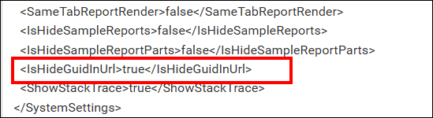
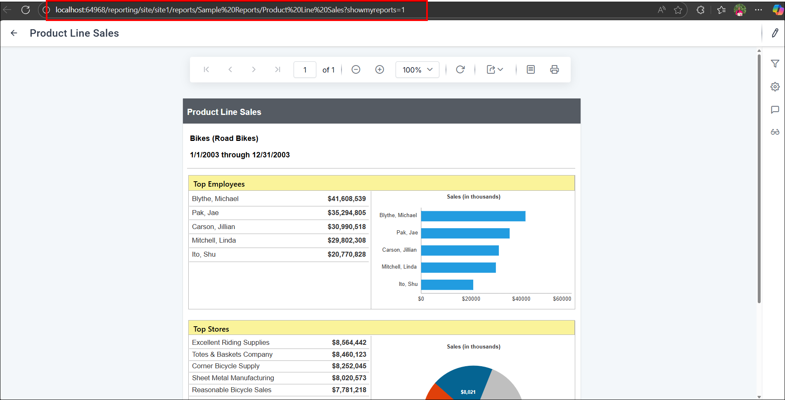

# Remove GUID from Report URLs in Bold Reports® On-Premises Edition

To remove the GUID from report URLs in Bold Reports® On-Premises Edition, set the `IsHideGuidInUrl` node to `true` in the reporting config.xml file. The setting simplifies embedding and gives you cleaner, more readable URLs.

## How do I hide the GUID in report URLs?

You hide the GUID in Bold Reports® report URLs by editing the reporting config.xml file from the UMS Settings page.

1. Go to the UMS **Settings** page > **Configuration** > **reporting/config.xml**.

2. Set the `IsHideGuidInUrl` node to true. If the node is not available, add the node, and then save the file. `<IsHideGuidInUrl>true</IsHideGuidInUrl>`

The following screenshot shows the `IsHideGuidInUrl` node in the reporting config.xml file.

## What happens after I enable the setting?

After you enable `IsHideGuidInUrl` in Bold Reports®, the GUID no longer appears in the URL when a report is rendered. The following screenshot shows a report URL without the GUID.

## Frequently asked questions

### What if the IsHideGuidInUrl node is missing from config.xml?

Add the `<IsHideGuidInUrl>true</IsHideGuidInUrl>` node to the reporting config.xml file, and then save the file.

### Why remove the GUID from report URLs?

Removing the GUID simplifies the embedding process and results in cleaner, more readable URLs.

## See also

* [Report link with filter parameters](../report-link-with-filter-parameters/)
* [Embed a report with user impersonation](../embed-the-report-with-user-impersonation/)
* [Register custom styles in Report Server](../register-custom-styles/)
