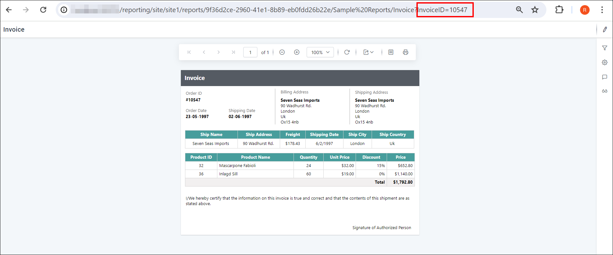
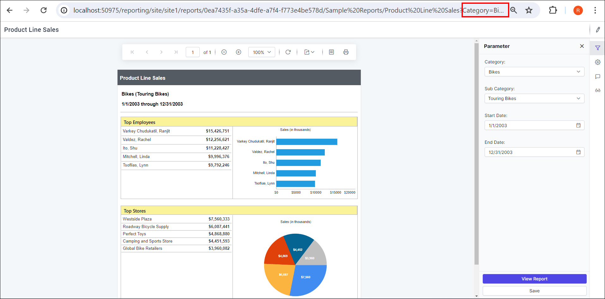

# Report link with filter parameters in Bold Reports® Report Server

In the Bold Reports® Report Server, you can pass parameters to a report by including them in the report URL. Parameter values in the URL apply filters to the report on initial load.

## What is the syntax for a URL parameter?

To set a Bold Reports® report parameter within a URL, use the following syntax:

`parameter=value1, value2,…, valueN`

Where `parameter` represents the parameter name.
A parameter can be single-valued or multi-valued.

## How do I add parameters to a report URL?

To append a parameter query string to a Report Server report URL, add the prefix (?) to the query string. If the URL already contains (?), add the prefix (&) to the query string.

`http://<servername>/<culturename>/reports/<reportid>/<category>/<reportname>?ParameterName=Value`

## What do single-valued and multi-valued parameters look like?

Bold Reports® Report Server filters the report the same way for single-valued and multi-valued parameters in the URL. The following report view shows a single-valued parameter.

The following report view shows a multi-valued parameter.

## Frequently asked questions

### When does a URL parameter filter the report?

Report Server applies the filter when the report first loads.

### Should I use ? or & before the parameter?

Use (?) to start the query string. If the URL already contains (?), use (&).

## See also

* [Remove the GUID from report URLs](https://help.boldreports.com/enterprise-reporting/administrator-guide/how-to/remove-id-from-url/)
* [Embed a report with user impersonation](https://help.boldreports.com/enterprise-reporting/administrator-guide/how-to/embed-the-report-with-user-impersonation/)
