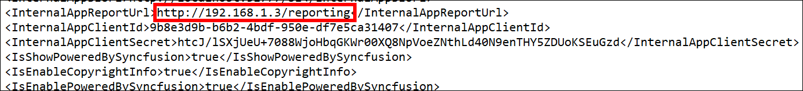
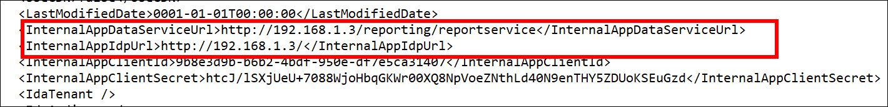
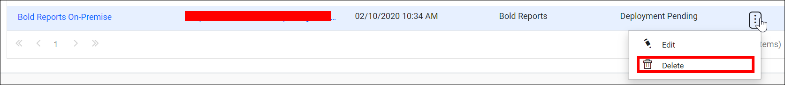

# Resolve the unavailable error in Bold Reports® sites up to version 2.x after a domain change

If a Bold Reports® Enterprise Reporting site fails to launch, change the Bold Reports® URL in the `Config.xml` file of Bold Reports® Enterprise Reporting. This fix applies to sites deployed on versions up to 2.x.

## How do I change the Bold Reports® URL?

To fix the unavailable error, update the Bold Reports® URL values in the configuration files and then create the site again.

1. Go to the deployed location and update the new binding values in the following configuration files:

   >By default, Bold Reports® will be deployed on C:\Bold Reports®.
  
   * Update the **`InternalAppReportUrl`** value in the config file at the following location:
    **`{Deployed Location}`**IDP\App_Data\Configuration\Config.xml
   
   * Update the **`InternalAppDataServiceUrl`** and **`InternalAppIdpUrl`** values in the config file at the following location:
   **`{Deployed Location}`**\Report Server\Configuration\Config.xml
   * If a file exists at the following location, change the **`InternalAppDataServiceUrl`** and **`InternalAppIdpUrl`** values in that config file too.
    **`{Deployed Location}`**\Report Server\App_Data\Configuration\Config.xml
   
2. Restart the site in IIS and browse the site.

3. Delete the site by clicking the **Delete** option on the site listing page.

4. Create a new site by following the [create a site](../../manage-sites/create-site/) steps.

## Frequently asked questions

### Where is Bold Reports® deployed by default?

By default, Bold Reports® is deployed on C:\Bold Reports®.

### Which values do I update in the Report Server Config.xml?

Update the **`InternalAppDataServiceUrl`** and **`InternalAppIdpUrl`** values. In the IDP Config.xml, update **`InternalAppReportUrl`**.

## See also

* [Create a site](../../manage-sites/create-site/)
* [Map a domain name to a Bold Reports® site before startup](../map-a-domain-name-to-bold-reports-site-before-startup/)
* [Change the binding in Bold Reports®](../how-to-change-the-binding-in-the-bold-reports/)
