# Set up Microsoft Entra ID Single Sign-On for Bold Reports® On-Premises Edition

To enable Single Sign-On in Bold Reports® On-Premises Edition, register it in Microsoft Entra ID (formerly Azure Active Directory) and add the details in settings. You can also use the same settings to import Microsoft Entra ID users and groups.

## How do I set up Microsoft Entra ID for Bold Reports® On-Premises Edition?

You set up Microsoft Entra ID for Bold Reports® On-Premises Edition by creating a directory, registering a web application and a mobile application, and entering their details in settings.

### What do I need first?

Before you set up Microsoft Entra ID for Bold Reports® On-Premises Edition, make sure you have the following:

* An Azure account with Active Directory support.
* Bold Reports® On-Premises Edition installed, and you logged in with an Administrator account.

### How do I create the Microsoft Entra ID directory?

To create the directory for Bold Reports® On-Premises Edition, log on to the Azure portal and create an `Azure Active Directory`.

1. Click `Create a resource` and search for `Azure Active Directory`, as shown in the following screenshots.
    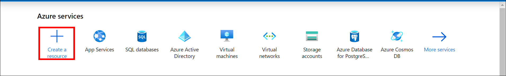
    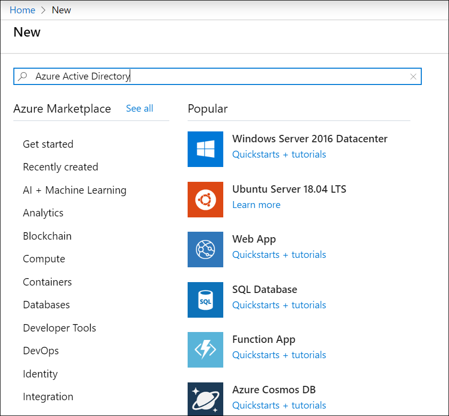

2. Click `Create`, as shown in the following screenshot.
    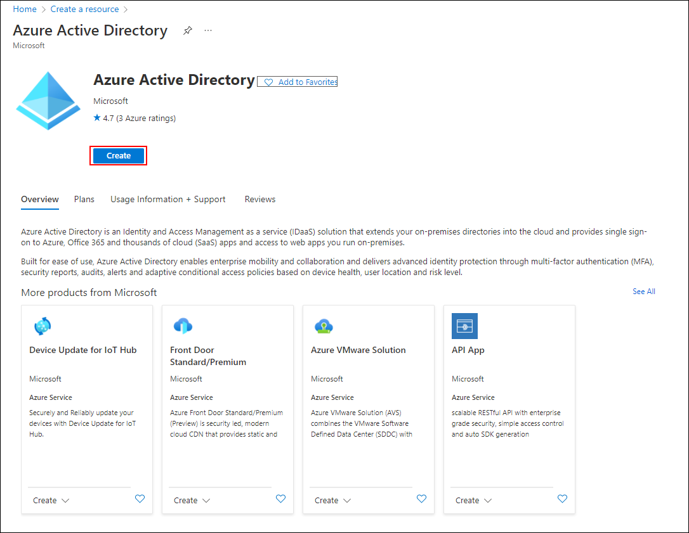

3. Choose `Azure Active Directory` and click `Next: Configuration`.
    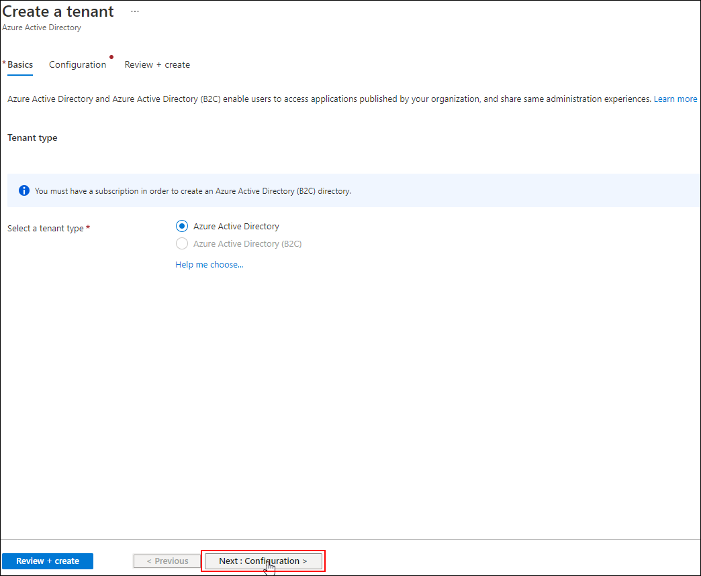

4. In the dialog box, enter the `Name` and `Domain Name`, choose the `Country or Region`, and then click `Next: Review + Create`.
    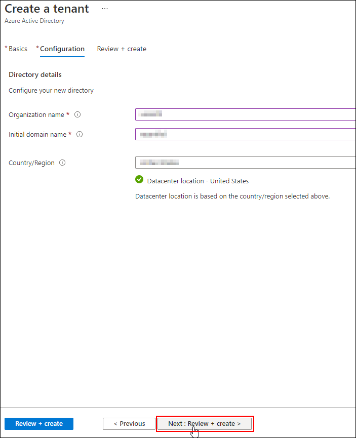
5. Crosscheck the details and click `Create`.
    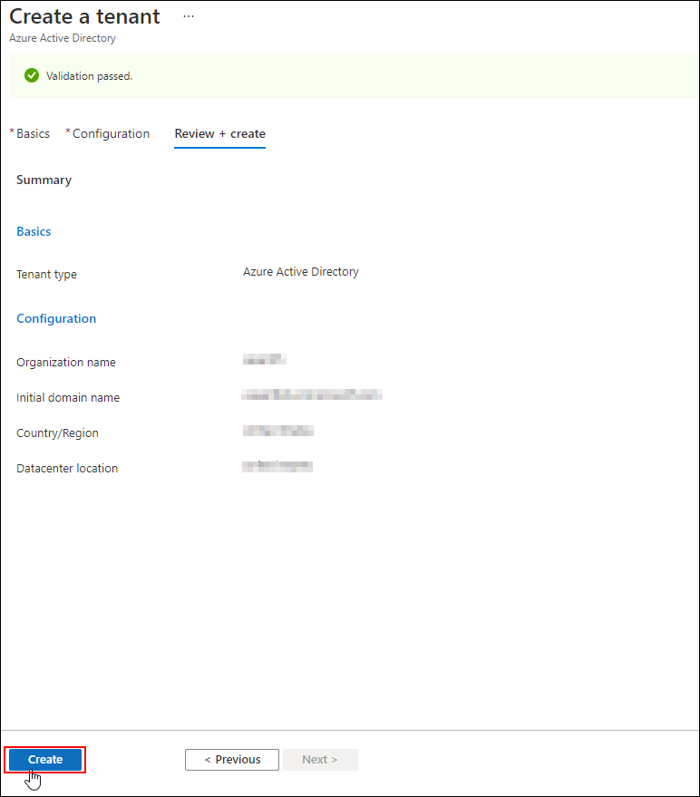

6. The application is added to the directory, and you can view its details in `App registrations`.

Go to Microsoft Entra ID (formerly Azure Active Directory). In the directory, add two applications. One acts as a Web API for authenticating Bold Reports® On-Premises Edition. The other acts as a native client application for authenticating the Bold Reports® On-Premises Edition mobile app.

#### Steps to register Bold Reports® On-Premise application in Azure Active Directory

Register the Bold Reports® On-Premises Edition web application in Microsoft Entra ID with the following steps:

1. Open the created directory, click `Azure Active Directory`, and then select `App registrations`.

2. Click `New application registration` to add a new application.
    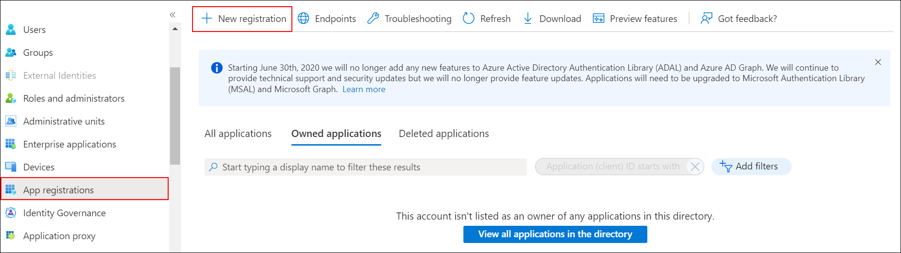

3. Enter the name of the application and choose the following options:
    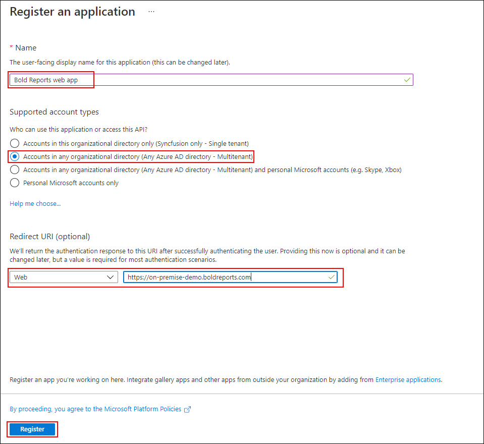

   * Accounts in any organizational directory (Any Azure AD directory - Multitenant) as `Supported account types`.
   * Web under the `Redirect URI(optional)` section, and enter the Redirect URI. Then, click `Register`.

   The application is added to the directory, and you can view its details in `App registrations`.

4. Select `Branding` in the left menu, enter the `Home page URL`, and click `Save`.
    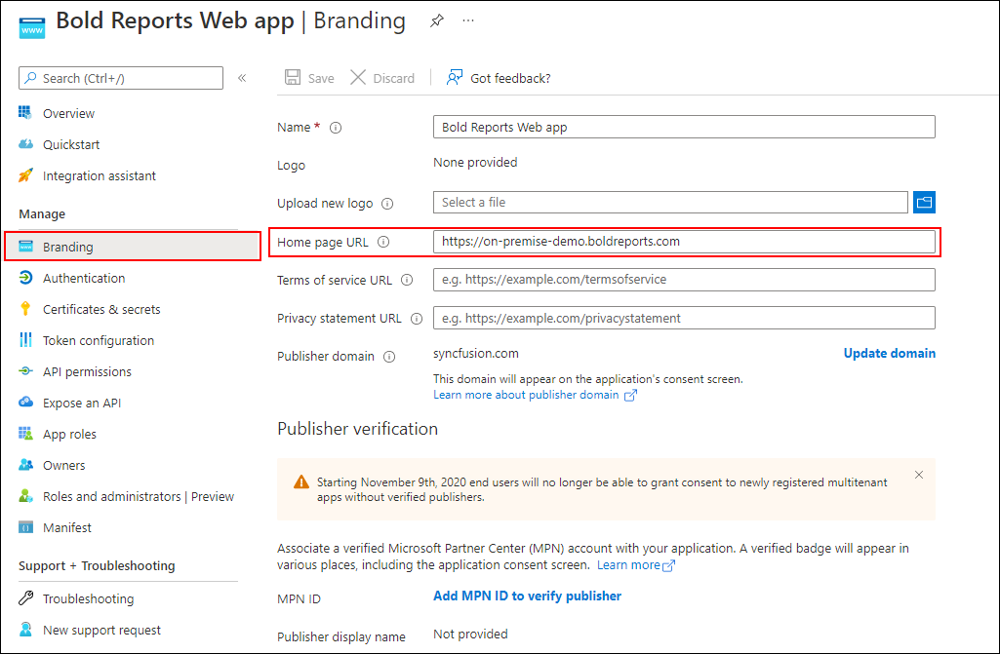

5. Select `Authentication` in the left menu and save the `Logout URL`, `Implicit grant`, and `Supported account types`, as highlighted in the following screenshot.
    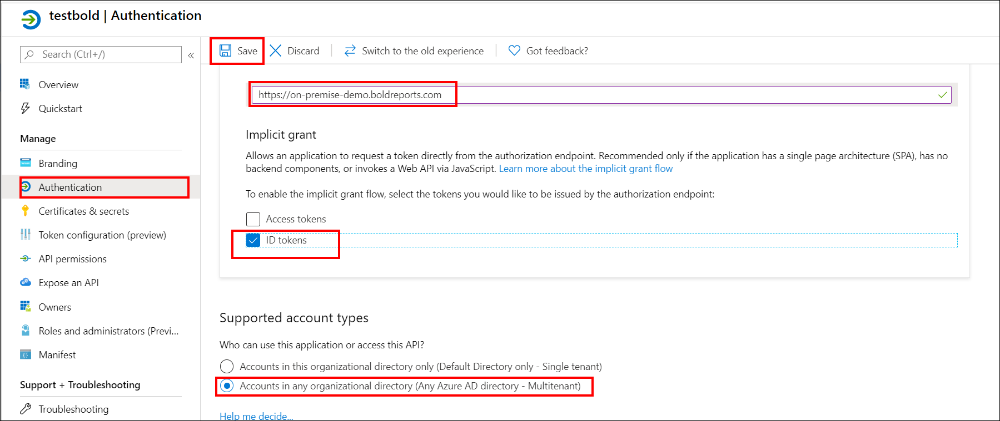

6. Select `Certificates & secrets` and click `New client secret` to add a client secret, as shown in the following screenshot.

    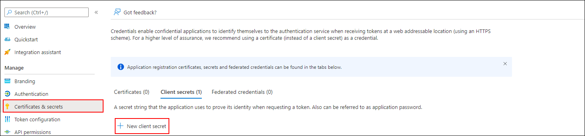

    * Provide a description, choose the expires option, and click `Add`.
     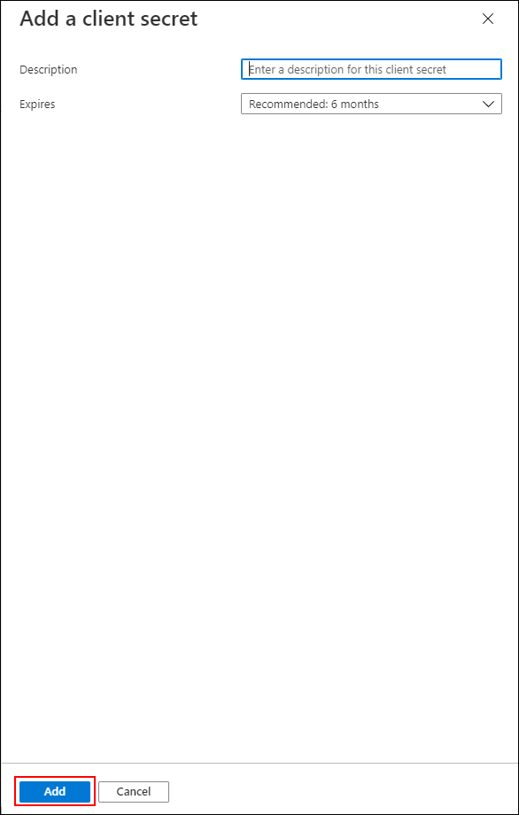

    >Save the client secret value generated.

7. Go to `API permissions`, click `Add a permission`, and then click `Microsoft Graph`.
    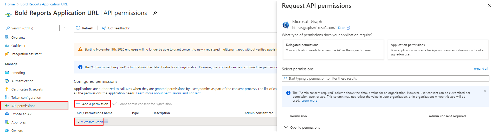

   <table>
     <tr>
     <th><b>Application Permissions</b></th>
     <th></th>
     </tr>
     <tr>
     <td> Directory <td>Read directory data</td></td>
     </tr>
     <tr>
     <th><b>Delegated Permissions</b></th>
     <th></th>
     </tr>
     <tr>
     <td> 1. Directory <td>Read directory data, Access directory as the signed in user</td></td>
     </tr>
     <tr>
     <td>2. Group <td>Read all groups</td></td>
     </tr>
     <tr>
     <td>3. User <td>Read and write access to user profile</td></td>
     </tr>
      <tr>
     <td>4. Profile <td>View user's basic profile</td></td>
     </tr>
     </table>

    Select the permissions listed in the table and click `Update permissions`.
    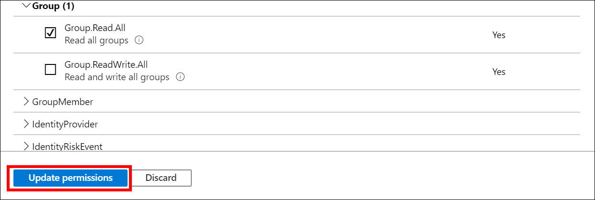

8. After you add the permissions, click `Grant admin consent` to grant admin consent for these permissions.
    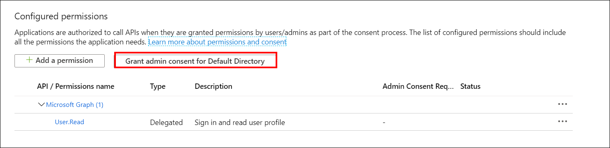

9. Select `Expose an API` in the left menu and click `set` next to Application ID URI.
    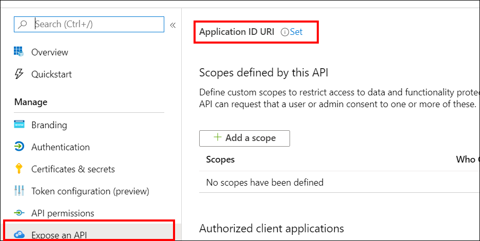

    Enter the `App ID URI` and click `Save`.
    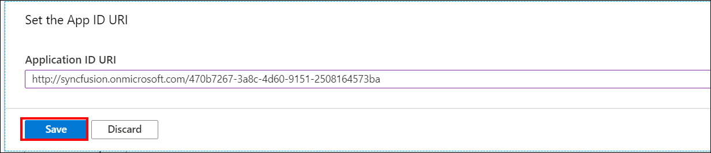

    >The `Application ID URI` must be in the format `http://{directory domain name}/{application id}`

10. Select `Expose an API` in the left menu and click `Add a scope`.
    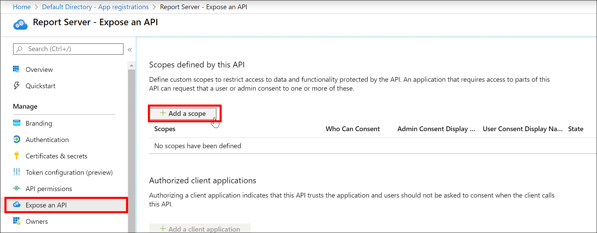

    Enter the `Scope name`, choose `Admins and users` for consent, and enter the `Admin consent display name`, `Admin consent description`, `User consent display name`, and `User consent description`. Set the state to `Enabled` and click `Add scope`.
    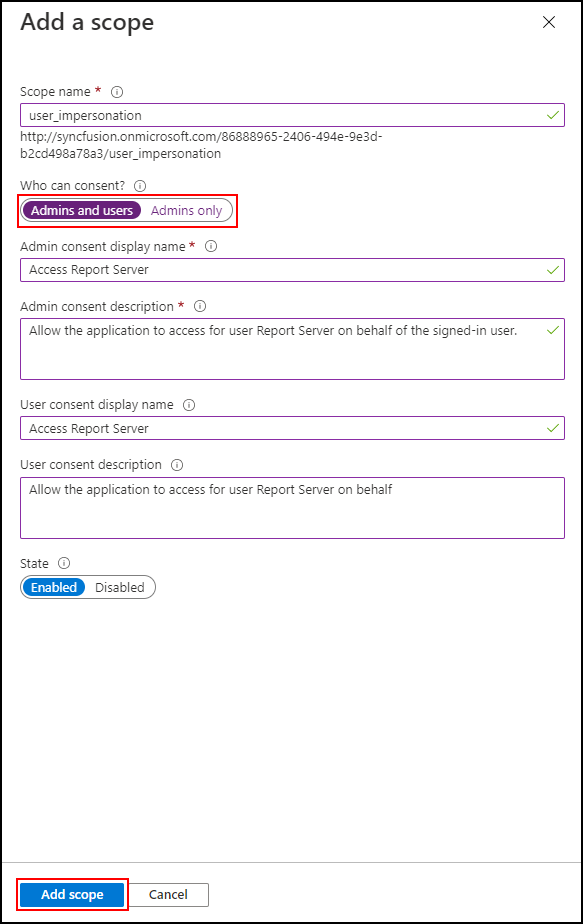

>The `Redirect URI` and `Home page URL` should be the URL of the Bold Reports® On-Premises Edition application.

#### Steps to register Bold Reports® On-Premise mobile application in Azure Active Directory

Register the Bold Reports® On-Premises Edition mobile app as a native client application in Microsoft Entra ID with the following steps:

1. Open the respective directory. Click `App registrations` in the left menu, and then click `New registration` to add a new application.
   

2. Enter the name of the application and choose the following options:
   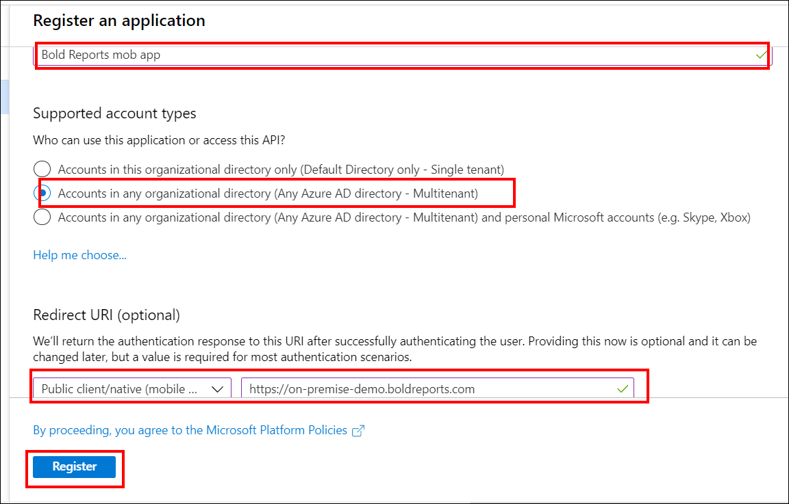

    * Accounts in any organizational directory (Any Azure AD directory - Multitenant) as `Supported account types`.
    * Public client/native(mobile & desktop) under the `Redirect URI(optional)` section, and enter the Redirect URI. Then, click `Register`.

    The application is added to the directory, and you can view its details in `App registrations`.

3. Select `Branding` in the left menu, enter the `Home page URL`, and click `Save`.
    

4. Select `Expose an API` in the left menu and click `set` next to Application ID URI.

    Enter the `App ID URI` and click `Save`.
   

    >The `Application ID URI` must be in the format `http://{directory domain name}/{application id}`

>The `Home page URL` should be the URL of the Bold Reports® On-Premises Edition application.

### How do I configure Microsoft Entra ID details for Single Sign-On in Bold Reports® On-Premises Edition?

To perform Single Sign-On, configure the following fields in Bold Reports® On-Premises Edition:

   **Application Id**: Go to the registered application, click `Overview`, and then copy the `Application Id` and paste it.
    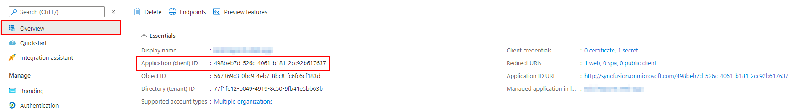

   **Application Id URI**: Go to the registered application, click `Overview`, and then copy the `Application Id URI` and paste it.
   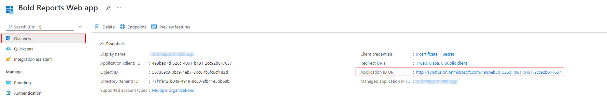

   **Tenant Name**: The default domain name of your Active Directory. Go to the created `Azure Active Directory` and copy the domain name.
    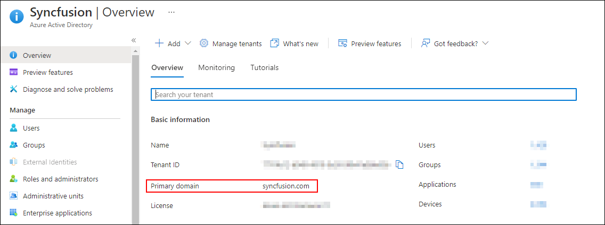

   **Mobile App Client ID**: Go to the registered application for the Bold Reports® On-Premises Edition mobile application. Copy the `Application Id` and paste it.
    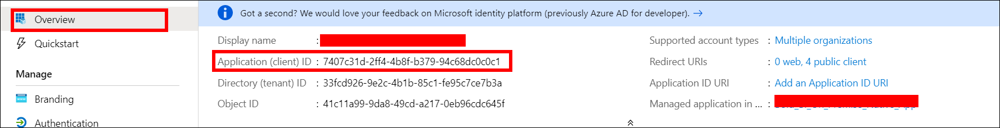

### How do I configure Microsoft Entra ID details to import users and groups in Bold Reports® On-Premises Edition?

To import Microsoft Entra ID users and groups, configure the following fields in Bold Reports® On-Premises Edition settings:

   **Tenant Name**: The default domain name of your Active Directory. Go to the created `Azure Active Directory` and copy the domain name.
     

   **Client ID**: The Client Id of the Bold Reports® On-Premises Edition application in your Microsoft Entra ID tenant. Go to the registered application, copy the `Application Id` in `Overview`, and paste it here.
     

    **Client secret code**: The secure key of the Bold Reports® On-Premises Edition application you created in your Microsoft Entra ID tenant. Go to `Certificates & secrets`, find the keys you saved for the application, and choose the `Value`.
     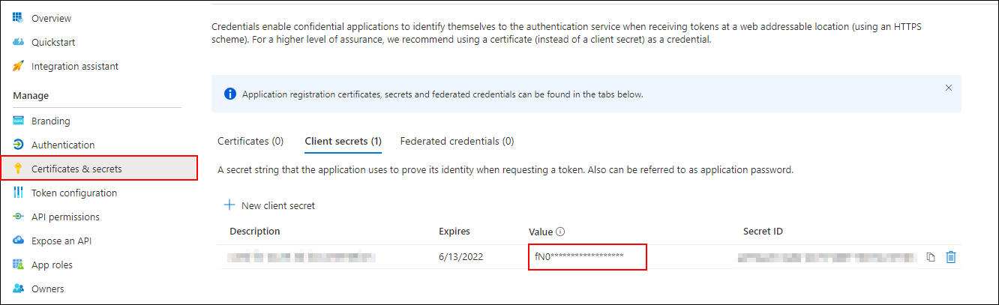

After you configure the settings in Bold Reports® On-Premises Edition, you can import Azure users into Bold Reports® On-Premises Edition. To learn more, see [Import Microsoft Entra ID Users](./../../manage-users/users/import-users/import-azure-active-directory-users/) and [Import Microsoft Entra ID Groups](./../../manage-users/groups/import-groups/import-azure-active-directory-groups/).

## Frequently asked questions

### How many applications do I register in Microsoft Entra ID?

Register two applications. One is a Web API for authenticating Bold Reports® On-Premises Edition, and the other is a native client application for the mobile app.

### What format must the Application ID URI use?

The `Application ID URI` must be in the format `http://{directory domain name}/{application id}`.

### Which URL do I use for the Redirect URI and Home page URL?

Use the URL of the Bold Reports® On-Premises Edition application.

## See also

* [Microsoft Entra ID settings](./../../manage-app-settings/azure-active-directory/)
* [Import Microsoft Entra ID Users](./../../manage-users/users/import-users/import-azure-active-directory-users/)
* [Import Microsoft Entra ID Groups](./../../manage-users/groups/import-groups/import-azure-active-directory-groups/)
