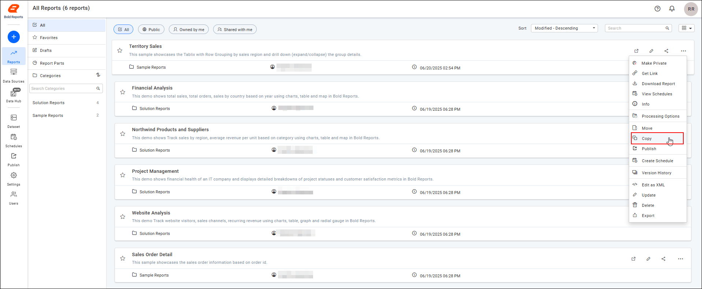
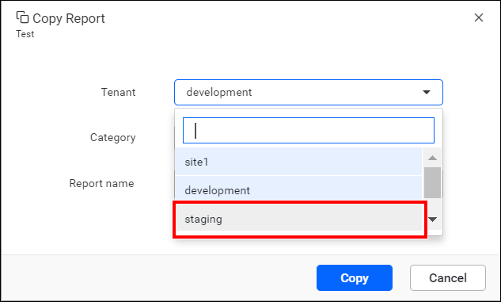
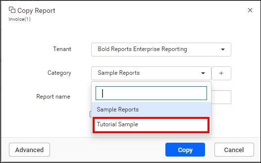

# Set up development, staging, and production environments in Bold Reports®

You can set up development, staging, and production environments in Bold Reports® Enterprise Edition by using different sites or categories. You then copy reports from one environment to the next.

## How do I set up environments using sites?

To use Bold Reports® sites as environments, set up three different tenants for the development, staging, and production environments:
* Development
* Staging
* Production

### How do I copy a report from the development site to the staging site?

To copy a report from the development site to the staging site in Bold Reports®, follow these steps:

1. Click the action button of the report to copy to the staging environment.

2. Select the copy option from the context menu.
  

3. In the copy report dialog box, select the staging tenant.
  

4. Select the category in the staging site to copy the report to.

5. Optionally, change the report name when you copy it to the staging site.

Follow the same procedure to copy the report to the production site.

## How do I set up environments using categories?

To use Bold Reports® categories as environments, set up three different categories for the development, staging, and production environments:
* Development
* Staging
* Production

### How do I copy a report from the development category to the staging category?

To copy a report from the development category to the staging category in Bold Reports®, follow these steps:

1. Click the action button of the report to copy to the staging environment.

2. Select the copy option from the context menu.
  

3. Select the staging category to copy the report to.
  

4. Optionally, change the report name when you copy it to the staging category.

Follow the same procedure to copy the report to the production category.

## Frequently asked questions

### Can I rename a report when I copy it to another environment?

Yes. You can change the report name when you copy it to the staging site or staging category.

### Should I use sites or categories for my environments?

You can use either. Sites use three tenants, and categories use three categories in one site.

## See also

* [Create a site](./../../manage-sites/create-site/)
* [Manage categories](./../../../designer-guide/manage-categories/)
* [Upgrade On-Premises Edition on a production server](./../upgrade-the-bold-reports-on-premise-edition-new-version-on-production-server/)
