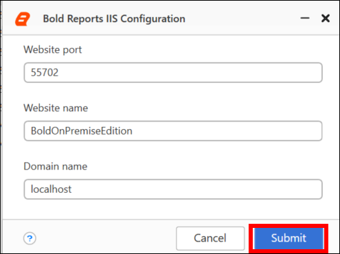
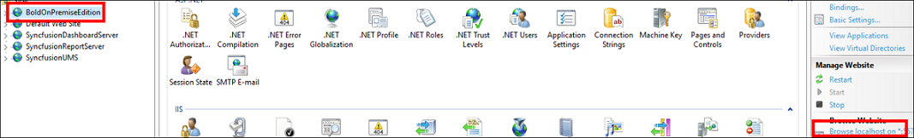
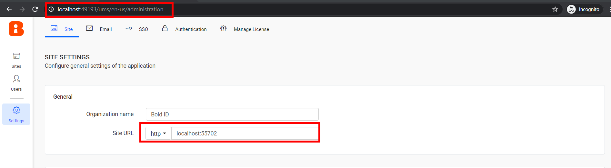
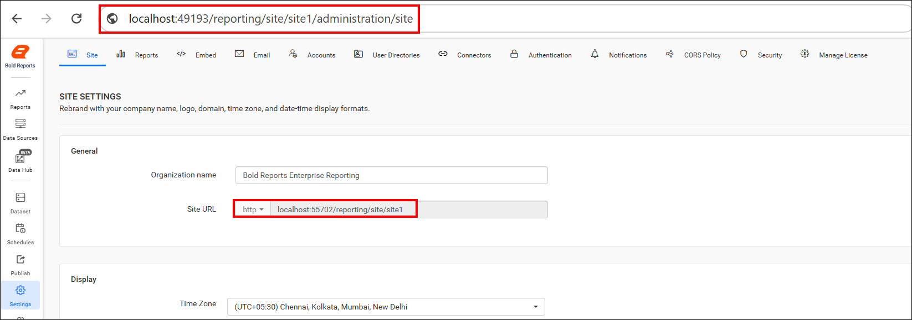

# Switch the installed Bold Reports® Report Server from IIS Express to IIS

You can switch the installed Bold Reports® Report Server IIS Express application to IIS with the `DeployIIS` utility. If the application is already configured, you then update the bindings in the site settings.

## How do I host Report Server in IIS?

To host Bold Reports® Report Server in IIS, run the `DeployIIS` utility and choose a port.

1. Run the `DeployIIS` application from the following installed location to host the Bold Reports® Report Server in IIS:

   `installed_Location\Bold Reports\On-Premise Edition\Utilities\DeployIIS\DeployIIS`
  
2. Type an unused port for the Bold Reports® Report Server and click `Submit`, as shown in the following image.

   

3. The utility hosts the application in IIS. Open the Bold Reports® Report Server from IIS by clicking browse.
   

## How do I update the bindings after switching to IIS?

If the Bold Reports® Report Server [application startup](./../../../application-startup/) was already configured, update the new binding in Report Server with the following steps. Otherwise, skip these steps.

1. Navigate to the site settings page of the UMS application using the old IIS Express binding URL and update the new binding information, as shown in the following image.

   `http://localhost:{port-no}/ums/administration`
  

   > By default, Bold Reports® Report Server will be opened with old IIS Express binding URL.

2. Navigate to the site settings of your Report Server application using the old IIS Express binding URL and update the new binding information, as shown in the following image.

   `http://localhost:{port-no}/reporting/en-us/site/site1/administration`
  

3. The Bold Reports® Report Server site is updated with the new bindings, and you can start the site with the new bindings.

## Frequently asked questions

### Where is the DeployIIS utility?

The utility is at `installed_Location\Bold Reports\On-Premise Edition\Utilities\DeployIIS\DeployIIS`.

### Which URL opens Report Server after the switch?

By default, Bold Reports® Report Server opens with the old IIS Express binding URL. Update the bindings in the UMS and Report Server site settings to use the new ones.

## See also

* [Change the binding in Bold Reports®](./../how-to-change-the-binding-in-the-bold-reports/)
* [Configure SSL for Bold Reports® in IIS Manager](./../configure-ssl-for-bold-reports-in-iis-manager/)
* [Application startup](./../../../application-startup/)
