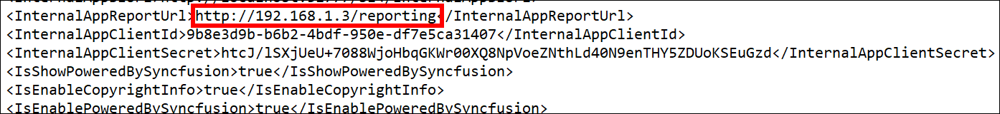
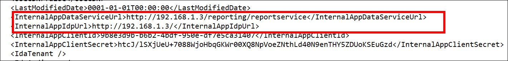

# How to upgrade Bold Reports® On-Premises Edition version up to 2.x on production server

To upgrade Bold Reports® On-Premises Edition up to version 2.x, install the upgrade on a staging machine, test it, and then move the files to the production machine. This approach keeps your production site running while you verify the new version.

## How do I upgrade Bold Reports® On-Premises Edition on the staging machine?

To upgrade Bold Reports® On-Premises Edition on the staging machine, install the new build first and then update any custom domain URLs in the configuration files.

* Install the Bold Reports® On-Premises Edition build you want to upgrade to by following the [installation guide](../../../deployment/).

* If you configured Bold Reports® On-Premises Edition with a new domain on the older version, update that domain URL in the configuration files after the upgrade installation completes:

1. Go to the deployed location.
   >By default, Bold Reports® will be deployed on C:\Bold Reports®.

2. Update the **`InternalAppReportUrl`** value in the config file at the following location:

   **`{Deployed Location}`**\IDP\UMS\Configuration\boldreports\Config.xml

   The following image shows the IDP config file.

   

3. Update the **`InternalAppDataServiceUrl`** and **`InternalAppIdpUrl`** values in the config file at the following location:

   **`{Deployed Location}`**\Report Server\Configuration\Config.xml

   The following image shows the Report Server config file.

   

* After you complete the previous steps, restart the Bold Reports® On-Premises Edition site. Test all features in Bold Reports® On-Premises Edition and confirm they work.

## How do I move the upgrade to the production machine?

To move the Bold Reports® On-Premises Edition upgrade to the production machine, back up the `App_Data` folders, copy the upgraded files from staging, and restart the site.

* Back up the IDP `App_Data` folder and the Report Server `App_Data` folder from the Bold Reports® site hosted location on the production machine.

   Example: If the Bold Reports® site is hosted at `D:\BoldReports` on the production machine, back up the `App_Data` folder from the IDP location and the Report Server folder location as follows:

   `D:\Bold Reports\IDP\App_Data`

   `D:\Bold Reports\Report Server\App_Data`

* On the staging machine, zip all files from the deployed location except the `Utilities` folder, and copy that zip file.

   **`{deployed location}`**\Bold Reports®
   > By default, Bold Reports® will be deployed on the following location in staging machine:
`C:\Bold Reports`

* Paste the copied zip file in any location on the production machine and extract it. Move the extracted files, except the `App_Data` folder, to the Bold Reports® site hosted location.

   Example: `D:\Bold Reports`

* Start the Bold Reports® site from IIS.

   > After upgrading, if you face any problems while browsing the Bold Reports® site, move the backup of the IDP `App_Data` folder and the Report Server `App_Data` folder to the Bold Reports® site hosted location.
   >Example: If the Bold Reports® site is hosted at `D:\Bold Reports`, move the backup (IDP and Report Server) App_Data folders to the following locations, respectively:
   >* `D:\Bold Reports\IDP\App_Data`
   >* `D:\Bold Reports\Report Server\App_Data`

## Frequently asked questions

### Which folder should I exclude when I copy files from the staging machine?

Exclude the `Utilities` folder when you zip the files on the staging machine. When you move the extracted files to the production site, exclude the `App_Data` folder.

### What should I do if the site has problems after the upgrade?

Move the backup of the IDP `App_Data` folder and the Report Server `App_Data` folder to the Bold Reports® site hosted location.

## See also

* [Set up development, staging, and production environments](../setup-the-development-staging-and-production-environment-for-bold-reports-on-premise-edition/)
* [Check the status and health of Bold Reports® services](../how-to-check-the-status-and-health-for-bold-reports-services/)
* [Update the database in Bold Reports®](../how-to-update-the-database-in-bold-reports-application/)
