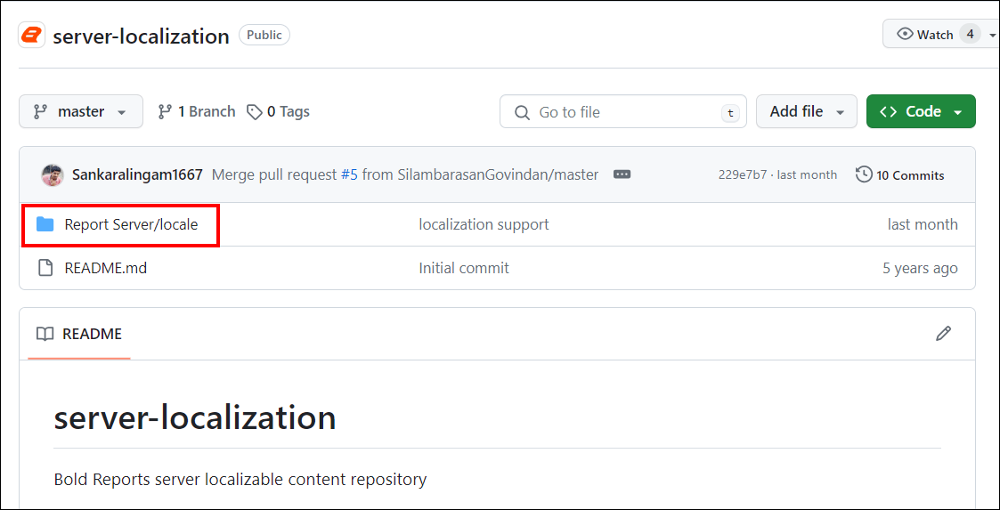
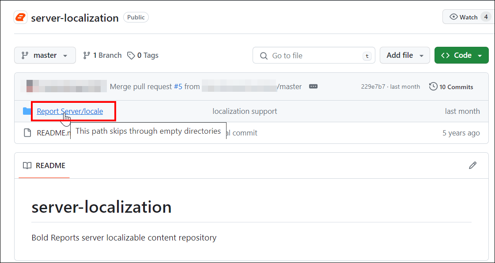
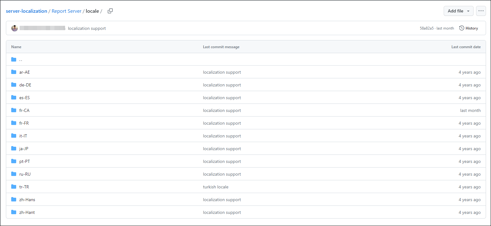
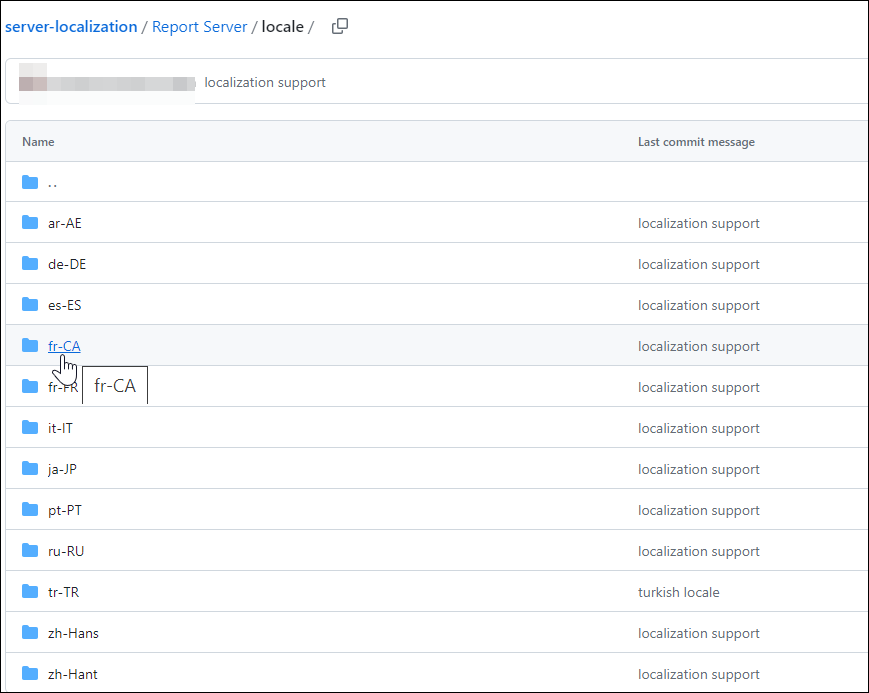
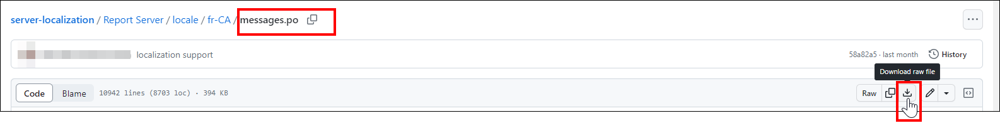
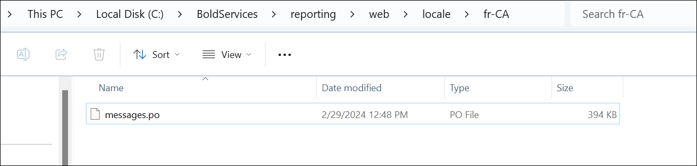
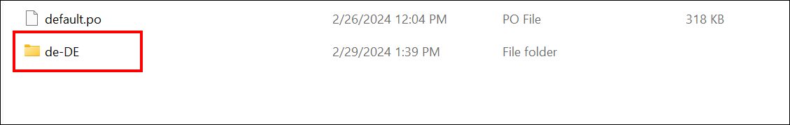
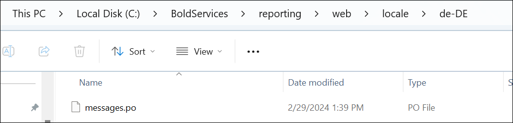
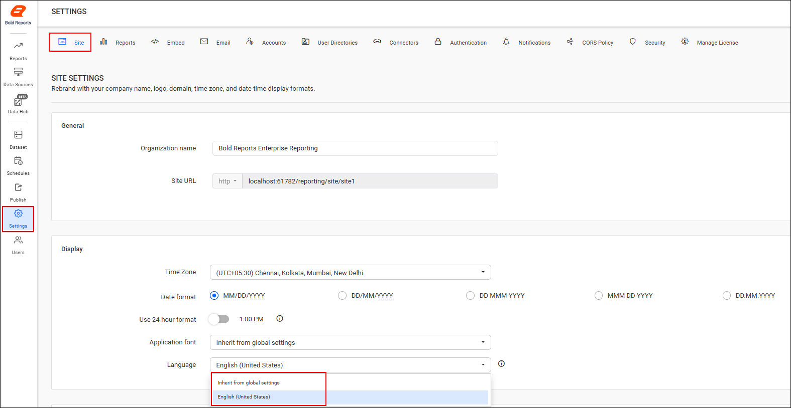
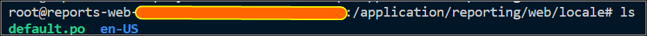

# Localize the Bold Reports® Report Server

Localization in Bold Reports® On-Premises Edition lets you adapt the Report Server to different languages and cultures.

* Localization is more than translating words. It adjusts a website to fit different languages and cultures.

* Localization includes adjusting content, design, and layout to resonate with diverse audiences authentically.

* The default language for Bold Reports® On-Premises Edition is English (**en-US**). Refer to the following sections for more details.

## How do I get a new localization file?

To get a new localization file for the Bold Reports® Report Server, clone your own culture from the [Report Server](https://github.com/boldreports/server-localization) localization repository and add it to the application anytime.
    

1. Click the `Report Server/locale` folder to see the localization support available in the Report Server.

    
    

2. Click the language you need, and download the **messages.po** file by clicking the download icon.
    
    

## How do I add a localization to Bold Reports® On-Premises Edition?

To add a localization to Bold Reports® On-Premises Edition, place your culture's **messages.po** file in a new culture folder inside the **locale** directory.

1. Copy your culture's **messages.po** file from the location where you downloaded it.

2. Create a folder in the **locale** directory with the format {language code}-{country code}, then paste the copied **messages.po** file inside the new folder.

The following table lists the **locale** folder path for each installation type:

| Installation Type | Folder Path |
| ----------------- | ----------- |
| Windows | Navigate to below installer folder:   {Installed_location}\BoldServices\reporting\web\locale  |
| Docker | Bash into the reports-web container.   Inside the container, go to the below location:  "/application/reporting/web/locale" |

> **Note:** To learn more about the language code, see the [language code documentation](https://learn.microsoft.com/en-us/openspecs/office_standards/ms-oe376/6c085406-a698-4e12-9d4d-c3b0ee3dbc4a).

### Windows

On Windows, you add a localization to the Bold Reports® Report Server by creating a culture folder in the installed **locale** folder.

* For example, if you are translating into `German`, create a folder named **de-DE** and paste the `messages.po` file inside.
    
    

* Refresh your Bold Reports® site and select your preferred language.
    

### Docker

On Docker, you add a localization to the Bold Reports® Report Server by creating the culture folder inside the reports-web container. The following image shows the new folder created in the container.

## Frequently asked questions

### What is the default language of Bold Reports® On-Premises Edition?

The default language for Bold Reports® On-Premises Edition is English (**en-US**).

### How should I name the culture folder?

Name the folder in the format {language code}-{country code}. For example, use **de-DE** for German.

## See also

* [Localization overview](../)
* [Localization for versions below 3.1](../lower-version/)
* [Report Server settings](../../manage-app-settings/)
