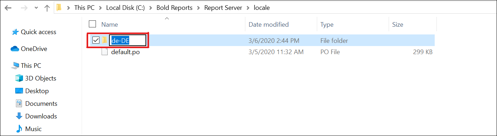
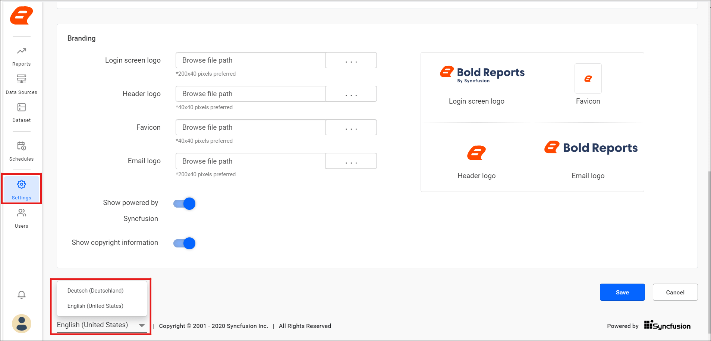

# Localization for Bold Reports® Report Server versions below 3.1

To localize Bold Reports® On-Premises Edition versions below 3.1, you add the `messages.po` file to a culture folder inside the Report Server locale folder.

## Where is the locale folder?

The Bold Reports® Report Server locale folder for versions below 3.1 is at the following path: `{Installed_location}\Bold Reports\Report Server\locale`.

* For example, if you are translating to German, create a folder named **de-DE** and paste the `messages.po` file.
    

* Then, refresh your Bold Reports® site and select the preferred language.
    

## See also

* [Localization overview](../)
* [Localization and globalization](../localization/)
* [Report Server settings](../../manage-app-settings/)
