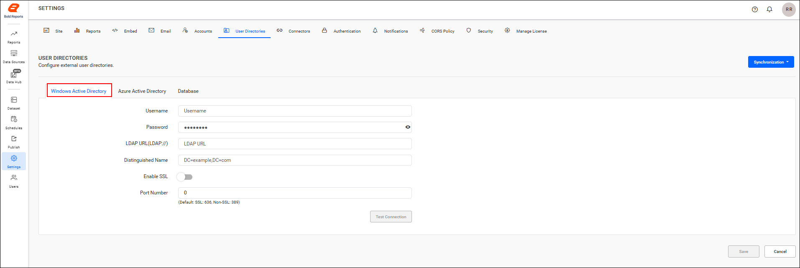
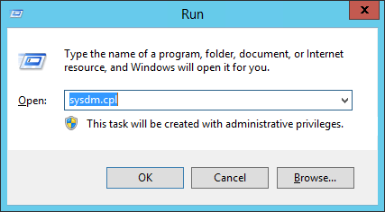
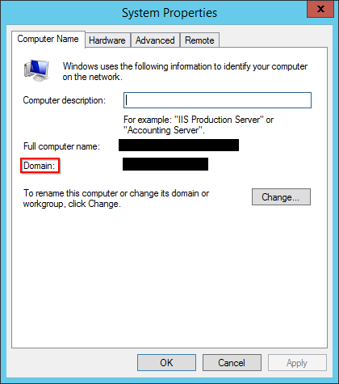

# Configure Windows Active Directory settings in Bold Reports® Report Server

Windows Active Directory settings in the Bold Reports® Report Server let you import users and groups from Windows Active Directory. The settings also synchronize their details after you import them into Bold Reports® On-Premises Edition.

## How do I configure Active Directory in Bold Reports®?

To configure [Active Directory](https://msdn.microsoft.com/en-us/library/windows/desktop/aa746492) with Bold Reports® On-Premises Edition, open the **User Directories** settings and enter your Active Directory details.

1. Click the **Settings** option in the Report Server left-side panel, navigate to the **User Directories** tab, and then select **Windows Active Directory** as shown in the following image.
    

2. Enter the following Active Directory details to configure Bold Reports® with your Active Directory:

    * **Username and Password:** Username and password of the user present in the Active Directory domain.
    * **LDAP URL:** IP or DNS name of the Windows Server, where you have Active Directory Domain Services enabled. For example, `LDAP://192.168.1.1`.
    * **Distinguished Name:** FQDN of the Active Directory.
    * **Enable/Disable SSL connection to Active Directory:** Enable this checkbox if your Windows Server requires an SSL connection for connectivity.
    * **Port Number:** The default port for non-SSL connections is 389, and for SSL connections, it is 636.

## How do I find the FQDN?

To find the distinguished name (FQDN) of your Active Directory for Bold Reports®, open the System Properties dialog on a machine in the domain.

1. Go to Run (Win + R) and type `sysdm.cpl` on a machine connected to the Active Directory or on the Windows Server where you have Active Directory Domain Services enabled.

    

2. The `System Properties` dialog opens. The distinguished name appears with the label `Domain`.

    

You can search either all the users in the domain or the users in a specific group that belongs to an organization in the domain.
> For example, if your Domain is `www.example.com`, to search for all the users of the domain, you have to type in `dc=www,dc=example,dc=com`.
To search for users in a specific group (e.g., TestGroup) of an organization (e.g., Syncfusion®) in the domain `www.example.com`, you can type in **CN=TestGroup,OU=Syncfusion®,DC=www,DC=example,DC=com**.

The following table lists the attribute types:

<table>
 <tr>
    <td>
       String
    </td>
     <td>
        Attribute Type
    </td>
 </tr>
 <tr>
 <td> CN </td>
 <td> commonName </td>
 </tr>
 <tr>
 <td> OU </td>
 <td> organizationalUnitName </td>
 </tr>
 <td> DC </td>
 <td> domainComponent </td>
 </tr>
 </table>

 The filter in the previous example searches and lists the users in the group named TestGroup of an organization named Syncfusion® in the domain [www.example.com](https://www.example.com/).

> **Note:** Click **Test Connection** to validate the connection with given details, and then click **Save**.

## Frequently asked questions

### Which ports does Bold Reports® use for Active Directory?

The default port for non-SSL connections is 389, and for SSL connections, it is 636.

### How do I validate the Active Directory settings?

Click **Test Connection** to validate the connection with the given details, and then click **Save**.

## See also

* [Active Directory synchronization schedule](../synchronization-schedule/active-directory-synchronization-schedule/)
* [Microsoft Entra ID settings](../azure-active-directory/)
* [Database settings](../database-settings/)
