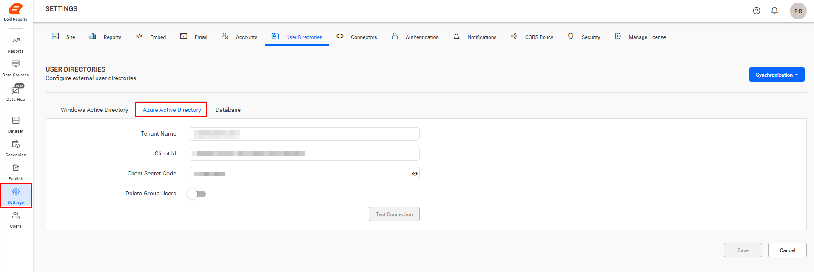
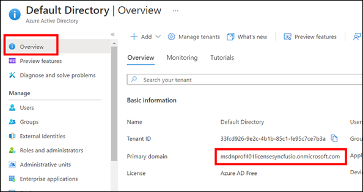
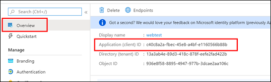
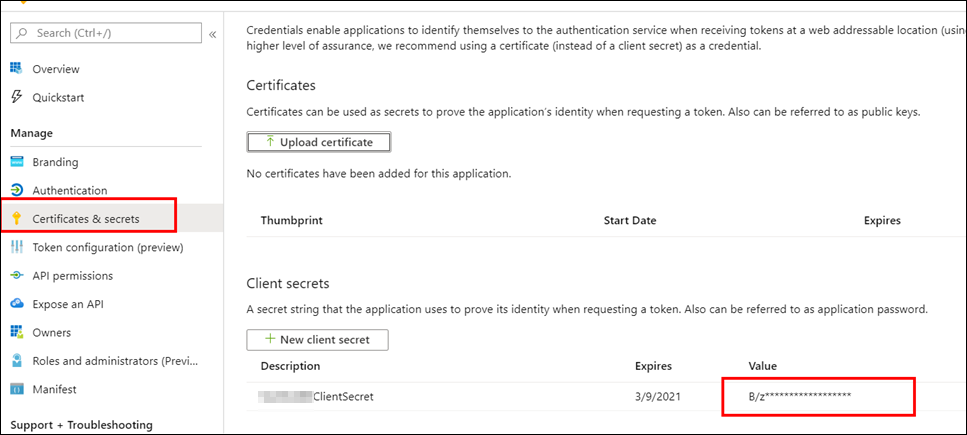
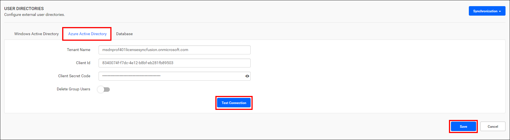

# Microsoft Entra ID settings in Bold Reports® Report Server

To import users and groups from [Microsoft Entra ID](https://www.microsoft.com/en-us/security/business/identity-access/microsoft-entra-id) (formerly Azure AD) into Bold Reports®, add your tenant name, client ID, and client secret in the Report Server.

## How do I register the Bold Reports® application in Microsoft Entra ID to import users and groups?

To register the Bold Reports® application in Microsoft Entra ID for importing users and groups, see the [steps to register the application](https://help.boldreports.com/enterprise-reporting/administrator-guide/how-to/set-up-azure-active-directory/#steps-to-register-bold-reports-on-premise-application-in-azure-active-directory).

## How do I configure Microsoft Entra ID details in Bold Reports® to import users and groups?

To configure Bold Reports® with Microsoft Entra ID, enter the tenant name, client ID, and client secret in the Report Server **User Directories** settings.

1. Click the **settings** option in the left-side panel of the Report Server, navigate to the **User Directories** tab, and select **Azure Active Directory**, as shown in the following image.
    

2. Enter the tenant name, client ID, and client secret code. Bold Reports® On-Premises Edition needs these values to connect to Microsoft Entra ID.

    * **Tenant name:** The default domain name of your Active Directory. Navigate to the `Azure Active Directory` you created and copy the domain name from there.
        

    * **Client ID:** The Client ID of the Bold Reports® application in your Microsoft Entra ID tenant. Navigate to the registered application, copy the `Application ID` from the `Overview` section, and paste it here.
        

    * **Client secret code:** The secure key of the Bold Reports® application you created in your Microsoft Entra ID tenant. Navigate to `Certificates & secrets`, locate the keys saved for the application, and then select the `value`.
        

3. Click **Test Connection** to validate the connection with the given details, and then click **Save**.
        

## Frequently asked questions

### Which details do I need to connect Bold Reports® to Microsoft Entra ID?

You need the tenant name, client ID, and client secret code of the Bold Reports® application registered in your Microsoft Entra ID tenant.

### Where do I find the client ID?

Navigate to the registered application in Microsoft Entra ID and copy the `Application ID` from the `Overview` section.

## See also

* [Set up Microsoft Entra ID for Bold Reports®](../../how-to/set-up-azure-active-directory/)
* [Microsoft Entra ID synchronization schedule](../synchronization-schedule/azure-active-directory-synchronization-schedule/)
* [Windows Active Directory settings](../active-directory/)
