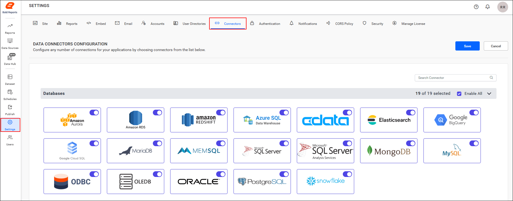
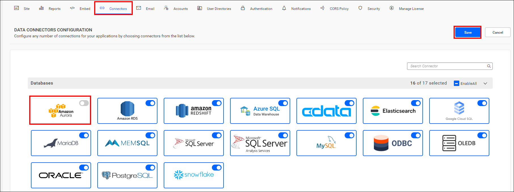
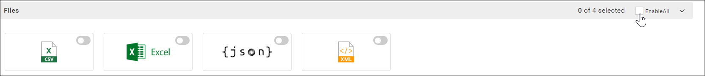
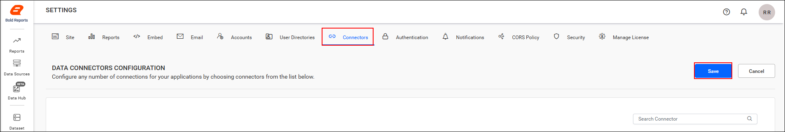

# Connectors settings in Bold Reports® Report Server

In the Bold Reports® Report Server, you can enable or disable connectors from the settings page. When you create a data source, only the enabled connectors are displayed.

## How do I enable or disable connectors?

To enable or disable connectors in the Bold Reports® Report Server, open the connectors settings and select the connectors you want.

1. Click the **Settings** option in the left-side panel of the Report Server to open the connectors settings.
    

2. Enable or disable a specific connector from the selected category.
    

3. To enable or disable all connectors in a category, click the checkbox in the category's right corner.
    

4. Click the **Save** button to save the connectors details. The following image shows the success message.
    

## Frequently asked questions

### Which connectors appear when I create a data source?

Only the enabled connectors are displayed when you create a data source in the Report Server.

### Can I disable a whole category of connectors at once?

Yes. Click the checkbox in the category's right corner to enable or disable all connectors in that category.

## See also

* [Database settings](../database-settings/)
* [Report settings](../report-settings/)
* [Manage app settings](../)
