# Database settings in Bold Reports® Report Server

Database settings in the Bold Reports® Report Server let you import users and groups from an existing database.

## How do I configure the database connection details?

To configure the database connection details in the Bold Reports® Report Server, open the **User Directories** tab and select **Database**.

1. Click the **Settings** option in the left-side panel of the Report Server.
2. Navigate to the **User Directories** tab, then select **Database** as shown in the following image.
    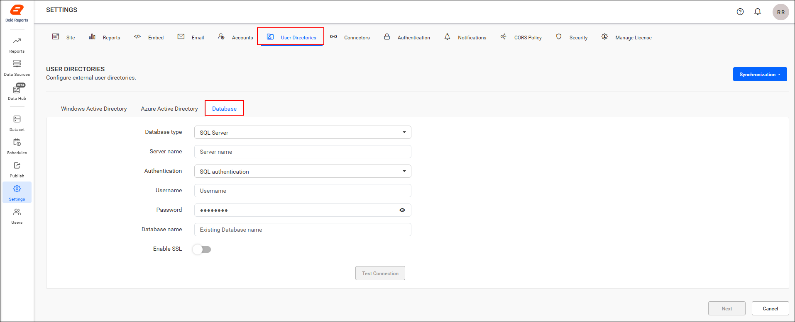

## Which databases can I import users from?

The Bold Reports® Report Server can import users from the following types of databases:
* SQL Server
* PostgreSQL

To select the type of database to import users from, click the **Database type** dropdown.
    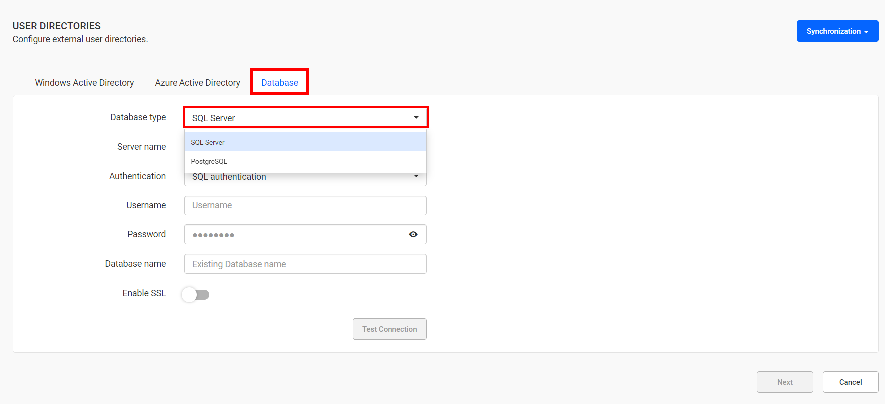

### SQL Server database

To connect the Report Server to a SQL Server database, enter the connection details and test the connection.

1. Provide the following connection details: Server name, Authentication type, Username, Password, and Database name.
2. Click **Test Connection** to validate the connection details.
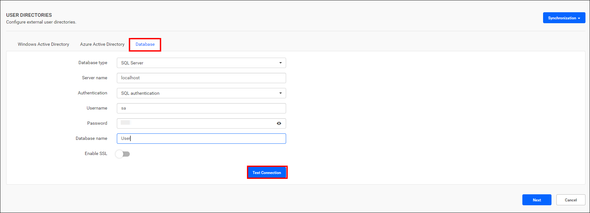

### PostgreSQL database

To connect the Report Server to a PostgreSQL database, enter the connection details and test the connection.

1. Provide the following connection details: Server name, Port, Username, Password, and Database name.
2. Click **Test Connection** to validate the connection details.
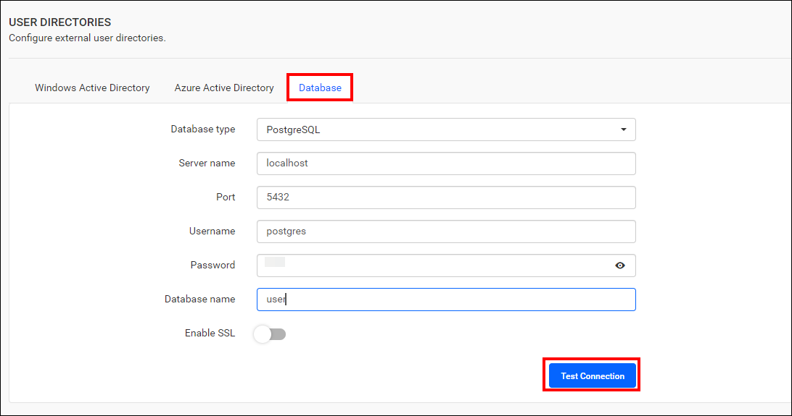

## How do I map database columns to user fields?

To map database columns in the Bold Reports® Report Server, retrieve the database schema and select the column that matches each user field.

1. After you fill in the connection details, click **Next** to retrieve the schema of the database connection.
    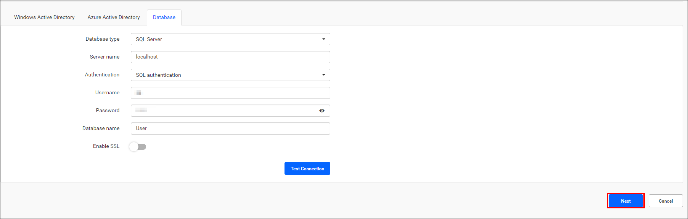

2. After the database connection is established, the data page is displayed as follows.
    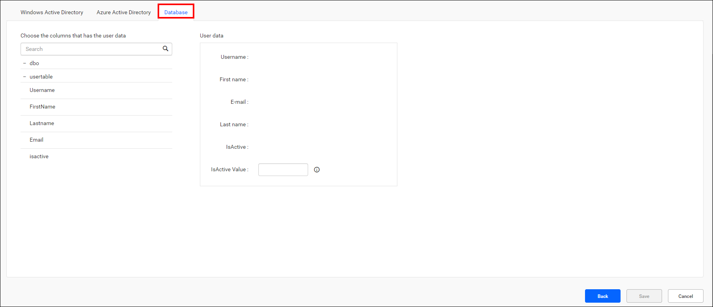

3. Select the matching columns from the database schema for the Username, First name, Email address, Last name (optional), and `IsActive` (Optional) fields.
    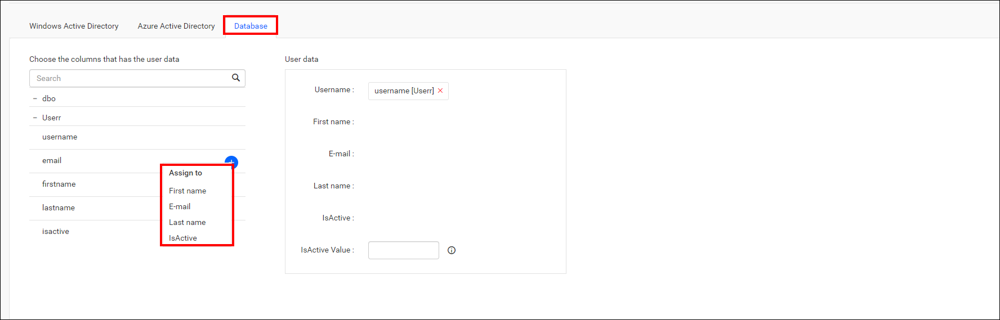

4. If you select columns from different tables, the following scenarios occur:
    * If the tables have a single relationship, the join is made with that relationship.
    * If the tables have multiple relationships, select the relationship from the list of relationships, and then click **Apply**.
        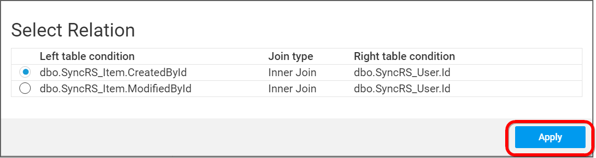

    * If there is no relationship between tables, form a join with the selected tables, and then click **Apply**.
        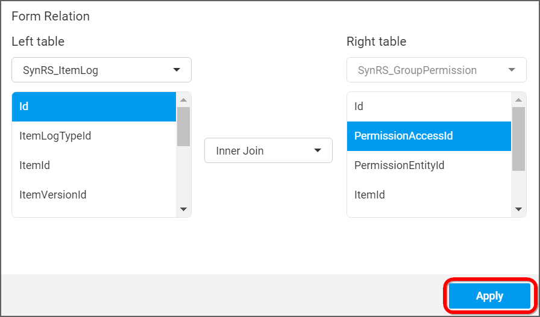

5. After you select all columns, click **Save** to save the database details. The system retrieves users from the configured database based on these saved details.
    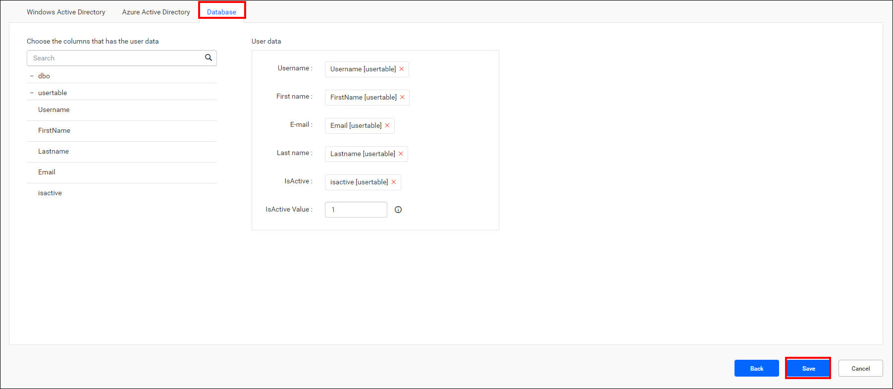

    > Use the **Back** button on the settings page to edit the database details before mapping and saving the database configuration.

6. After the changes are complete, the success message is displayed as shown in the image.
    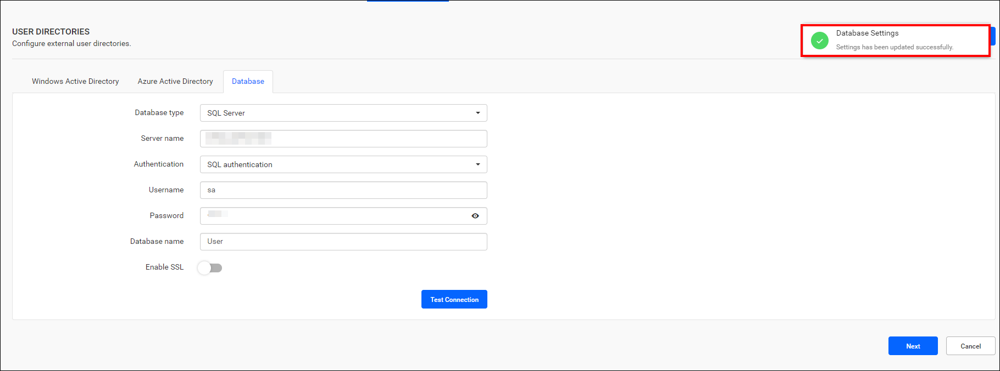

    > **Note:** After configuring the database details, to import users from the existing database, it's necessary to change the account activation type from **automatic** to **email**.
    > 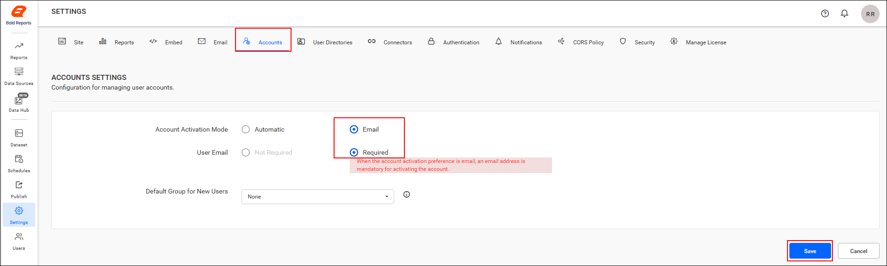

## Frequently asked questions

### Which user fields are required when I map columns?

Username, First name, and Email address are required. Last name and `IsActive` are optional.

### What must I change before importing users from the database?

Change the account activation type from **automatic** to **email** to import users from the existing database.

## See also

* [Database synchronization schedule](../synchronization-schedule/database-synchronization-schedule/)
* [Windows Active Directory settings](../active-directory/)
* [Microsoft Entra ID settings](../azure-active-directory/)
