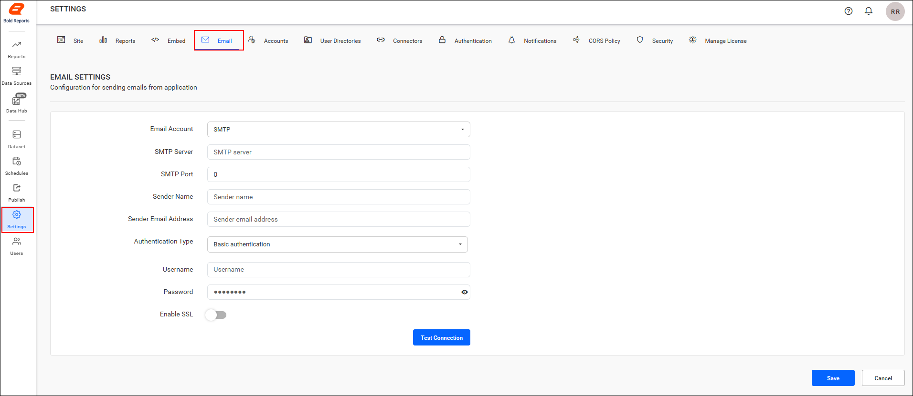
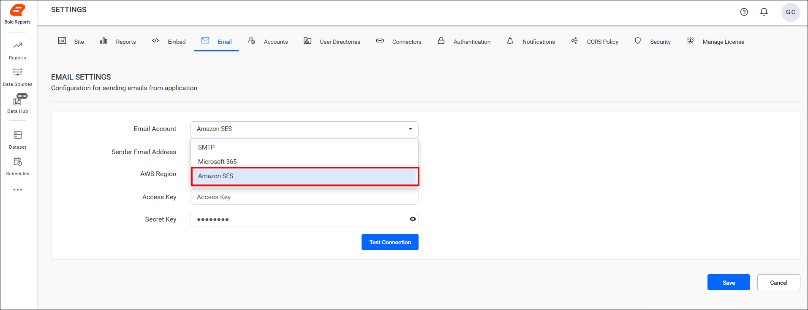
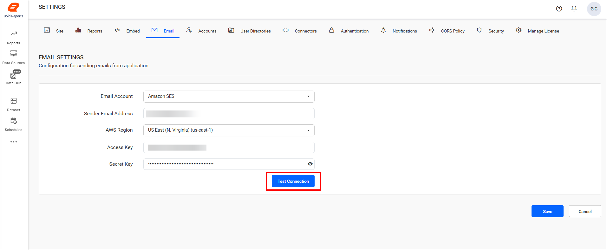
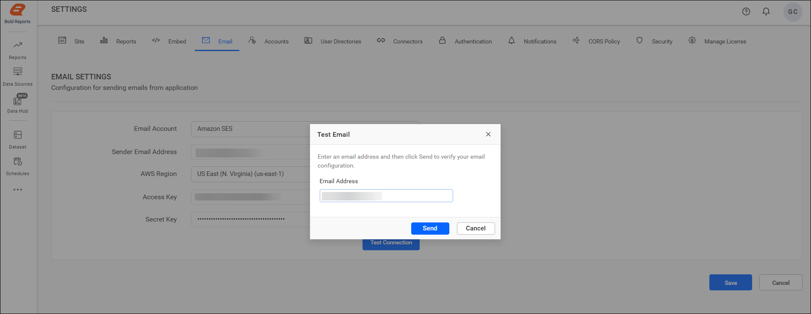
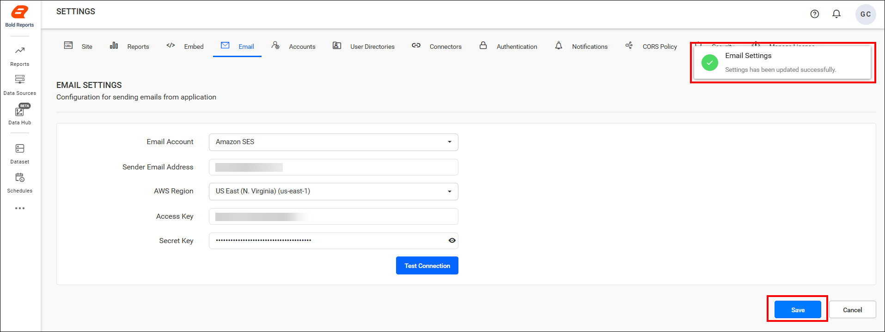

# Configure Amazon SES email in Bold Reports® Report Server

To send emails from the Bold Reports® Report Server with **Amazon Simple Email Service (SES)**, select `Amazon SES` as the email account and enter your AWS credentials. Amazon SES is a cost-effective, scalable email service that requires proper credentials and region configuration.

## What details does Report Server need for Amazon SES?

The Bold Reports® Server requires the following credentials to send email:

<table>
<tr>
    <td>Sender Email Address</td>
    <td>The email address, which is displayed as the `From` email address in the recipient's email.</td>
</tr>
<tr>
    <td>AWS Region</td>
    <td>The region where your SES service is configured (e.g., `us-east-1`, `us-west-1`).</td>
</tr>
<tr>
    <td>Access Key</td>
    <td>The AWS access key ID used to authenticate API requests.</td>
</tr>
<tr>
   <td>Secret Key</td>
   <td>The AWS secret access key paired with the access key for secure authentication.</td>
</tr>
</table>

## How do I configure Amazon SES in Bold Reports®?

To configure Amazon SES in the Bold Reports® Report Server, follow these steps:

1. Go to **Settings** in the left-side panel of the Report Server and open the `Email` tab, as shown in the following image. You can also open this page directly with the URL `http://{domain}/reporting/site/site1/administration/e-mail-settings`.
   

2. Select `Amazon SES` from the `Email Account` drop-down menu.
    

3. After you enter the email connection details, validate the settings with the `Test Connection` option.
    

4. Enter an email address and click `Send` to confirm that the configuration is correct.
    

5. Click `Save` to apply the settings.
    

## Frequently asked questions

### Which AWS details do I need for Amazon SES in Report Server?

You need the sender email address, the AWS region where SES is configured, the AWS access key ID, and the paired secret access key.

### How do I check that Amazon SES is set up correctly?

Use the `Test Connection` option, then enter an email address and click `Send` to confirm the configuration before you click `Save`.

## See also

* [Configure SMTP email settings](./../email-settings/)
* [Configure Microsoft Office 365 email with OAuth](./../office-365-account/)
* [Track emails with email activity logs](./../email-activity-logs/)
