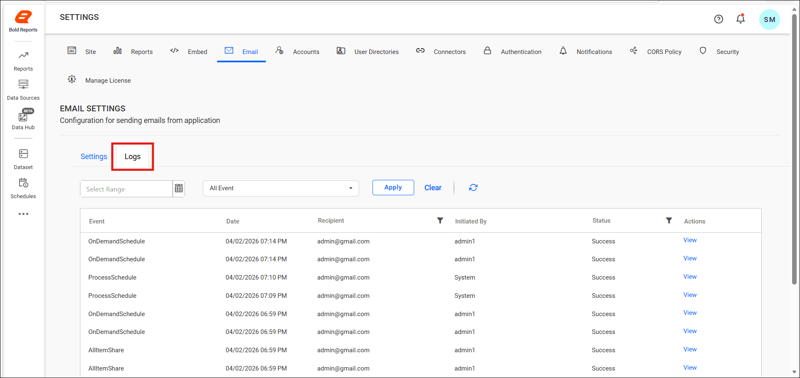
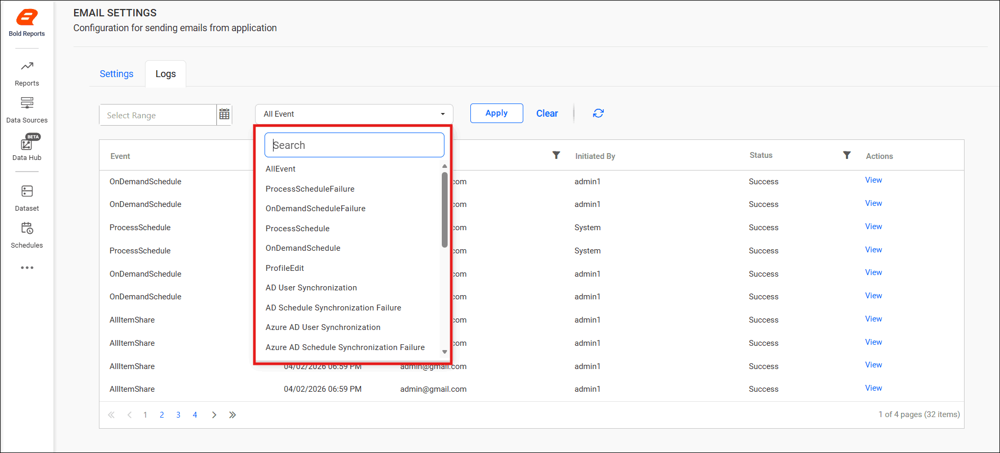
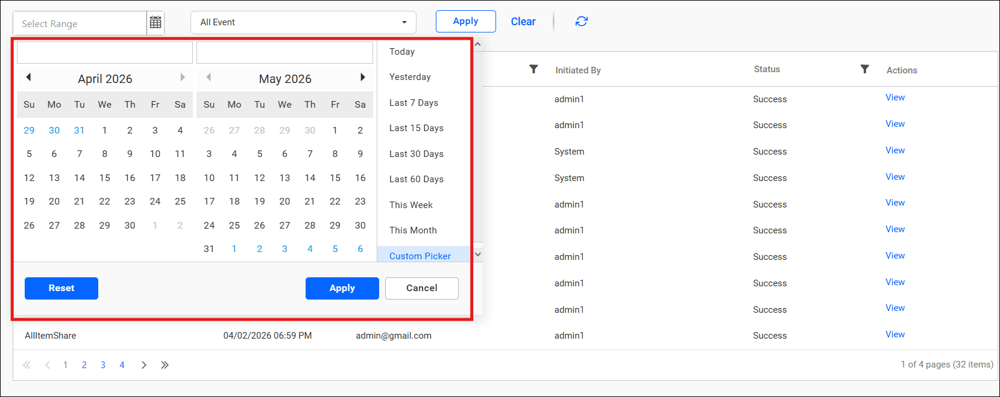
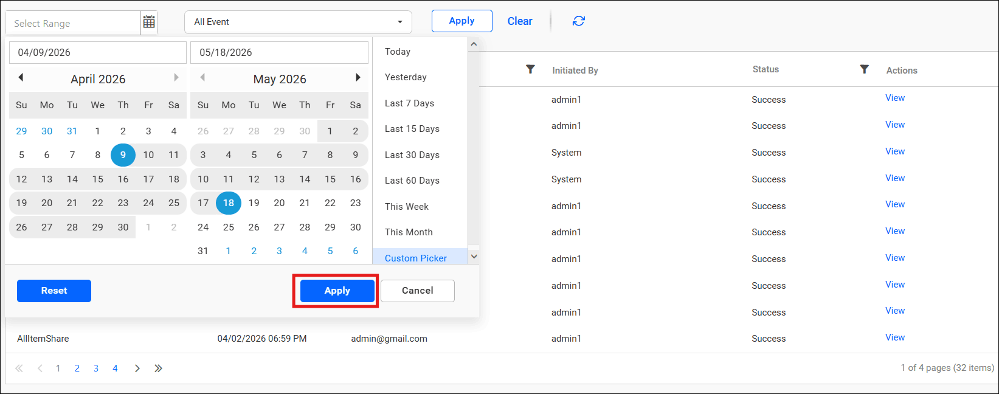
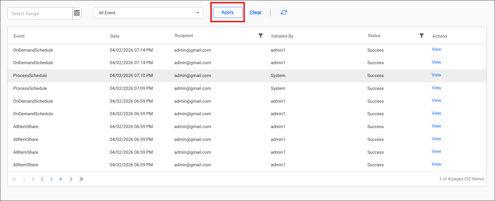
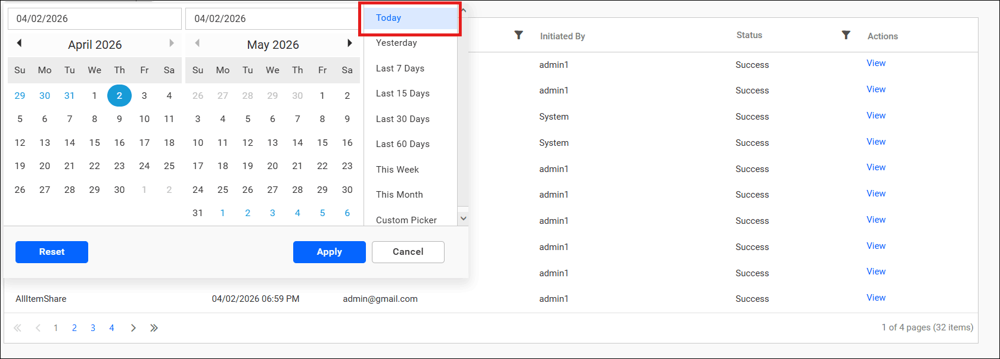
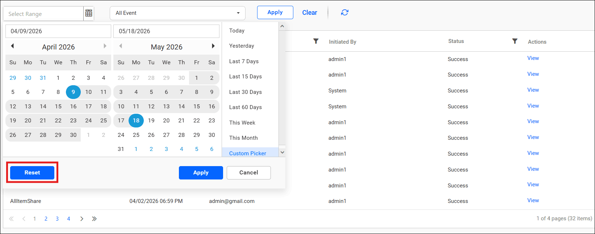
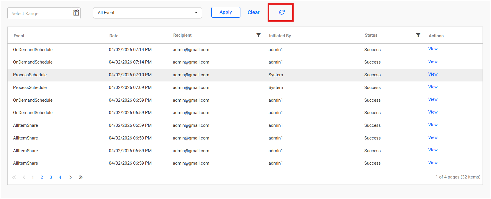

# Email activity logs in Bold Reports® Report Server

The Email Activity Logs in the Bold Reports® Report Server show whether each email was sent to the recipients. The logs contain information about each email, including the <b>sender and recipient, date and time, status, and any associated error messages</b>.

> **NOTE:** These email activity logs only show the status of whether the email was sent from the Bold Reports® server to your SMTP configured server or not. If an email is sent from Bold Reports® to your SMTP server but the SMTP server is unable to deliver the email to the recipient, then the logs will not be shown here. This setting is applicable only for On-Premises Deployment.

The following image shows the email activity log tab in the Report Server.

  

## How do I filter email logs by event and date?

You can filter the Bold Reports® Report Server email activity logs by email event and date range. Follow these steps:

1. Open the **Email Event** drop-down and select the required event. The default selection is `All Event`.

   

2. Open the **Date Picker** calendar and select the date range you want to filter.

   

3. Click the `Apply` option to apply that date range.

   

4. Click the `Apply` button to view the email activity logs for the selected date range and event.
   

## Can I use a predefined date range?

Yes. The Report Server date range dialog box offers predefined ranges, such as **Today**, **Yesterday**, **Last 7 Days**, **Last 15 Days**, or **Last 30 Days**.

  

## How do I reset the date range or refresh the logs?

To reset the date range in the Report Server email activity logs, click `Reset` in the dialog box. The dates you selected are cleared.

  

You can also refresh the email activity logs manually to update the list of records.

  

## Frequently asked questions

### Do email activity logs show whether the recipient received the email?

No. The logs only show whether Bold Reports® sent the email to your SMTP configured server. If the SMTP server cannot deliver the email to the recipient, the logs do not show it.

### What information does each email log contain?

Each log entry contains the sender and recipient, date and time, status, and any associated error messages.

## See also

* [Configure SMTP email settings](./../email-settings/)
* [Customize email templates](./../email-templates/)
* [Email account settings overview](./../)
