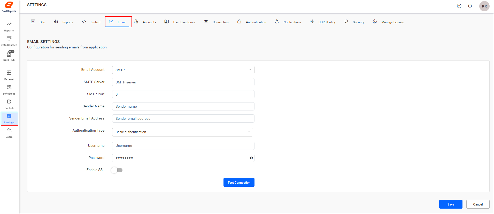
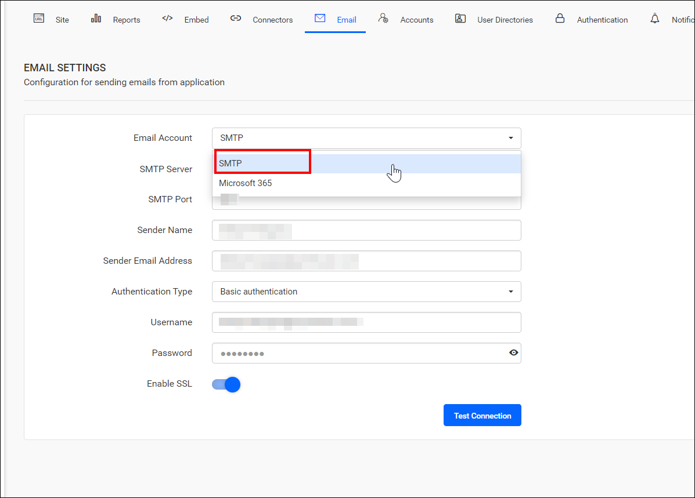
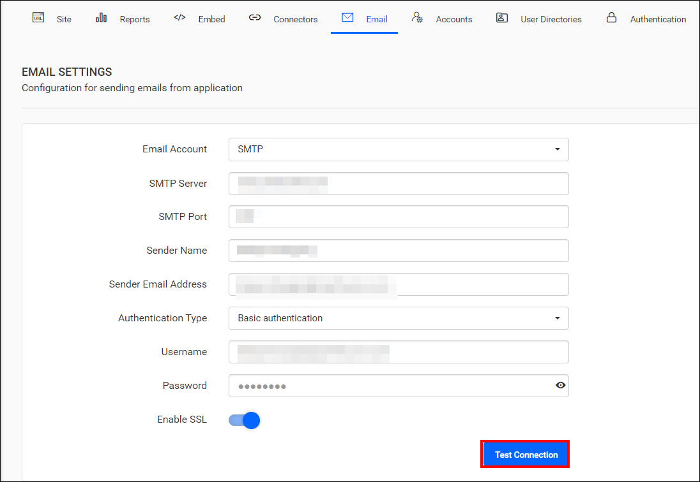
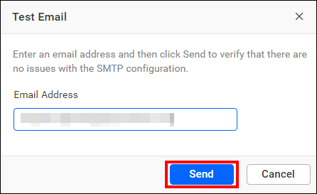
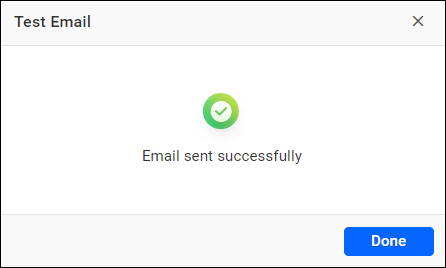
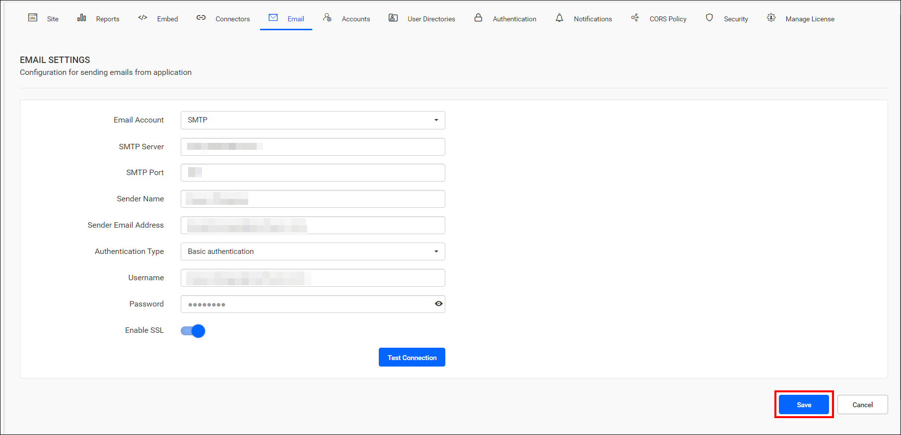

# Configure an SMTP account in Bold Reports® Report Server

To send emails from the Bold Reports® Report Server using an [SMTP](https://en.wikipedia.org/wiki/Simple_Mail_Transfer_Protocol) account, configure the SMTP details in the email settings.

## Which operations need SMTP email settings?

Bold Reports® Report Server needs SMTP email settings to perform the following operations:

* `Account activation:` Sending user account activation emails.
* `Forgot password:` Provide request links to reset passwords for users who have forgotten them.
* `Reset password:` Sending links to facilitate password resets.
* `Schedule and deliver reports:` Distributing exported reports to scheduled recipients.

## What SMTP details does Report Server need?

The Bold Reports® Server requires the following SMTP details to send emails:

<table>
 <tr>
 <td> SMTP Server </td>
 <td> The SMTP server specifies the public IP address or provider that delivers the emails to the end user's mail box. </td>
 </tr>
 <tr>
 <td> SMTP Port </td>
 <td> The port number of the SMTP server may vary depending on the SMTP server and the connection type (SSL/TLS).</td>
 </tr>
 <td> Sender Name </td>
 <td> The name displayed on the email as the <b>From name.</b> </td>
 </tr>
 <tr>
 <td> Sender Email Address </td>
 <td> The email address displayed as the <b>From email address</b> in the recipient's email. </td>
 </tr>
  <tr>
 <td> Authentication type </td>
 <td> We support two types of authentication:   1.<b>Basic Authentication:</b> This default authentication type requires a username and password. 2.<b>Anonymous Authentication:</b> You can choose this option if you have disabled authentication on your SMTP server. </td>
 </tr>
  <tr>
 <td> Username </td>
 <td> A valid username for the sender's email account is required for sending emails.</td>
 </tr>
   <tr>
 <td> Password </td>
 <td> The password of the sender's email account.</td>
 </tr>
   <tr>
 <td> Enable SSL </td>
 <td> If SSL is enabled, it will be used to connect with your SMTP server; otherwise, the connection will be made using TLS.</td>
 </tr>
 </table>

## How do I configure SMTP account settings in Bold Reports®?

To configure an SMTP account in the Bold Reports® Report Server, follow these steps:

1. Go to **Settings** in the left-side panel of the Report Server and open the `Email` tab, as shown in the following image. You can also open this page directly with the URL `http://{domain}/reporting/site/site1/administration/e-mail-settings`.

   

2. Select SMTP from the Email Account drop-down menu. Fill in the SMTP Server, SMTP Port, Sender Name, Sender Email Address, Authentication Type, Username, and Password fields.

   

3. After you enter the email connection details, validate the settings with the `Test Connection` option.

   

4. Enter an email address and click `Send` to confirm that the SMTP configuration is correct. A success message appears when the test email is sent.
   
   

5. Click `Save` to apply the settings.

    

## Frequently asked questions

### Which SMTP authentication types does Report Server support?

Report Server supports Basic Authentication, the default, which requires a username and password. It also supports Anonymous Authentication for SMTP servers with authentication disabled.

### What happens if I do not enable SSL?

If SSL is not enabled, the connection to your SMTP server is made using TLS.

## See also

* [Configure Microsoft Office 365 email with OAuth](./../office-365-account/)
* [Configure Amazon SES email](./../amazon-email-service/)
* [Track emails with email activity logs](./../email-activity-logs/)
