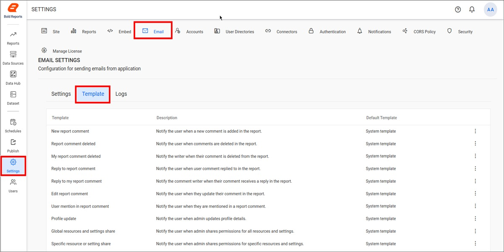
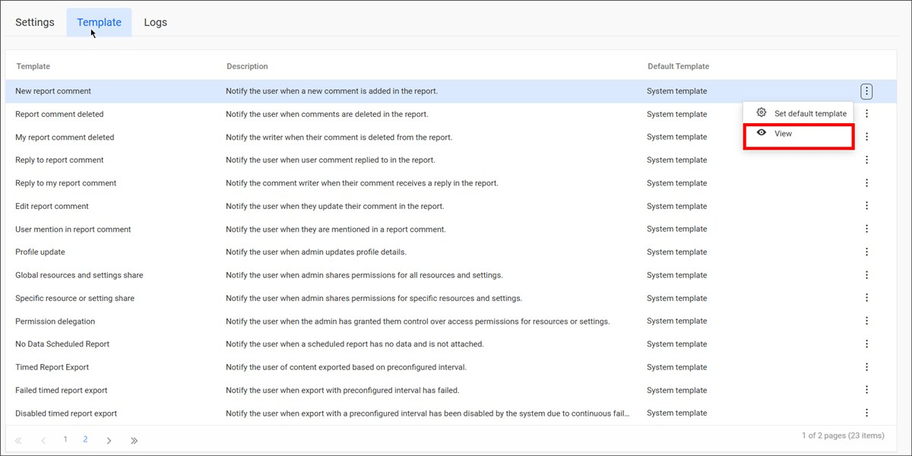
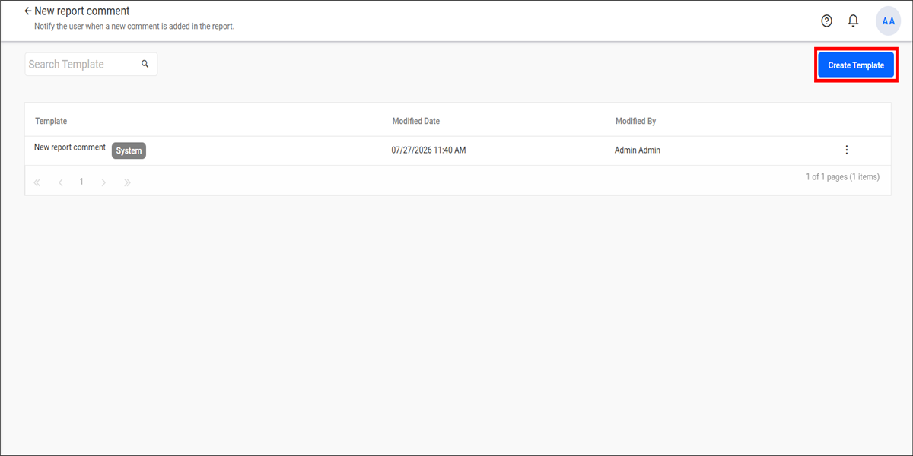
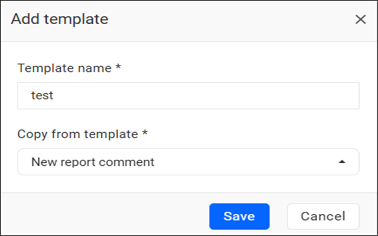
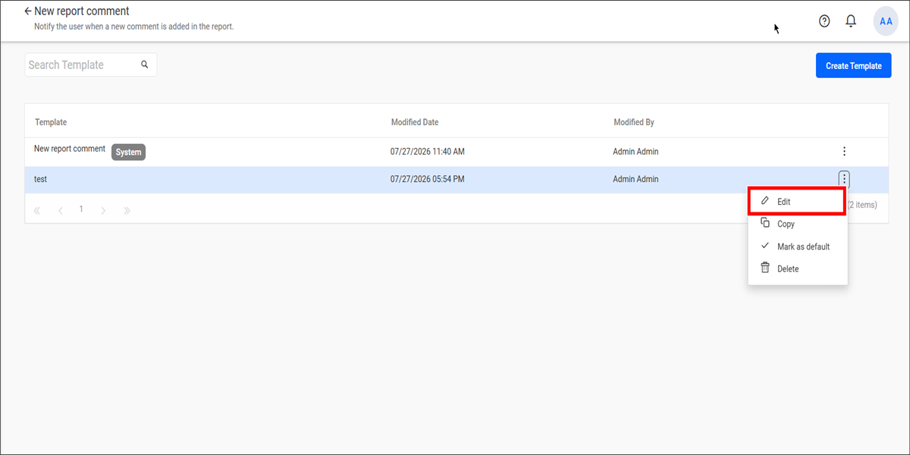
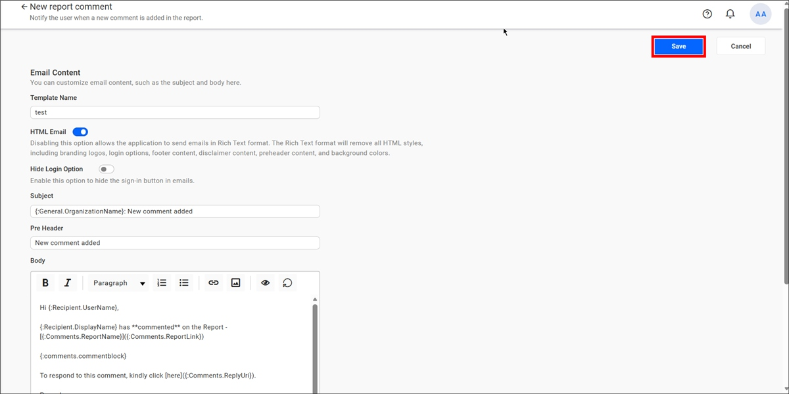
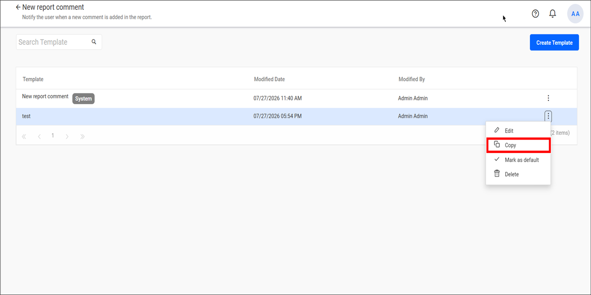
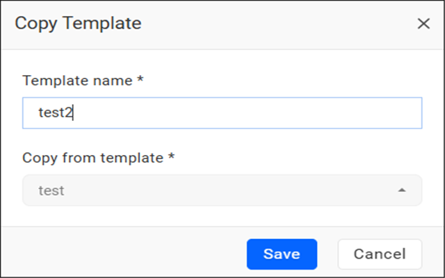
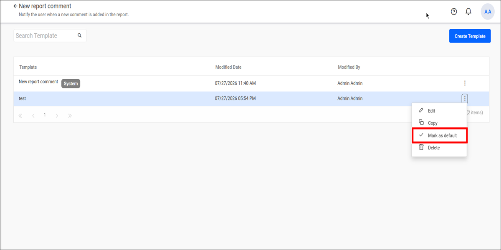
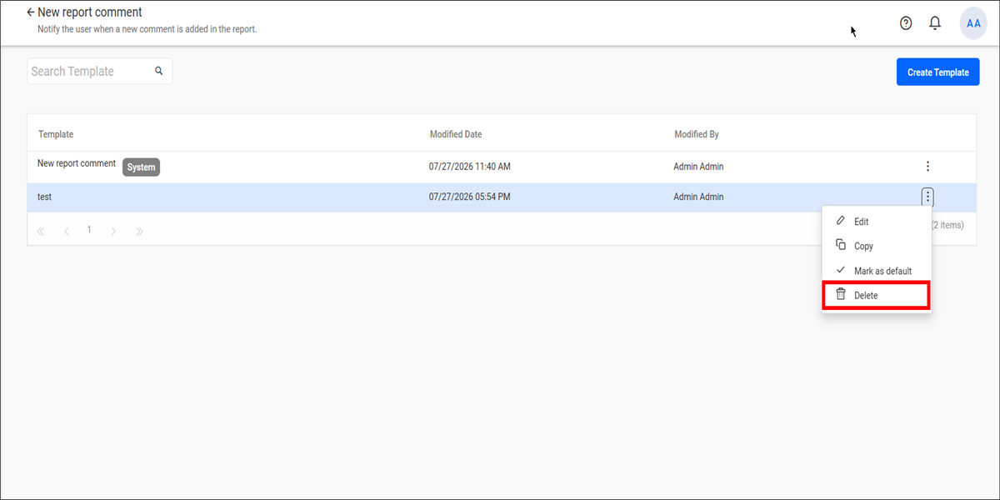

# Email templates in Bold Reports® Report Server

The **Email Templates** page in Bold Reports® Report Server lets administrators manage the email templates used for notifications across Bold Reports® modules. You can use the built-in system templates, create custom templates, and customize email content to fit your organization’s requirements.

The following image shows the **Email Templates** page.

> **NOTE:** This setting is applicable only for **On-Premises Deployment**.

## Which default email templates does Bold Reports® provide?

Bold Reports® provides predefined system templates for various notification events. You use these system templates as the base templates for customization.

<table>
    <thead>
        <tr>
            <th>Template</th>
            <th>Description</th>
        </tr>
    </thead>
    <tbody>
        <tr>
            <td>New Report Comment</td>
            <td>
                Notify when someone adds a new comment to a report you have access to.
                
<strong>For Example:</strong> If User A comments on a report that is accessible to User B, then User B receives an email notification using this template.

            </td>
        </tr>
        <tr>
            <td>Report Comment Deleted</td>
            <td>
                Notify when any comment is removed from a report you have access to.
                
<strong>For Example:</strong> If User A deletes a comment on a report that is accessible to User B, then User B receives an email notification using this template.

            </td>
        </tr>
        <tr>
            <td>My Report Comment Deleted</td>
            <td>
                Notify when someone else deletes a comment that you wrote on a report.
                
<strong>For Example:</strong> If you wrote a comment and an administrator deletes it, you will receive an email notification stating that your comment was removed.

            </td>
        </tr>
        <tr>
            <td>Reply to Report Comment</td>
            <td>
                Notify when someone replies to a comment made on a report you have access to.
                
<strong>For Example:</strong> If User A replies to a comment on a report accessible to User B, then User B receives an email notification using this template.

            </td>
        </tr>
        <tr>
            <td>Reply to My Report Comment</td>
            <td>
                Notify when someone replies to a comment you made on a report.
                
<strong>For Example:</strong> If you commented on a report and someone replies to it, you will be notified of the reply using this template.

            </td>
        </tr>
        <tr>
            <td>Edit Report Comment</td>
            <td>
                Notify when a comment is edited on a report you have access to.
                
<strong>For Example:</strong> If User A edits a comment on a report accessible to User B, then User B receives a notification using this template.

            </td>
        </tr>
        <tr>
            <td>User Mention in Report Comment</td>
            <td>
                Notify when someone mentions you in a report comment using '@'.
                
<strong>For Example:</strong> If User A mentions User B in a report comment, then User B receives a notification using this template.

            </td>
        </tr>
        <tr>
            <td>Profile Update</td>
            <td>
                Notify when an administrator updates your profile details.
                
<strong>For Example:</strong> If your role or email address is changed by an administrator, you will receive a notification using this template.

            </td>
        </tr>
        <tr>
            <td>Global Resources and Settings Share</td>
            <td>
                Notify when an administrator shares access to all resources and settings with you.
                
<strong>For Example:</strong> If an administrator grants you access to all reports and settings, you will be notified using this template.

            </td>
        </tr>
        <tr>
            <td>Specific Resource or Setting Share</td>
            <td>
                Notify when an administrator shares access to a specific resource or setting.
                
<strong>For Example:</strong> If an administrator grants you access to a specific report or setting, you will be notified using this template.

            </td>
        </tr>
        <tr>
            <td>Permission Delegation</td>
            <td>
                Notify when an administrator delegates permission management for resources or settings to you.
                
<strong>For Example:</strong> If an administrator delegates permission management to you, you will receive a notification using this template.

            </td>
        </tr>
        <tr>
            <td>No Data Scheduled Report</td>
            <td>
                Notify when a scheduled report does not contain any data and therefore is not attached.
                
<strong>For Example:</strong> If a scheduled report runs successfully but returns no data, recipients will receive a notification using this template.

            </td>
        </tr>
        <tr>
        <td>Timed Report Export</td>
            <td>
                Notify users when a report export is generated based on a schedule.
                
<strong>For Example:</strong> If a report is scheduled to be exported every Monday, the recipients configured in the schedule will receive an email notification using this template.

            </td>
            </tr>
            <tr>
                <td>Failed Timed Report Export</td>
                <td>
                    Notify users when a scheduled report export fails.
                    
<strong>For Example:</strong> If a scheduled report export fails due to a processing or delivery issue, the recipients configured in the schedule will receive a notification using this template.

                </td>
            </tr>
            <tr>
                <td>Disabled Timed Report Export</td>
                <td>
                    Notify users when a scheduled export is disabled because of repeated failures.
                    
<strong>For Example:</strong> If a scheduled report export fails repeatedly, the system automatically disables the schedule and notifies the recipients using this template.

                </td>
            </tr>
            <tr>
                <td>Synchronization Azure AD</td>
                <td>
                    Notify users when Microsoft Entra ID (formerly Azure Active Directory) synchronization completes successfully.
                    
<strong>For Example:</strong> If users or groups are imported from Microsoft Entra ID and the synchronization completes successfully, an email notification is sent using this template.

                </td>
            </tr>
            <tr>
                <td>Synchronized Windows AD</td>
                <td>
                    Notify users when Windows Active Directory synchronization completes successfully.
                    
<strong>For Example:</strong> If users or groups are imported from Windows AD and the synchronization completes successfully, an email notification is sent using this template.

                </td>
            </tr>
            <tr>
                <td>Synchronized Database Users</td>
                <td>
                    Notify users when database user synchronization completes successfully.
                    
<strong>For Example:</strong> If users are imported from a database and the synchronization completes successfully, an email notification is sent using this template.

                </td>
            </tr>
            <tr>
                <td>Failed Azure AD Synchronization</td>
                <td>
                    Notify users when Microsoft Entra ID (formerly Azure Active Directory) synchronization fails.
                    
<strong>For Example:</strong> If Microsoft Entra ID synchronization fails because of a connection or configuration issue, a notification is sent using this template.

                </td>
            </tr>
            <tr>
                <td>Failed Windows AD Synchronization</td>
                <td>Notify users when Windows Active Directory synchronization fails.
                    
<strong>For Example:</strong> If Windows AD synchronization fails because of an unexpected error, a notification is sent using this template.

                </td>
            </tr>
            <tr>
                <td>Failed Database User Synchronization</td>
                <td>Notify users when database user synchronization fails.
                    
<strong>For Example:</strong> If importing users from a database fails because of a connection or query error, a notification is sent using this template.

                </td>
            </tr>
            <tr>
                <td>User Activation</td>
                <td>Notify users when their account is activated by an administrator.
                    
<strong>For Example:</strong> If an administrator activates your account, you will receive an email notification using this template.

                </td>
            </tr>
            <tr>
                <td>User Invitation</td>
                <td>Notify users when they receive an invitation to join the platform.
                    
<strong>For Example:</strong> If an administrator sends you an invitation to join the Bold Reports® server, you will receive an email notification using this template.

                </td>
            </tr>
    </tbody>
</table>

## How do I manage email templates?

In Bold Reports® Report Server, you can create, edit, copy, mark as default, and delete custom email templates from the **Email Templates** page.

### How do I create a new email template?

To create a custom email template in Report Server, follow these steps:

1. Select a template from the grid.
2. Click the **View** option.

   

3. Click **Create Template**.

   

4. Choose a base template and customize the content as required.

   

5. Save the template.

### How do I edit an email template?

To modify an existing custom template in Report Server, follow these steps:

1. Click the **Actions** menu in the template grid.
2. Select **Edit**.

   

3. Update the template content as required.
4. Click **Save**.

   

### How do I copy an email template?

To create a copy of an existing template in Report Server, follow these steps:

1. Click the **Actions** menu.
2. Select **Copy**.

   

3. Confirm the copy operation in the dialog.

   

### How do I mark a template as default?

To make a custom template the default template in Report Server, follow these steps:

1. Click the **Actions** menu.
2. Select **Mark as Default**.

   

Report Server then uses the selected custom template as the default template for that notification type.

### How do I delete an email template?

To delete a custom template in Report Server, follow these steps:

1. Click the **Actions** menu.
2. Select **Delete**.

   

3. Confirm the deletion.

> **NOTE:** System default templates cannot be edited, deleted, or set as default.

## How do I create email templates for scheduled reports?

You create and manage schedule email templates in Bold Reports® Report Server from the **Email Templates** page under **Email Settings**. Templates created for the **Timed Report Export** notification type are available for selection when creating or editing a report schedule.

### Which template options can I choose for a scheduled report?

When you configure a scheduled report email in Report Server, the **Choose a template** dropdown displays the following options:

* **Inherit default from settings** – Uses the template marked as **Default** for the **Timed Report Export** notification type in **Email Settings > Email Templates**.

* **Timed Report Export** – Uses the system default email template.

* **Templates created for Timed Report Export** – Any template created for the **Timed Report Export** notification type is displayed in the dropdown using its template name. For example, if a template named **test** is created, it will appear as **test** in the template selection list.

> **NOTE:** When **Inherit default from settings** is selected, the schedule automatically uses the template marked as **Default** for the **Timed Report Export** notification type.

> **NOTE:** The **Timed Report Export** template is the system default template. System templates cannot be edited, deleted, or marked as default.

## Frequently asked questions

### Can I edit or delete the system default email templates?

No. System default templates cannot be edited, deleted, or set as default. Create a custom template from a base template instead.

### Which template does a schedule use when Inherit default from settings is selected?

The schedule uses the template marked as **Default** for the **Timed Report Export** notification type in **Email Settings > Email Templates**.

## See also

* [Configure SMTP email settings](./../email-settings/)
* [Track emails with email activity logs](./../email-activity-logs/)
* [Email account settings overview](./../)
