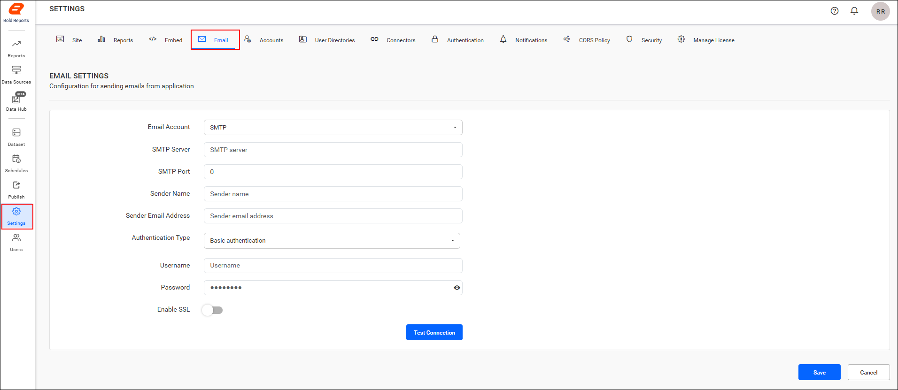
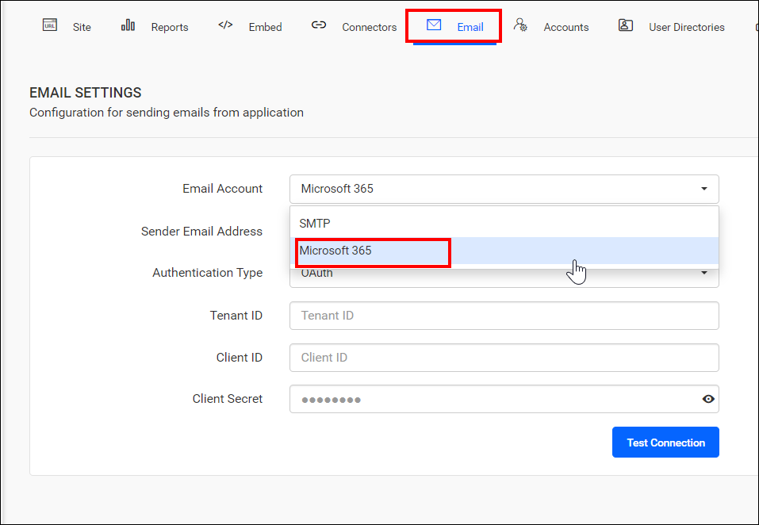
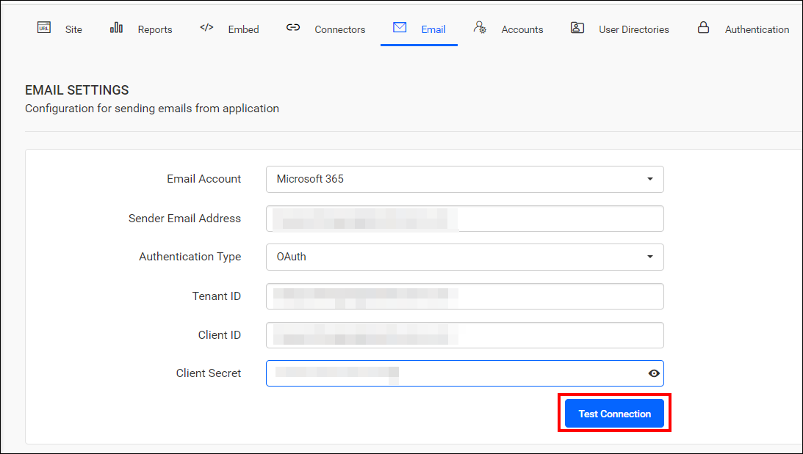
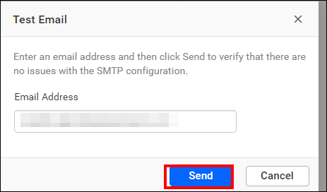
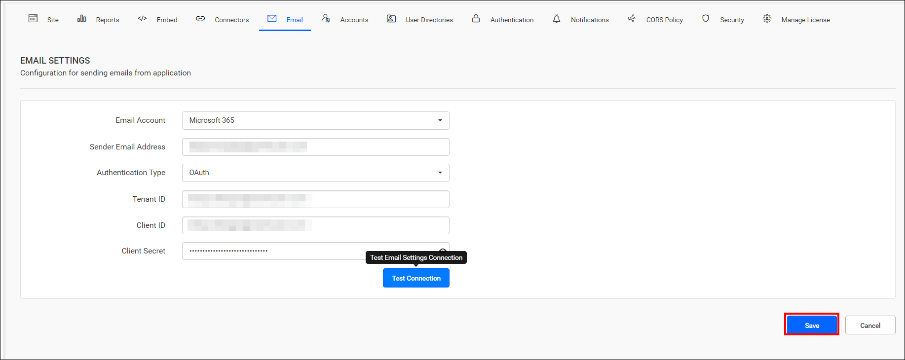
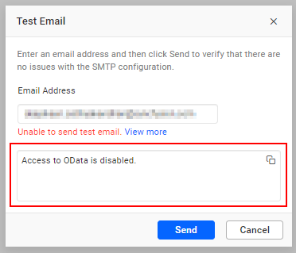

# Configure Microsoft Office 365 email with OAuth in Bold Reports® Report Server

To send emails from the Bold Reports® Report Server with a Microsoft Office 365 account, register an Azure app and enter its OAuth details in the email settings. This process requires creating an Azure app and granting it the necessary API permissions to access the email service. If needed, you can also restrict the app’s access to specific mailboxes.

## How do I register an Azure app for sending email?

To register an Azure app for the Bold Reports® Report Server with mail-sending API permissions and restrict access to specific mailboxes, see [Register an Azure app with mail-sending permissions](./../../../how-to/how-to-register-an-azure-app-with-mail-sending-permissions/).

## What Microsoft Office 365 details does Report Server need?

**The Bold Reports® Server requires the following Microsoft Office 365 account details to send email:**

<table>
<tr>
    <td>Sender Email Address</td>
    <td>The email address, which is displayed as the `From` email address in the recipient's email.</td>
</tr>
<tr>
    <td>Authentication Type</td>
    <td>The OAuth authentication is the default authentication type that requires the Tenant ID, Client ID, and Client Secret for authentication.</td>
</tr>
<tr>
    <td>Tenant ID</td>
    <td>A unique identifier specifies the Microsoft Entra ID (formerly Azure AD) instance that manages the app's permissions and roles, establishing its authorization context.</td>
</tr>
<tr>
    <td>Client ID</td>
    <td>A unique identifier for the Azure app, which is essential for requesting and validating tokens when accessing mail services.</td>
</tr>
<tr>
    <td>Client Secret</td>
    <td>A confidential key that proves the app’s identity, used along with the Client ID for app authentication and authorization.</td>
</tr>
</table>

## How do I configure Microsoft Office 365 account settings in Bold Reports®?

To configure a Microsoft Office 365 account in the Bold Reports® Report Server, follow these steps:

1. Go to **Settings** in the left-side panel of the Report Server and open the `Email` tab, as shown in the following image. You can also open this page directly with the URL `http://{domain}/reporting/site/site1/administration/e-mail-settings`.
    

2. Select `Microsoft 365` from the `Email Account` drop-down menu.
    

3. Enter your email address in the Sender Email Address field. This address must have the `Mail.Send` API permission for Microsoft Graph.

4. Keep OAuth, the default Authentication type. Enter the app's Tenant ID, Client ID, and Client Secret in the respective fields.

5. After you fill in the email connection details, test the settings with the `Test Connection` option.
    

6. Enter an email address and click `Send` to confirm that the Microsoft Office 365 configuration is correct.
    

7. Click `Save` to apply the settings.
    

### What happens if the sender email address does not have application access

If the sender email address in the Report Server configuration does not have app access, the test email fails with an `Access to OData disabled` error. Learn more about restricting app access to specific mailboxes in the [app access restriction guide](./../../../how-to/how-to-register-an-azure-app-with-mail-sending-permissions/#restricting-app-access-to-specific-mailboxes).

The following image shows the error that appears without app access.

## Frequently asked questions

### Which permission does the sender email address need?

The sender email address needs the `Mail.Send` API permission for Microsoft Graph.

### What does the Access to OData disabled error mean?

The error means the sender email address in the configuration does not have app access, so the test email fails.

## See also

* [Configure SMTP email settings](./../email-settings/)
* [Configure Amazon SES email](./../amazon-email-service/)
* [Email account settings overview](./../)
