# Configure IP allowlisting in Bold Reports® Report Server

IP allowlisting enables administrators to enforce IP-based access restrictions for the Bold Reports® application. You configure the specific IP addresses from which clients can access the application. This improves security by ensuring that only trusted and authorized users have access.

> **Warning:** Before enabling this feature, make sure to add the current user’s IP address, then save the changes.

## How does IP allowlisting work?

When IP allowlisting is enabled in Bold Reports®, it allows site access only to the listed IP addresses and restricts access for non-allowlisted IP addresses.

By default, IP allowlisting is disabled, and no restrictions are applied for rendering pages in the Bold Reports® application. The following image shows the default setting.
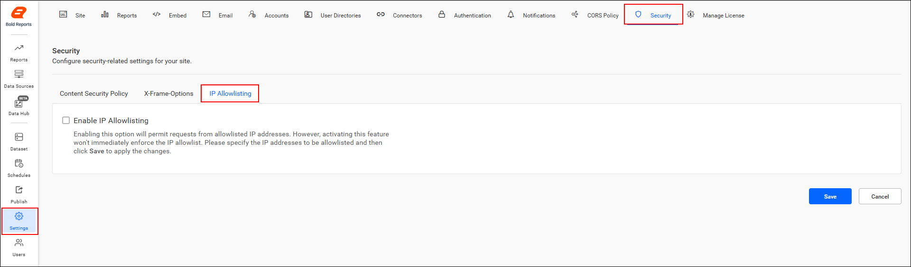

## How do I enable IP allowlisting?

Enabling IP allowlisting in Bold Reports® restricts application access to only those IP addresses that are explicitly authorized. The following image shows the option enabled.
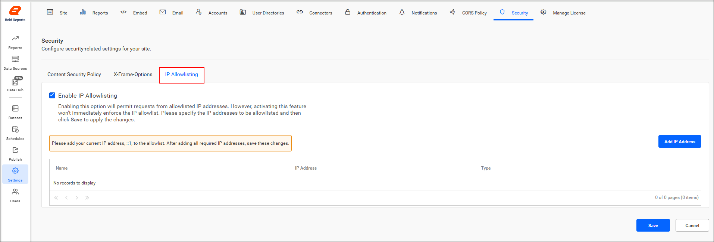

## How do I add an IP address?

To add an IP address to the Bold Reports® allowlist, click the **Add IP Address** button to open the **Add Rule** dialog. In the dialog, specify the rule details.

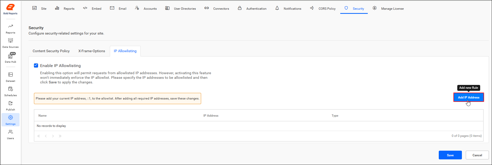

**Rule Name:** Specify a valid rule name. 
**IP Type:** Select the IP type, either IPv4 or IPv6. 
**IP Address:** Specify a valid IP address based on the chosen IP type. 
**Add Rule:** After providing all required details, click the Add Rule button. The values will then be displayed in the grid.

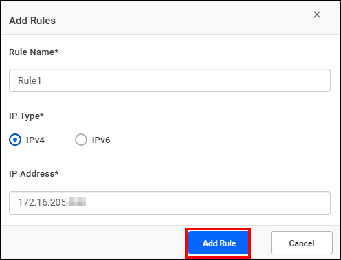
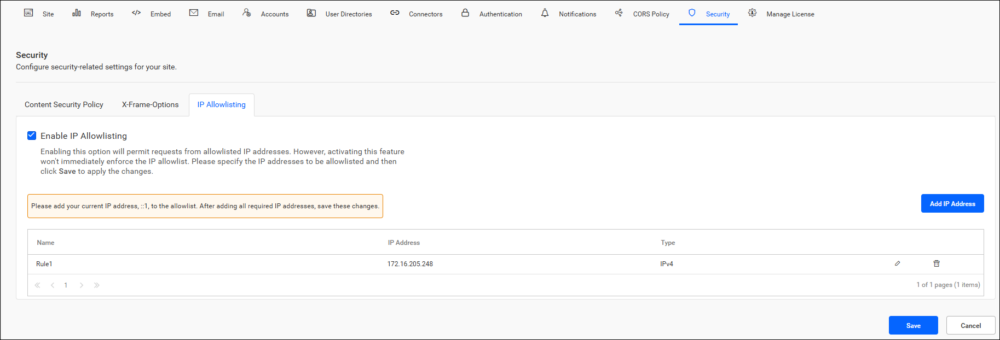

> **Note:** If the current user’s IP address is not listed in the grid, add it to the rule. The current user’s IP address will be displayed on the message banner.

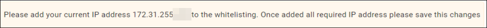

After you enter all the valid requirements for IP allowlisting, click **Save** to apply these configurations to the application.

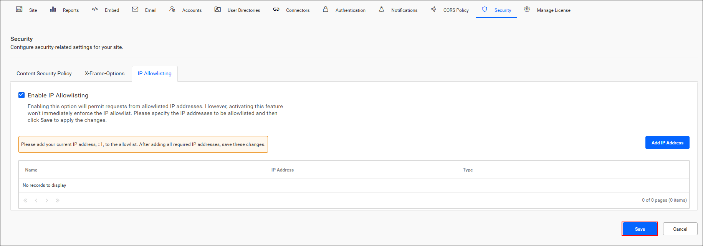

> **Note:** When you activate this feature, note that IP allowlisting will not take effect immediately. To ensure uninterrupted access, specify the IP addresses that need to be allowlisted and save the changes to apply these configurations. This proactive step helps prevent unintentional access restrictions and ensures smooth implementation of your security settings.

## How do I edit a rule?

To edit an existing IP allowlisting rule in Bold Reports®, click the **Edit** icon in the grid. The **Edit Rules** dialog opens.

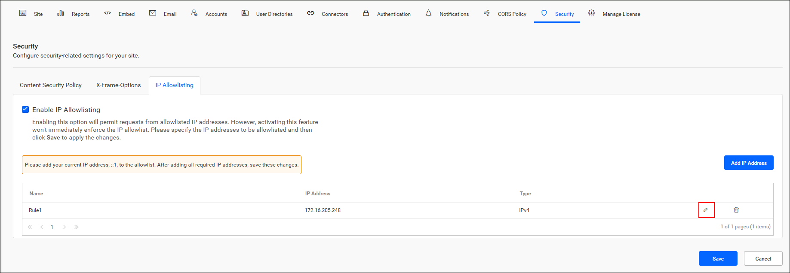

Update the rule details as needed in the Edit Rule dialog. After you make your edits, save the changes.

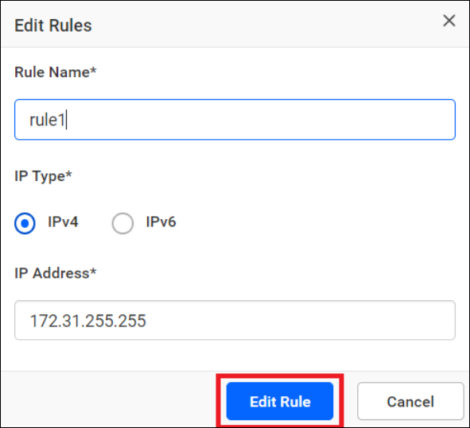

## How do I delete a rule?

To remove a rule from the Bold Reports® allowlist, click the **Delete** icon. After the rule is deleted, save the changes.

> **Important:** If the user deletes the current user’s IP address, the changes will not be saved when attempting to save the settings.

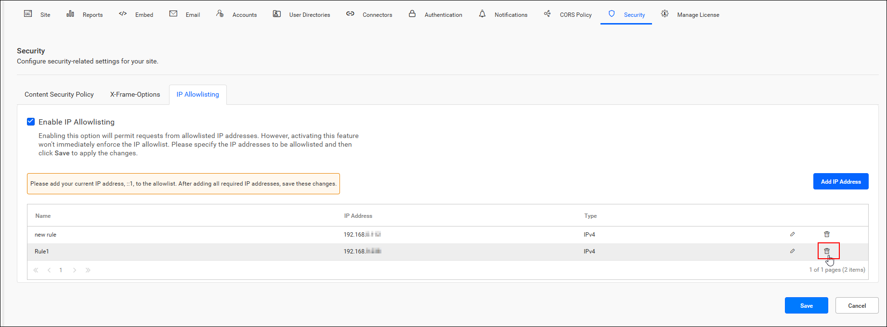

## What happens when a blocked IP address tries to access the application?

If an unauthorized IP address tries to access the Bold Reports® application, it shows an **Access Denied** page. The page indicates that the IP address is not permitted to view or interact with the application.

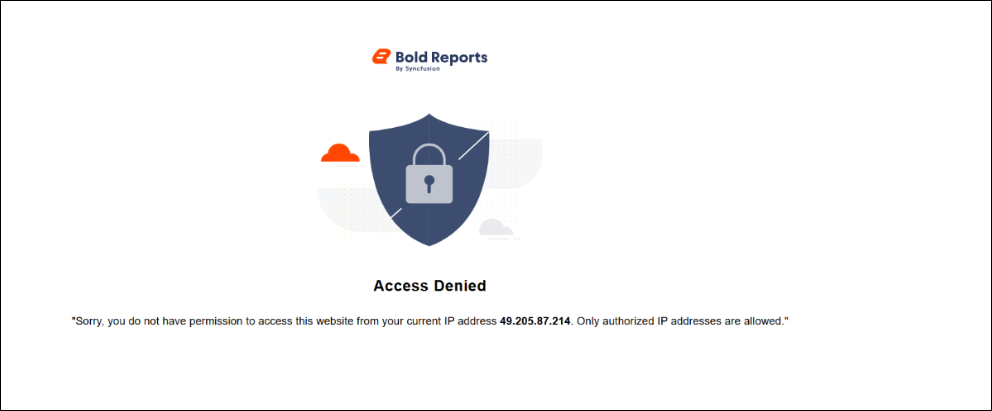

## Frequently asked questions

### Is IP allowlisting enabled by default?

No. IP allowlisting is disabled by default, and no restrictions are applied for rendering pages in the Bold Reports® application.

### Which IP address types can I allowlist?

You can allowlist IPv4 or IPv6 addresses. Select the IP type in the **Add Rule** dialog.

### Can I delete my own IP address from the allowlist?

No. If you delete the current user’s IP address, the changes are not saved when you try to save the settings.

## See also

* [Report Server settings overview](./../)
* [Configure JWT authentication settings](./../json-web-token-settings/)
