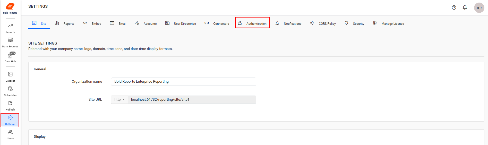
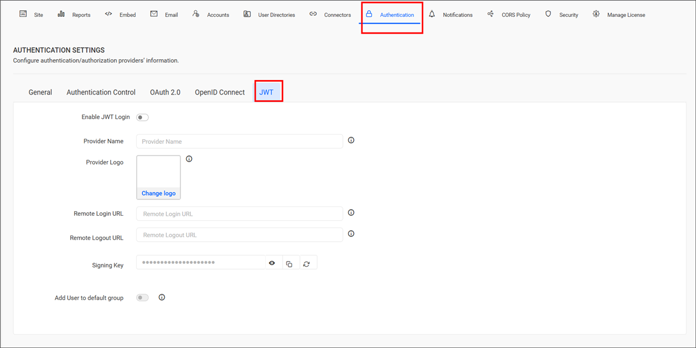

# Configure JWT authentication in Bold Reports® Report Server

You can configure the Bold Reports® application to support JSON Web Token (JWT) authentication. Users then access the Bold Reports® application through a trusted token that an external authentication provider issues and the application validates.

## What do I need before configuring JWT authentication?

To configure JWT authentication in Bold Reports® Report Server, you need the following:

1. An external authentication application capable of generating JSON Web Token (JWT) tokens.

## How do I configure JWT authentication in Bold Reports®?

To configure JWT authentication in the Bold Reports® Report Server, follow these steps:

1. Click the **Settings** option in the left-side panel of the Report Server.

2. Go to the `Authentication` tab and select `JWT`, as shown in the following images.
    

    

3. Provide the following details in the JWT Authentication settings of Bold Reports® application:
<table>
<tr>
    <td>
        Provider Name
    </td>
    <td>
        It represents the name of the JWT authentication provider configured in the application.
    </td>
</tr>
<tr>
    <td>
        Provider Logo
    </td>
    <td>
        It represents the logo of the authentication provider to be displayed on the login page.
    </td>
</tr>
<tr>
    <td>
        Remote Login URL
    </td>
    <td>
        It specifies the endpoint of the external authentication application that issues JSON Web Tokens.
    </td>
</tr>
<tr>
    <td>
        Remote Logout URL
    </td>
    <td>
        It specifies the endpoint of the external authentication application that handles user logout from the Bold Reports® application.
    </td>
</tr>
<tr>
    <td>
        Add User to Default Group
    </td>
    <td>
        Automatically adds authenticated JWT users to the configured default group during login. When enabled, users are assigned to the default group after successful authentication.
    </td>
</tr>
</table>

> Note: After the JWT settings are saved, the application automatically generates a signing key. Use this signing key in the external authentication application when signing JWT tokens.

## Frequently asked questions

### Where do I get the signing key for JWT tokens?

Bold Reports® automatically generates a signing key after you save the JWT settings. Use this key in your external authentication application when signing JWT tokens.

### Can JWT users be added to a group automatically?

Yes. When **Add User to Default Group** is enabled, authenticated JWT users are assigned to the configured default group after successful authentication.

## See also

* [Configure OAuth 2.0 settings](./../oauth-settings/)
* [Configure OpenID Connect settings](./../open-id-connect-settings/)
* [Report Server settings overview](./../)
