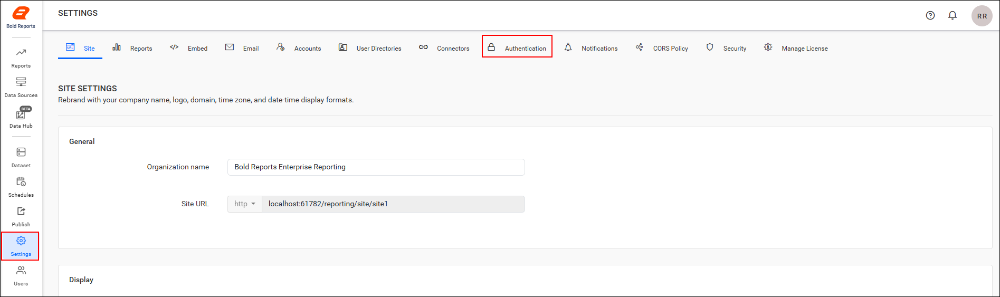
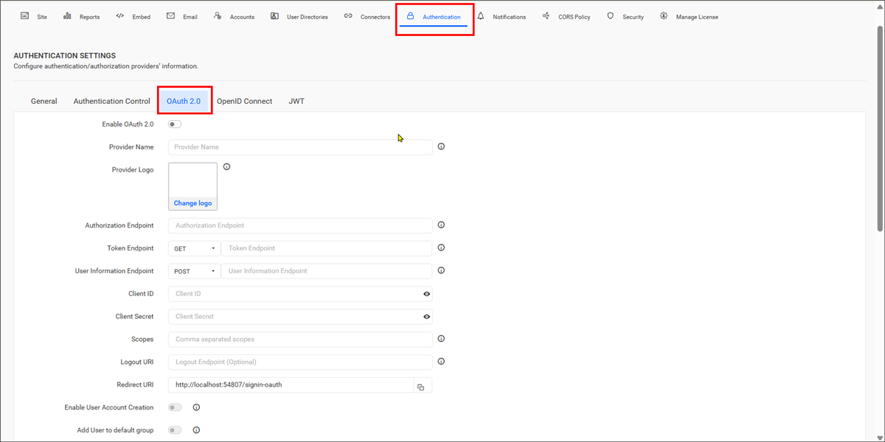

# Configure OAuth 2.0 SSO in Bold Reports® Report Server

You can configure the Bold Reports® application to support OAuth 2.0 for Single Sign-On (SSO). Users then log in directly to the Bold Reports® application after they authenticate with OAuth 2.0.

## What do I need before configuring OAuth 2.0?

To configure OAuth 2.0 in Bold Reports® Report Server, you need the following:

1. An account with an OAuth 2.0 provider.

2. Register the Bold Reports® application with the OAuth 2.0 provider.

## How do I configure OAuth 2.0 in Bold Reports®?

To configure the OAuth 2.0 connection details in the Bold Reports® Report Server, follow these steps:

1. Click the **Settings** option in the left-side panel of the Report Server.

2. Go to the `Authentication` tab and select `OAuth 2.0`, as shown in the following images.
    
    

3. Provide the following details in the OAuth 2.0 settings of Bold Reports® application:

<table>
<tr>
    <td>
        Provider Name
    </td>
    <td>
        It represents the name of the authentication provider to be displayed on the login page.
    </td>
</tr>
<tr>
    <td>
        Provider Logo
    </td>
    <td>
        It represents the logo of the authentication provider to be displayed on the login page.
    </td>
</tr>
<tr>
    <td>
        Authorization Endpoint
    </td>
    <td>
        This is the endpoint in the provider used to authorize the user.
    </td>
</tr>
    <tr>
    <td>
        Token Endpoint Method
    </td>
    <td>
        It represents the request type to access the token endpoint.
    </td>
</tr>
</tr>
    <tr>
    <td>
        Token Endpoint
    </td>
    <td>
        It is the endpoint in the provider responsible for generating the token.
    </td>
</tr>
</tr>
    <tr>
    <td>
        User Information Endpoint Method
    </td>
    <td>
        It is the endpoint in the provider used to retrieve the user details.
    </td>
</tr>
</tr>
    <tr>
    <td>
        User Information Endpoint
    </td>
    <td>
        It represents the request type used to access the user information endpoint.
    </td>
</tr>
</tr>
    <tr>
    <td>
        Client ID
    </td>
    <td>
        It is a unique identifier provided to each application during registration with the providers.
    </td>
</tr>
</tr>
    <tr>
    <td>
        Client Secret
    </td>
    <td>
        It is a secret key used to authorize the applications.
    </td>
</tr>
</tr>
    <tr>
    <td>
        Scopes
    </td>
    <td>
        It is a comma-separated list of identifiers that specifies the access privileges being requested from the provider.
    </td>
</tr>
</tr>
    <tr>
    <td>
        Logout URI
    </td>
    <td>
        It is an endpoint that logs out the third-party provider.
    </td>
</tr>
</tr>
    <tr>
    <td>
        Email
    </td>
    <td>
        This should be the email address of an admin account of the provider.
    </td>
</tr>
<tr>
    <td>
        Enable User Account Creation
    </td>
    <td>
        Controls whether users are automatically created in the application when signing in through OAuth 2.0. When enabled, users are added automatically and can access the application. When disabled, users are not added automatically, and access is denied unless the user is added manually.
    </td>
</tr>
<tr>
    <td>
        Add User to Default Group
    </td>
    <td>
        Automatically adds authenticated OAuth 2.0 users to the configured default group during login. When enabled, users are assigned to the default group after successful authentication.
    </td>
</tr>
</table>

## Group Claims Authentication

Group claims authentication in Bold Reports® Report Server maps users and groups automatically, based on the group claim received in the authentication token. The claims are typically represented as a JSON object containing key-value pairs for each claim. Provide the appropriate JSON key to identify the group claim value.

<table>
    <tr>
        <td>Enable User and Group Mapping </td>
        <td>When enabled, the system fetches group claim values from the token and dynamically maps users to one or more groups during login.</td>
    </tr>
    <tr>
        <td>Un-map Existing Groups of User and map to New Group </td>
        <td>When enabled, all previously assigned groups for the user are removed, and the user is mapped only to the groups specified in the claim.</td>
    </tr>
    <tr>
        <td>Group Claim Name</td>
        <td>Enter the claim name that contains the group identifiers. Users will be mapped only if the group names in the claim match existing groups in the site.</td>
    </tr>
</table>

The following image shows the group claims settings.

   

> **Note:** For more information, see the [OAuth 2.0 authentication](./../../authentication/single-sign-on/oauth-2.0/) documentation.

## Frequently asked questions

### What happens when Enable User Account Creation is disabled?

Users who sign in through OAuth 2.0 are not added automatically, and access is denied unless the user is added manually.

### How are users mapped to groups with group claims?

When **Enable User and Group Mapping** is on, Report Server fetches group claim values from the token and maps users to groups during login. Users are mapped only if the group names in the claim match existing groups in the site.

## See also

* [Configure OpenID Connect settings](./../open-id-connect-settings/)
* [Configure JWT authentication settings](./../json-web-token-settings/)
* [OAuth 2.0 authentication](./../../authentication/single-sign-on/oauth-2.0/)
