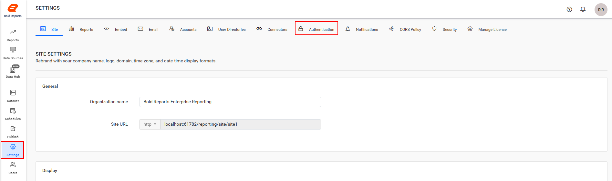
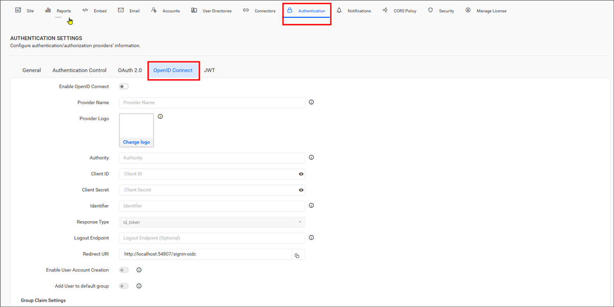
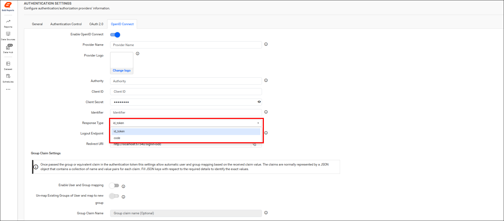

# Configure OpenID Connect SSO in Bold Reports® Report Server

You can configure the Bold Reports® application to support OpenID Connect for Single Sign-On (SSO). Users then log in directly to the Bold Reports® application after they authenticate with OpenID Connect.

## What do I need before configuring OpenID Connect?

To configure OpenID Connect in Bold Reports® Report Server, you need the following:

1. An account with an OpenID Connect provider.

2. Register the Bold Reports® application in the OpenID Connect provider.

## How do I configure OpenID Connect in Bold Reports®?

To configure OpenID Connect in the Bold Reports® Report Server, follow these steps:

1. Click the **Settings** option in the left-side panel of the Report Server.

2. Go to the `Authentication` tab and select `OpenID Connect`, as shown in the following images.
    

    

3. Provide the following details in the OpenID Connect settings of Bold Reports® application:
<table>
<tr>
    <td>
        Provider Name
    </td>
    <td>
        It represents the name of the authentication provider to be displayed on the login page.
    </td>
</tr>
<tr>
    <td>
        Provider Logo
    </td>
    <td>
        It represents the logo of the authentication provider to be displayed on the login page.
    </td>
</tr>
<tr>
    <td>
        Authority
    </td>
    <td>
        It is the instance created within the provider for the user.
    </td>
</tr>
<tr>
    <td>
        Client ID
    </td>
    <td>
        It is a unique identifier provided to each of the applications while registering with the providers.
    </td>
</tr>
<tr>
    <td>
        Client Secret
    </td>
    <td>
        It is a secret key used to authorize the applications.
    </td>
</tr>
<tr>
    <td>
        Identifier
    </td>
    <td>
        It is the property name that stores the email address of the user in the deserialized ID token.
    </td>
</tr>
<tr>
    <td>
        Logout Endpoint
    </td>
    <td>
        It is an endpoint that logs out the third-party provider.
    </td>
</tr>
<tr>
    <td>
        Enable User Account Creation
    </td>
    <td>
        Controls whether users are automatically created in the application when signing in through OpenID Connect. When enabled, users are added automatically and can access the application. When disabled, users are not added automatically, and access is denied unless the user is added manually.
    </td>
</tr>
<tr>
    <td>
        Add User to Default Group
    </td>
    <td>
        Automatically adds authenticated OpenID users to the configured default group during login. When enabled, users are assigned to the default group after successful authentication.
    </td>
</tr>
</table>

>Note: While configuring OpenID Connect, you need to choose the appropriate **Response Type** either `token-id` or `code` for the Group Claims settings.

The following image shows the **Response Type** option.

## Group Claims Authentication

Group claims authentication in Bold Reports® Report Server maps users and groups automatically, based on the group claim received in the authentication token. The claims are typically represented as a JSON object containing key-value pairs for each claim. Provide the appropriate JSON key to identify the group claim value.

<table>
    <tr>
        <td>Enable User and Group Mapping </td>
        <td>When enabled, the system fetches group claim values from the token and dynamically maps users to one or more groups during login.</td>
    </tr>
    <tr>
        <td>Un-map Existing Groups of User and map to New Group </td>
        <td>When enabled, all previously assigned groups for the user are removed, and the user is mapped only to the groups specified in the claim.</td>
    </tr>
    <tr>
        <td>Group Claim Name</td>
        <td>Enter the claim name that contains the group identifiers. Users will be mapped only if the group names in the claim match existing groups in the site.</td>
    </tr>
</table>

The following image shows the group claims settings.

   

> **Note:** For more information, see the [OpenID Connect authentication](./../../authentication/single-sign-on/openid-connect/) documentation.

## Frequently asked questions

### Which Response Type should I choose for group claims?

Choose the appropriate **Response Type**, either `token-id` or `code`, for the Group Claims settings while you configure OpenID Connect.

### What does the Identifier field store?

The Identifier is the property name that stores the email address of the user in the deserialized ID token.

## See also

* [Configure OAuth 2.0 settings](./../oauth-settings/)
* [Configure JWT authentication settings](./../json-web-token-settings/)
* [OpenID Connect authentication](./../../authentication/single-sign-on/openid-connect/)
