# Report settings in Bold Reports® Report Server

Report settings in the Bold Reports® Report Server let administrators control public reports, sample data in the Web Report Designer, and deployment reports for site deployments.

## Mark Reports as Public - Allow/Restrict Switch

In the Bold Reports® Report Server, administrators can allow or restrict marking reports as public from the Reports settings page. Administrators control whether users can designate reports as public by enabling the **Mark reports as public** option.

## What happens when public reports are allowed or restricted?

When the administrator allows public reports in Bold Reports® Report Server, users can mark reports as public, and other users can view these public reports. When the administrator restricts it, users cannot mark reports as public, and those reports are not visible to other users.

## How is public report access controlled by default?

The **Mark report as public** option in Bold Reports® Report Server is disabled by default on the Reports settings page.
    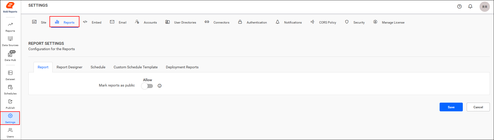

* When the option is disabled and an administrator chooses the `Make Public` option from the context menu of a report, the following message appears:

    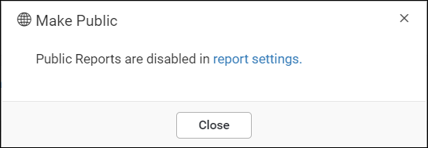

* When the option is disabled and a user chooses the `Make Public` option from the context menu of a report, the following message appears:

    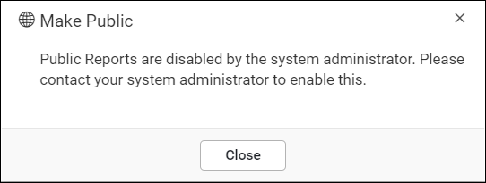

### How do I enable the Mark reports as public option?

To make reports accessible to anonymous users in Bold Reports® Report Server, follow these steps:

1. Enable the `Mark reports as public` option and save the changes in the reports settings page.
    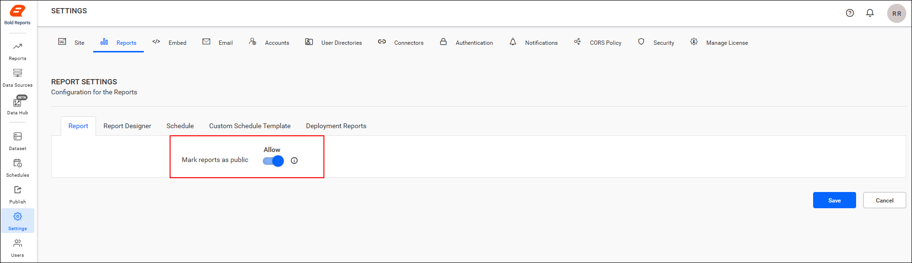

2. Click the `Make Public` option from the context menu of the report.
    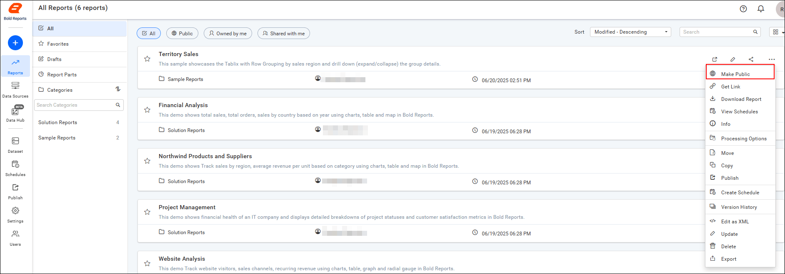

3. Click `Make Public` in the confirmation dialog box. The report is marked as public and is displayed on the Public page.
    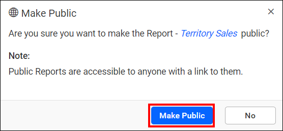
    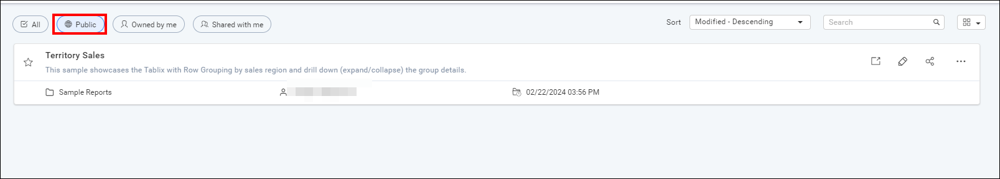

### How do I disable the Mark reports as public option?

To restrict public reports in Bold Reports® Report Server, follow this step:

1. Disable the `Mark reports as public` option and save the changes in the reports settings page.

    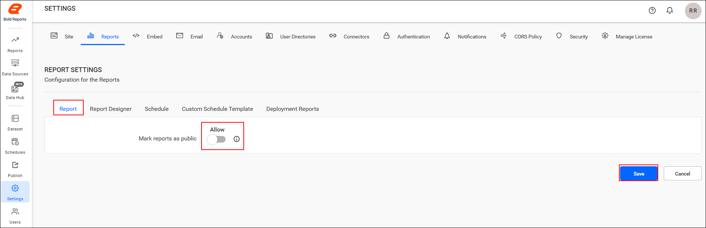

After you restrict the `Mark reports as public` option, the **Public Reports** tab shows a message:

* If the administrator clicks the **Public Reports** tab, the following message is displayed:
    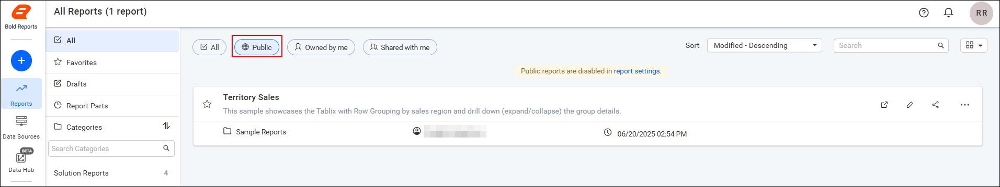

* If the end user clicks the **Public Reports** tab, the following message is shown:
    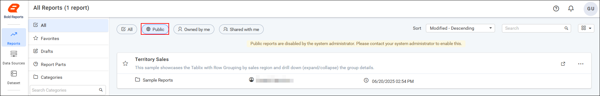

> **Note:** Learn more about Public Reports in the <a href="./../../../designer-guide/manage-content/reports/public-report/">Public Reports Guide</a>.

## Web Report Designer

The **Show Sample Data** option in Bold Reports® report settings controls whether the Web Report Designer can import sample reports.

* The **Show Sample Data** option is enabled by default in the report settings.
    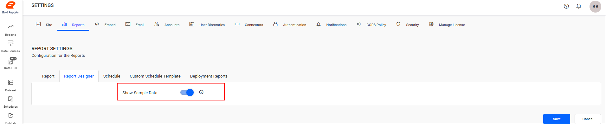

* When enabled, the Import Sample Data option is visible in the Web Report Designer, so you can import sample reports directly on the designer page.
    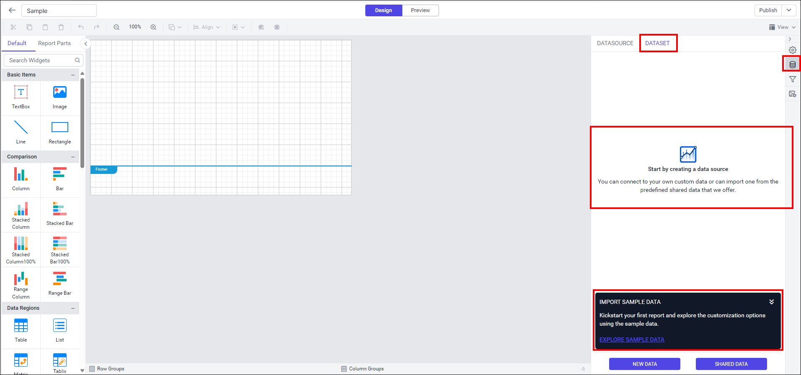

* Disable this option and save the changes to hide the Import Sample Data option in the Web Report Designer. You then cannot import the sample reports directly on the designer page.
    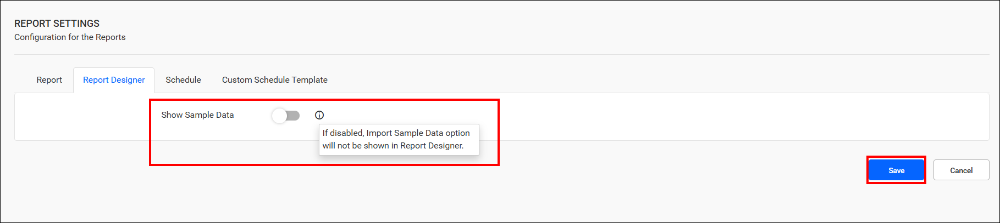
    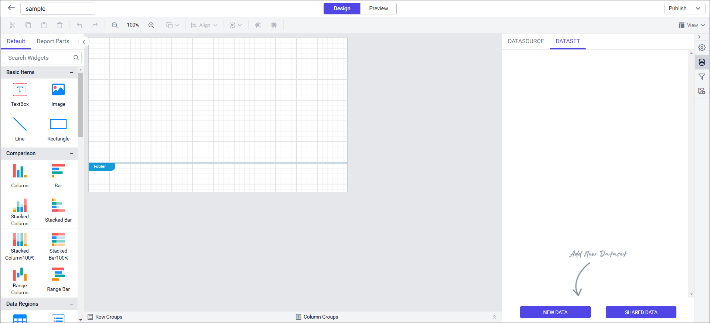

## Deployment Reports:

Deployment reports in Bold Reports® Report Server publish reports from the master site to site deployments.

### How do I publish reports to site deployments?

Deployment Reports let you create and manage reports centrally in the master site and automatically publish them to all associated site deployments.

#### How do I add a deployment report?

To add a report for deployment in Report Server, follow these steps:

1. Click **Add Report** in the Deployment Reports section.
    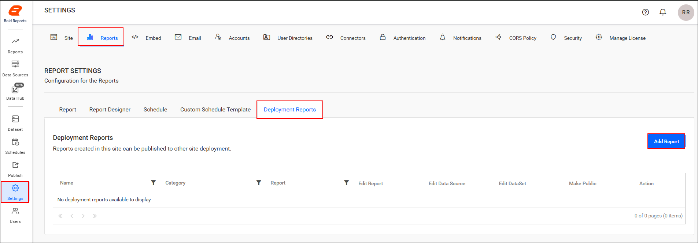

2. The Add Deployment Report dialog appears.

3. Enter the required details and click **Add**.
    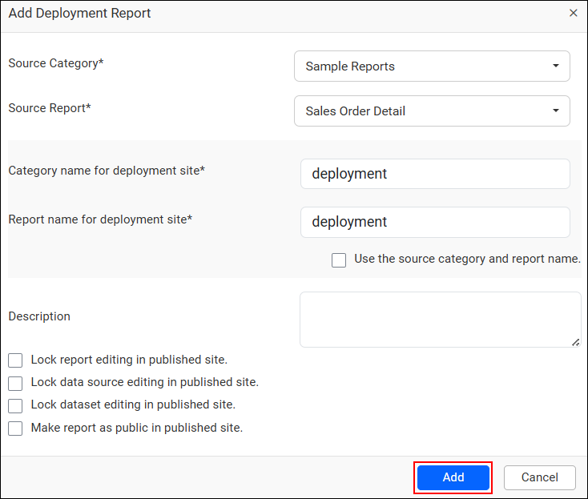

After the report is added, it appears in the Deployment Grid, and a confirmation message is displayed: **The report has been added successfully for deployment**.
    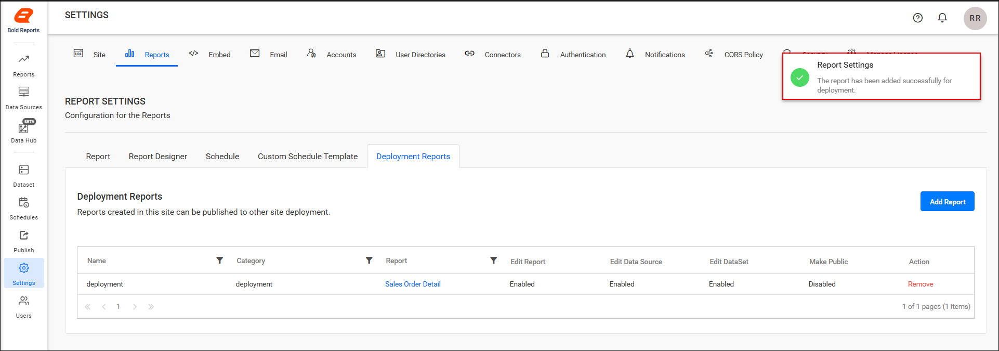

#### What happens when a new site is created?

When a new site is created in Report Server, any reports already present in the Deployment Grid are automatically published to the newly deployed site.
    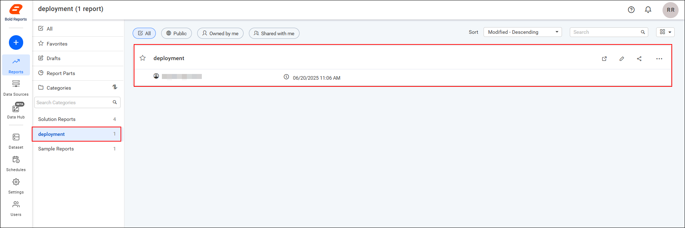

## Frequently asked questions

### Is the Mark reports as public option enabled by default?

No. The **Mark report as public** option is disabled by default on the Reports settings page.

### Do existing deployment reports reach new sites?

Yes. When a new site is created, any reports already in the Deployment Grid are automatically published to the newly deployed site.

## See also

* [Report Server settings overview](./../)
* [Create a site](https://help.boldreports.com/enterprise-reporting/administrator-guide/manage-sites/create-site/)
* [Configure email account settings](https://help.boldreports.com/enterprise-reporting/administrator-guide/manage-app-settings/email-account-settings/)
