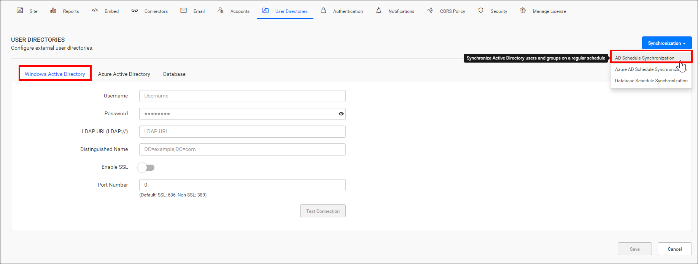
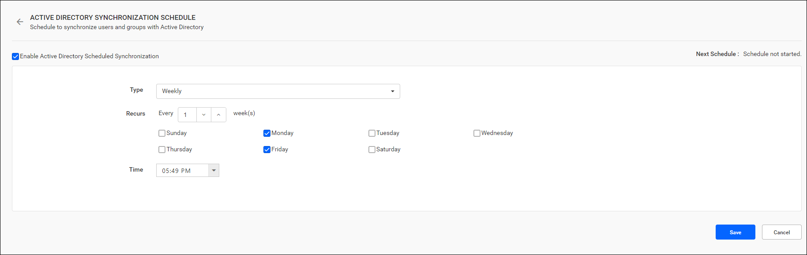

# Schedule Active Directory synchronization in Bold Reports®

You can schedule Bold Reports® On-Premises Edition to synchronize users and groups from Active Directory on a recurring basis.

## What do I need before scheduling Active Directory synchronization?

Before you schedule Active Directory synchronization for users and groups in Bold Reports® On-Premises Edition, complete the following steps:

1. Configure the [Active Directory Settings](./../../active-directory/).
2. To synchronize Active Directory users, import them from Active Directory to Bold Reports® On-Premises Edition using the [Import Active Directory Users](./../../../manage-users/users/import-users/import-active-directory-users/).
3. For synchronizing the Active Directory groups, import the groups from Active Directory to Bold Reports® On-Premises Edition using the [Import Active Directory Groups](./../../../manage-users/groups/import-groups/import-active-directory-groups/).

## How does the Active Directory synchronization schedule work?

The following images show the Windows AD option and the Active Directory synchronization schedule in Bold Reports® Report Server.

* You can synchronize users and groups from Active Directory on a schedule to keep their details up to date in the Report Server.

* Active Directory synchronization facilitates synchronization for the following entities:
    1. Users
    2. Groups

* During synchronization, users will be added to or removed from the Bold Reports® Server depending on their presence in the specified distinguished name within Active Directory.

* For more details on synchronizing users and groups from Active Directory with the Report Server, see the following links:
    * [Synchronize Active Directory Users](./../../../manage-users/users/synchronize/synchronize-active-directory-users/)
    * [Synchronize Active Directory Groups](./../../../manage-users/groups/synchronize/synchronize-active-directory-groups/)

## Who gets email notifications about synchronization?

After the scheduled synchronization recurrence is completed, Bold Reports® notifies members of the **System Administrator** group by email about the synchronization status.

## How do I enable or disable the synchronization schedule?

You can enable or disable the Bold Reports® synchronization schedule at any time with the checkbox at the top.

## Frequently asked questions

### Which entities does Active Directory synchronization update?

Active Directory synchronization updates users and groups.

### Are users removed during synchronization?

Yes. Users are added to or removed from the Bold Reports® Server depending on their presence in the specified distinguished name within Active Directory.

## See also

* [Microsoft Entra ID Synchronization Schedule](./../azure-active-directory-synchronization-schedule/)
* [Database Synchronization Schedule](./../database-synchronization-schedule/)
* [Synchronization schedule overview](./../)
