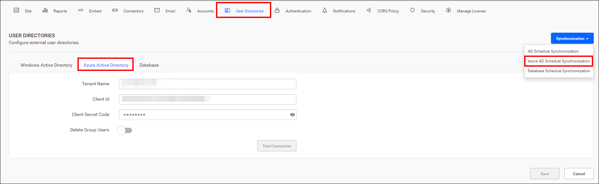
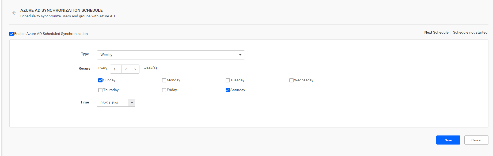

# Schedule Microsoft Entra ID synchronization in Bold Reports®

You can schedule Bold Reports® On-Premises Edition to synchronize users and groups from Microsoft Entra ID (formerly Azure Active Directory) on a recurring basis.

## What do I need before scheduling Microsoft Entra ID synchronization?

Before you set up the synchronization schedule for Microsoft Entra ID users and groups in Bold Reports®, complete the following steps:

1. Configure [Microsoft Entra ID Settings](./../../azure-active-directory/).
2. To synchronize Microsoft Entra ID users, import them into Bold Reports® On-Premises Edition. See [Import Microsoft Entra ID Users](./../../../manage-users/users/import-users/import-azure-active-directory-users/).
3. To synchronize Microsoft Entra ID groups, import them into Bold Reports® On-Premises Edition. See [Import Microsoft Entra ID Groups](./../../../manage-users/groups/import-groups/import-azure-active-directory-groups/).

## How does the Microsoft Entra ID synchronization schedule work?

The following images show the Microsoft Entra ID option and its synchronization schedule in Bold Reports® Report Server.

* You can synchronize users and groups from Microsoft Entra ID on a schedule to keep their details up to date in Bold Reports®.

* For more details on synchronizing users and groups from Microsoft Entra ID with the Report Server, see the following links:
    * [Synchronize Microsoft Entra ID Users](./../../../manage-users/users/synchronize/synchronize-azure-active-directory-users/)
    * [Synchronize Microsoft Entra ID Groups](./../../../manage-users/groups/synchronize/synchronize-azure-active-directory-groups/)

## Who gets email notifications about synchronization?

After a scheduled synchronization recurrence is completed, Bold Reports® sends users in the **System Administrator** group email notifications about the synchronization status.

## How do I enable or disable the synchronization schedule?

You can enable or disable the Bold Reports® synchronization schedule at any time with the checkbox at the top.

## Frequently asked questions

### Do I need to import Microsoft Entra ID users before synchronizing them?

Yes. Import Microsoft Entra ID users and groups into Bold Reports® On-Premises Edition before you set up the synchronization schedule.

## See also

* [Active Directory Synchronization Schedule](./../active-directory-synchronization-schedule/)
* [Database Synchronization Schedule](./../database-synchronization-schedule/)
* [Synchronization schedule overview](./../)
