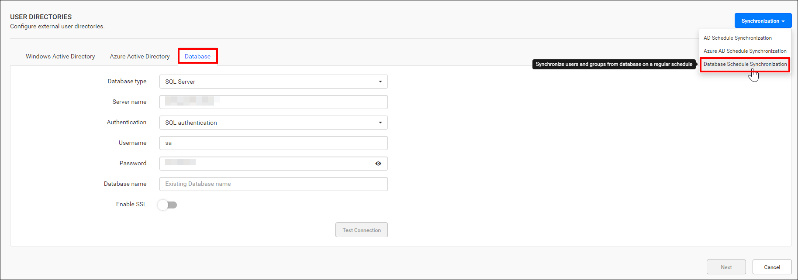
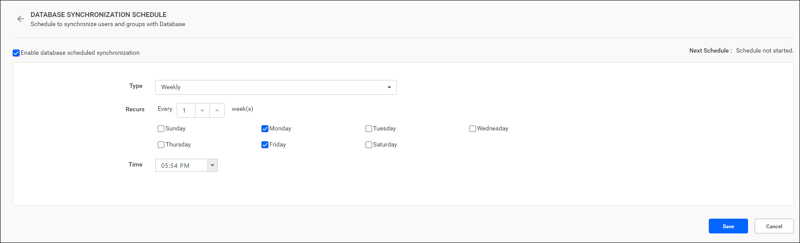

# Schedule database user synchronization in Bold Reports®

You can schedule Bold Reports® On-Premises Edition to synchronize users imported from an existing database on a recurring basis.

## What do I need before scheduling database user synchronization?

Before you schedule database user synchronization in Bold Reports® On-Premises Edition, configure the database settings and import the users.

> **Note:** Make sure to configure the [database settings](./../../database-settings/) before initiating the synchronization process for existing database users.

To synchronize existing database users, import users from the database to Bold Reports® On-Premises Edition. See [Import Database Users](./../../../manage-users/users/import-users/import-users-from-database/).

## How does the database user synchronization schedule work?

The following images show the Database option and the imported database users synchronization schedule in Bold Reports® Report Server.

* You can synchronize users from the existing database on a schedule to keep their details up to date in Bold Reports®.

* For more details on synchronizing users from the existing database with the Bold Reports® Report Server, see the following link:
    * [Synchronize Imported Database Users](./../../../manage-users/users/synchronize/synchronize-existing-database-users/)

## Who gets email notifications about synchronization?

After a scheduled recurrence of synchronization is completed, Bold Reports® sends users in the **System Administrator** group email notifications about the synchronization status.

## How do I enable or disable the synchronization schedule?

You can enable or disable the Bold Reports® synchronization schedule at any time with the checkbox at the top.

## Frequently asked questions

### What must I configure before synchronizing database users?

Configure the database settings and import the users from the database to Bold Reports® On-Premises Edition first.

## See also

* [Active Directory Synchronization Schedule](./../active-directory-synchronization-schedule/)
* [Microsoft Entra ID Synchronization Schedule](./../azure-active-directory-synchronization-schedule/)
* [Synchronization schedule overview](./../)
