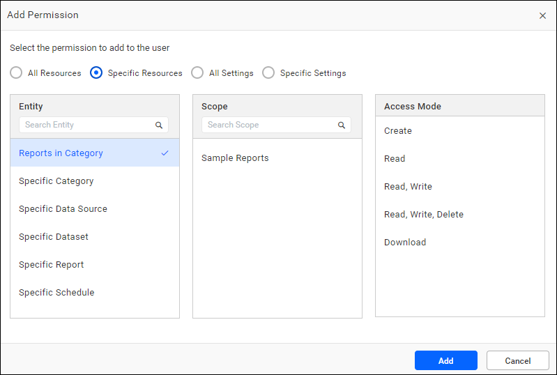
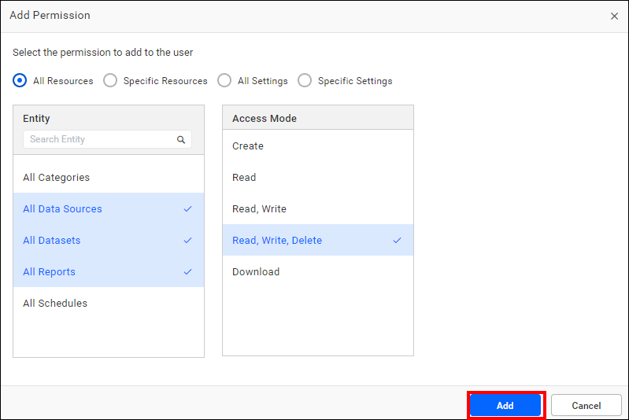
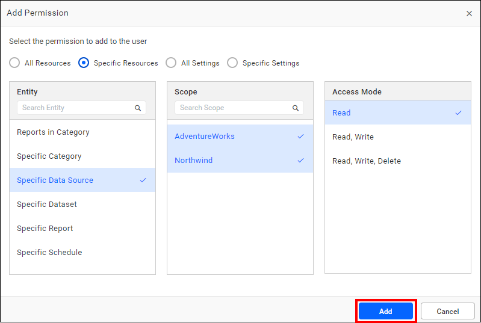
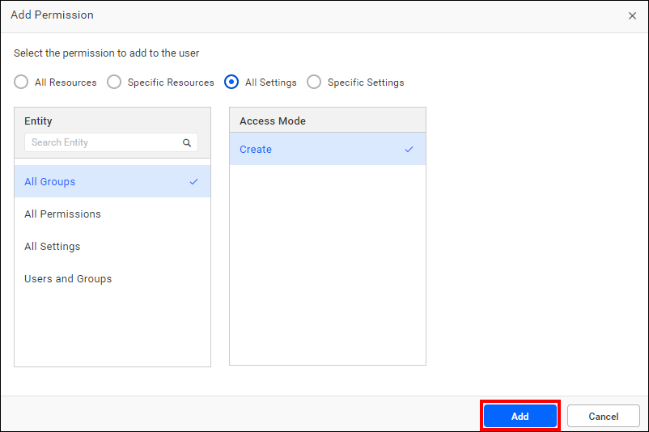
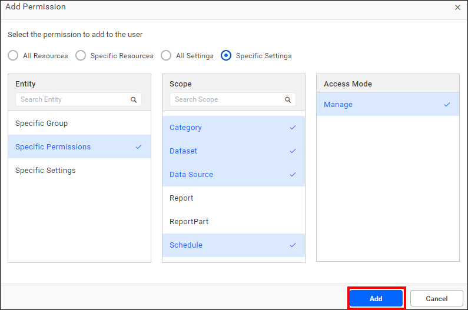

# Manage permissions in Bold Reports® Report Server

Bold Reports® permissions combine an entity, a scope, and an access mode, and you can add them to users and groups.

## Who can manage permissions?

In Bold Reports® Report Server, the following users can manage permissions:

* All permissions are available to users in the `System Administrator` group or to those designated with the permission entity of `All Permissions`. Additionally, users with the permission entity of **Specific Permissions** for corresponding resources, such as Category, Data Source, Dataset, Report and Schedule, can manage specific permissions related to those resources.

* You can add permissions directly to both users and groups through the [Add Permission](./../manage-permissions/#add-permissions) dialog.
    

## How are permissions structured?

Bold Reports® permissions are classified in the following structure:
* Entity – Scope – Access Mode

## Entity

The entity in a Bold Reports® permission defines which resources or settings the permission covers.

| Entity      | Description                                                 |
| --------        | -----------------------                                          |
| All Categories      | Provides permission to access **all categories** with the chosen access mode.|
| All Data Sources    | Provides permission to access **all data sources** with the chosen access mode.|
| All Datasets        | Provides permission to access **all datasets** with the chosen access mode.|
| All Reports         | Provides permission to access **all the reports** with the chosen access mode.|
| All Schedules       | Provides permission to access **all schedules** with the chosen access mode.|
| All Groups          | Provides permission to **create new groups**, except for importing groups from third parties.|
| All Permissions     | Users with the Manage Access mode can delegate permissions for all resources listed on the users and groups management page. However, access to permissions is granted only if the user possesses specific Group permission or the Create and Manage permission for Users and Groups.|
| All Settings        | Provides permission to access **all settings** pages with the Manage access mode.|
| Users and Groups    | Grants access to user and group management with the **Create and Manage** access mode, excluding the `Manage Permission` page. To access this page, `delegate permission` is required.|
| Reports in Category | Provides permission to access **reports in a specific category** with a chosen access mode.|
| Specific Category   | Provides permission to access a **specific category** with the chosen access mode.|
| Specific Data Source| Provides permission to access a **specific data source** with the chosen access mode.|
| Specific Dataset| Provides permission to access a **specific dataset** with the chosen access mode.|
| Specific Report     | Provides permission to access a **specific report** with the chosen access mode.|
| Specific Schedule   | Provides permission to access a **specific schedule** with the chosen access mode.|
| Specific Group      | Permission is granted to access **specific groups** using the Manage access mode, with the exception of the Manage Permission page. To access this page, `delegate permission` is required.|
| Specific Permissions| Provides permission with the Manage Access mode to delegate permissions for specific resources on the users and groups management page. Access to permissions will be granted only if the user has specific group permission or the Create and Manage permission for Users and Groups.|
| Specific Settings   | Provides permission to access **specific settings** pages with the Manage access mode.|

## Scope

The scope in a Bold Reports® permission selects the specific item. The scope selection is limited to **Specific Resources** and **Specific Settings** types.

## Access Mode

The access mode in a Bold Reports® permission defines what the user or group can do with the chosen entity.

| Entity      | Description                                                 |
| --------        | -----------------------                                          |
| Read            | Provides **read permission** for the chosen entity.|
| Read and Write  | Provides **read and write permission** for the chosen entity.|
| Read, Write, and Delete | Provides **read, write, and delete permission** for the chosen entity.|
| Download | Provides **download permission** for the chosen entity.|
| Create   | Provides **permission to create** the chosen entity.|
| Manage   | Provides **permission to manage** the chosen entity.|
| Create and Manage| Provides **permission to create and manage users and groups**.|

## Add permissions

The Add Permission dialog in Bold Reports® Report Server is divided into four sections:

* All Resources
* Specific Resources
* All Settings
* Specific Settings

> **NOTE:** It is not possible to select multiple access modes.

### All Resources

To assign multiple permissions for all resources, select multiple resource entities and one access mode.

### Specific Resources

To assign multiple permissions for specific resources, select multiple scopes, one entity, and one access mode.

### All Settings

Multiple entities and access modes cannot be selected in All Settings. However, you can assign Create permission for All Groups, Manage permission for All Permissions and All Settings, and Create and Manage permission for User and Groups.

### Specific settings

To assign multiple permissions for specific settings, select multiple scopes, one entity, and one access mode.

## How do I manage permissions for a user?

To add and manage permissions for a user in Bold Reports® Report Server, see [Manage User Permissions](./../manage-users/users/manage-users/#manage-permissions).

## How do I manage permissions for a group?

To add and manage permissions for a group in Bold Reports® Report Server, see [Manage Group Permissions](./../manage-users/groups/manage-groups/#manage-permissions).

## Frequently asked questions

### Can I select more than one access mode in a permission?

No. It is not possible to select multiple access modes.

### Who has all permissions by default?

All permissions are available to users in the `System Administrator` group or to those designated with the permission entity of `All Permissions`.

## See also

* [User roles](./../user-role/)
* [Manage users and groups](./../manage-users/)
* [Report Server settings](./../manage-app-settings/)
