# Create a new site in Bold Reports® Report Server

To create a new site in the Bold Reports® On-Premises Edition multi-tenant application, click `Create Site` in the site management module and complete each step.

## How do I start creating a site?

You create another site in the Bold Reports® On-Premises Edition application by clicking the `Create Site` button in the site management module.

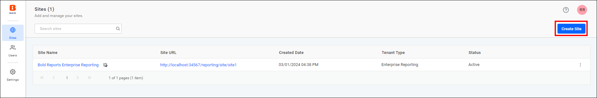

The first step holds the site details, such as tenant type, name, domain, and identifier. The site identifier should be unique, and it is part of your site URL.

Based on the branding you choose, the following information is copied to the site. Otherwise, default images and values are used for the tenant branding.

* Localization
* Date Format
* Branding Images

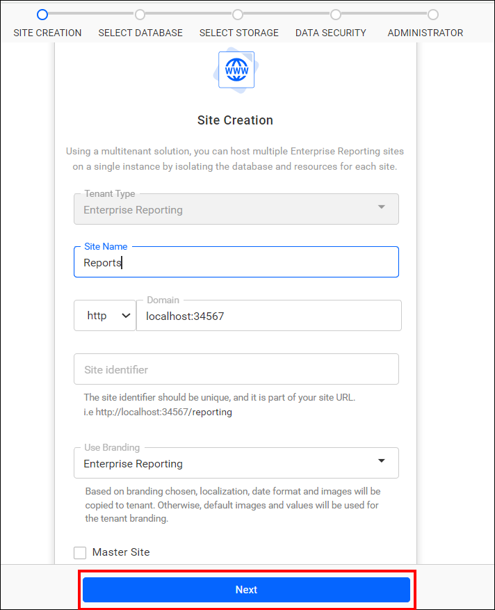

> **Note:** When creating a new site, you have the option to designate it as the master site. For more information, see [switch the master site](./../../manage-sites/manage-sites/#switch-master-site).

## Which database can I select for a new site?

You can select an MSSQL, PostgreSQL, or MySQL Server instance for a new Bold Reports® site.

1. The Select Database step helps you configure databases for the Bold Reports® Server.

2. The reports, users, and their access rights are stored in various SQL databases, including MSSQL, PostgreSQL, and MySQL.

You can connect to the existing **MSSQL Server** instance using the options below:

* You can create a new database for **Bold Reports® Site** using MSSQL.
    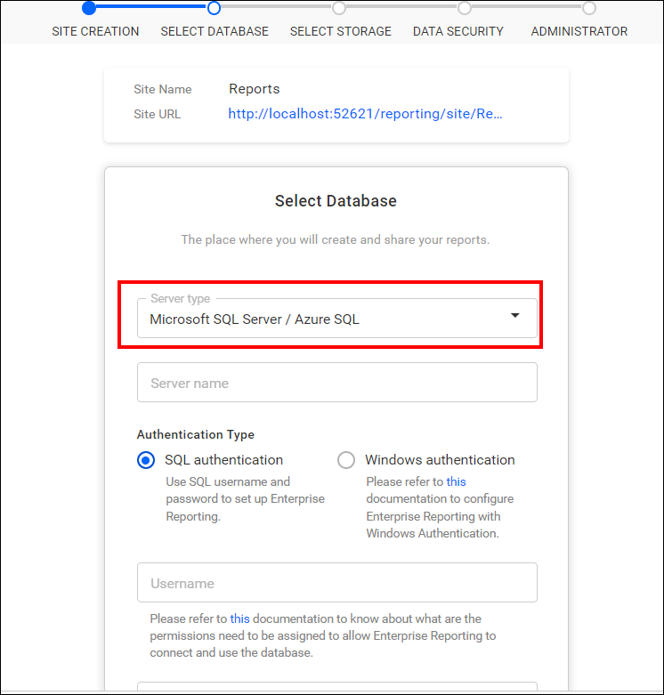
    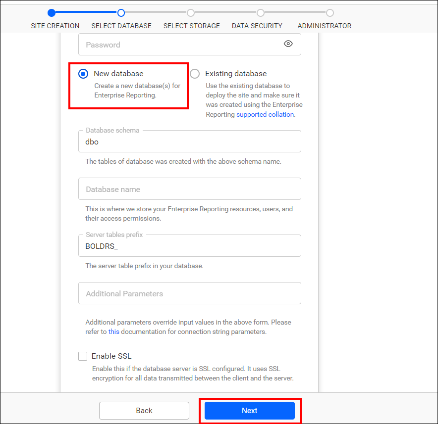

* Additionally, you have the option to select an existing database to create a new site.  
    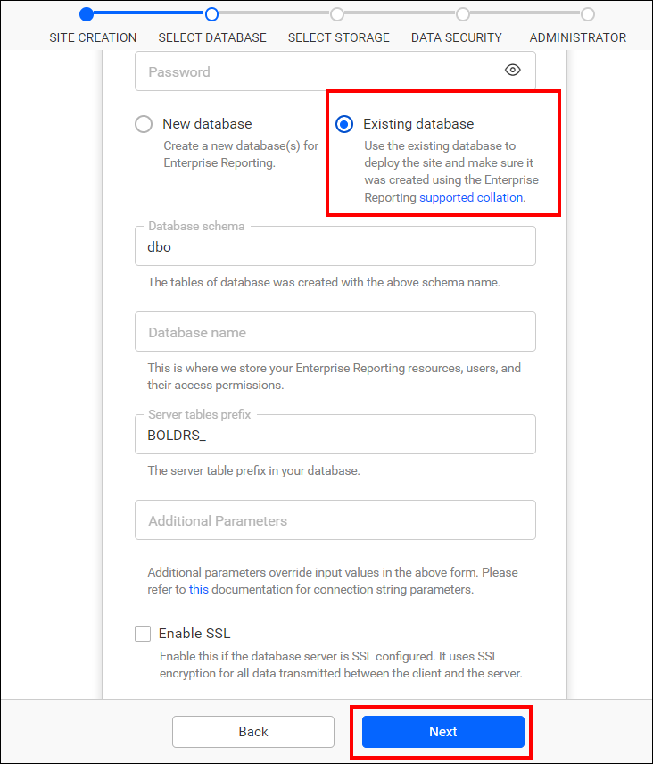

Similarly, you have the option to connect to the existing **PostgreSQL Server** and **MySQL Server** instances.

> **Note:** The credentials given to connect to the MSSQL / PostgreSQL / MySQL Server instance must have [permissions](./../../faq/what-are-the-database-permissions-required-to-set-up-bold-reports/) to:
>* Create Database
>* Create Table
>* Insert
>* Update Table
>* Alter Table
>* Select
>* Drop Table
>* Drop Database

## Select Storage

In Bold Reports® Report Server, you can select the preferred storage type, File Storage or Blob Storage, to store the report, data source and dataset in Bold Reports® Report Server.
    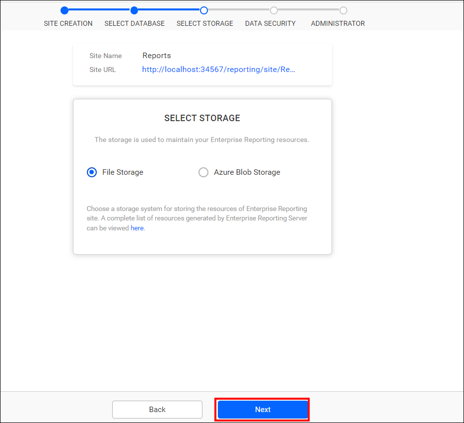
    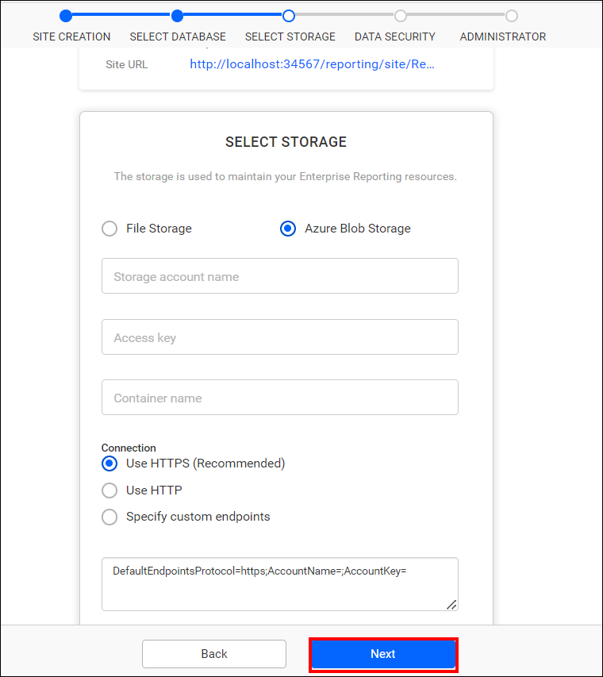

## How do I configure custom attributes for the site?

Custom attributes for a Bold Reports® site are optional during site creation. You can skip this configuration by clicking the Next button, or configure custom attributes and then click Next.
    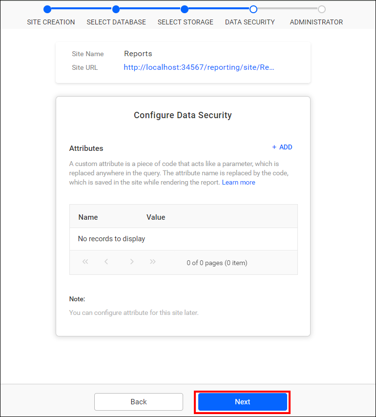

### Custom Attribute

The UMS admin can configure custom attributes for a Bold Reports® site on the site details page. For additional details, see the [Configure Custom Attribute](../../../designer-guide/report-designer/manage-data/dataset/configure-custom-attribute/) section.

Attributes are name-value pairs that are associated with users, groups, and the sites.
    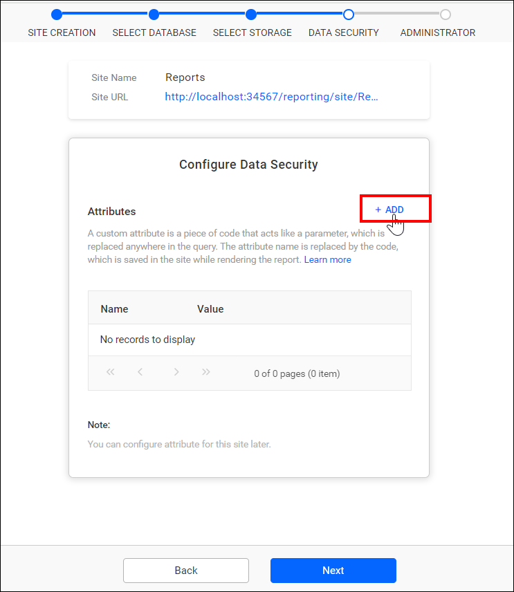
    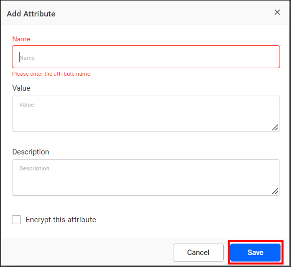
    **Name :** The name of the attribute 
    **Value :** The value associated with the attribute 
    **Description :** Explanation of the attribute's purpose 
    **Encrypt :** Store the value as encrypted in the database, displaying as dots in the grid

## How do I select the site administrator?

In the Select Administrator step, you select the user who has complete control over the Bold Reports® site.

The selected users have the following permissions:
* [Create Reports](../../../designer-guide/manage-content/reports/create-report/)
* [Create Data Sources](../../../designer-guide/manage-content/data-sources-management/)
* [Create Datasets](../../../designer-guide/manage-content/dataset-management/)
* [Create Schedules](../../../designer-guide/manage-schedule/manage-reports-schedule/)
* [Create Users](../../../administrator-guide/manage-users/users/manage-users/)
* [Create Groups](../../../administrator-guide/manage-users/groups/manage-groups/)
* [Manage Permissions for users and groups](../../../administrator-guide/manage-permissions/)

After you select the user, click `Create and launch site`.

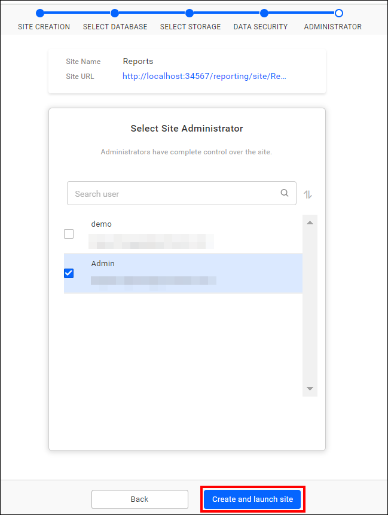

The selected admin user(s) can access resources and manage users, groups, and their permissions solely within the corresponding site.

## Frequently asked questions

### Which databases can store site data?

The reports, users, and their access rights are stored in SQL databases, including MSSQL, PostgreSQL, and MySQL.

### Which storage types can I choose for a site?

You can choose File Storage or Blob Storage to store the report, data source, and dataset.

### Can I make the new site the master site?

Yes. When creating a new site, you have the option to designate it as the master site.

## See also

* [Manage sites](./../../manage-sites/manage-sites/)
* [Manage admin access](./../../manage-sites/manage-admin-access/)
* [Manage users](./../../manage-sites/manage-users/)
