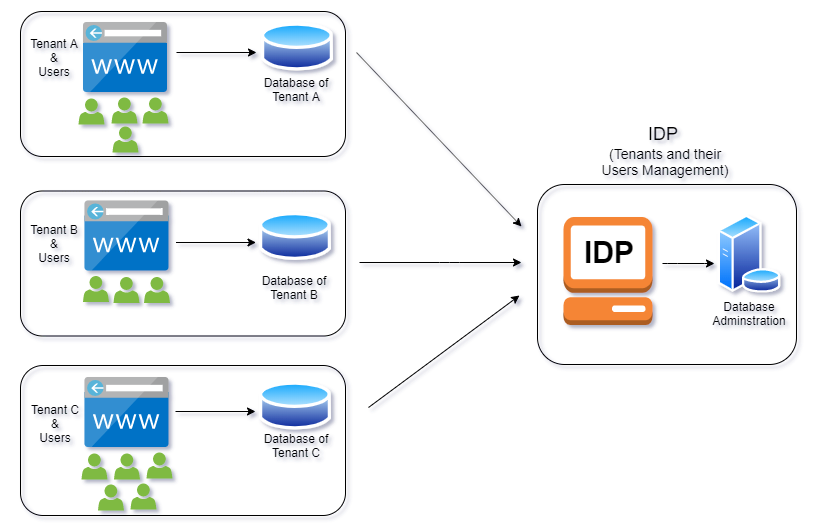
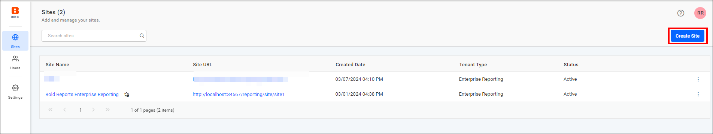

# Multiple sites in Bold Reports® Enterprise Reporting

Bold Reports® Enterprise Reporting lets administrators deploy and manage multiple sites from a single deployment.

## What is multi-site deployment?

Bold Reports® Enterprise Reporting supports multi-site deployment, allowing administrators to deploy and manage multiple sites. By default, each site has its own database for managing reports and resources, isolated from other sites within a single Bold Reports® deployment. From v6.1, sites can also share one database with separate tables per site, and from v7.1 all sites can share common tables with logical isolation (PostgreSQL and Microsoft SQL Server only).

## How does the multi-site architecture work?

The following image illustrates the architecture of the Bold Reports® multi-site solution. By default, each site is deployed with its own database and resources, ensuring data isolation from other sites.

To establish a multi-site solution, install and deploy Bold Reports® Enterprise Reporting. The installation deploys the first site with an Identity Provider (IDP) application in an isolated database. Subsequently, you can deploy additional sites, each with their own database.

The Identity Provider (IDP) application is a core component of the multi-site solution, responsible for managing the sites and their user identities.

> **Note:** IDP and the first Reports site can share the same database, but you cannot share the same database between the two site applications.

### How are sites secured?

The Bold Reports® multi-tenant product provides security for both the application and data.

### Application security

Every Bold Reports® product installation generates unique private keys on the customer's machine. These private keys are used to encrypt and store sensitive data such as passwords and connection strings.

### Data security

Bold Reports® isolates data between sites in the following ways:

* Every site user can only log in to their site and access the resources. Each site has been deployed with its own database and resources, ensuring that one site's data is not shared with another site.

* Users belonging to one site can only see other users who belong to the same site and can share reports with those users. Users must have permissions to view and access reports and resources created by other users within the same site.

### How do I add a new site?

You deploy a new site in the Bold Reports® Enterprise application by clicking the **Create Site** button on the site management page. A new site deployment uses its own database and resource storage, completely separated from other sites. Find additional information on how to create a new site in the [site creation guide](./../manage-sites/create-site/).
    

### How do I add or invite users to a site?

In Bold Reports® Enterprise Reporting, only users belonging to the System Administrator group can add, edit, and delete users. You can invite users to your site from other sites by adding them with the same email address as an existing user. Additionally, an email invitation can be sent to the existing site user. Invited users can access resources in both sites after the required permissions (Read/Write/Delete) for those resources are granted.

> **Note:** Learn more about adding a new user to the site in the [user management guide](./../../administrator-guide/manage-users/users/manage-users/).

### How do I share reports with site users?

You can share Bold Reports® reports with users in the same site or another site using two options:

1. Within the same site, you can share the reports with other users by granting them read permission to the particular report. Learn more about managing permissions in the [permissions management guide](./../../administrator-guide/manage-permissions/).

2. To share the reports with users from another site, make the report public and share the report link URL with them. Learn more about sharing reports in the [public report guide](./../../designer-guide/manage-content/reports/public-report/).

## Frequently asked questions

### Can two sites share the same database?

By default, each site has its own database. From v6.1, sites can also share one database with separate tables per site, and from v7.1 all sites can share common tables with logical isolation (PostgreSQL and Microsoft SQL Server only).

### Can users from one site see users from another site?

No. Users belonging to one site can only see other users who belong to the same site.

## See also

* [Create a new site](./../manage-sites/create-site/)
* [Manage sites](./../manage-sites/manage-sites/)
* [Manage admin access](./../manage-sites/manage-admin-access/)
