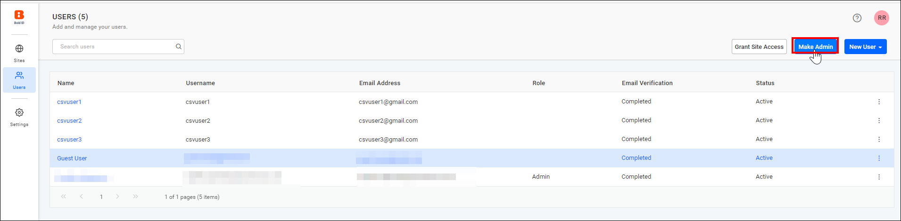
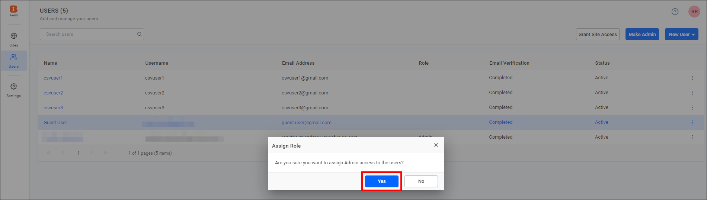
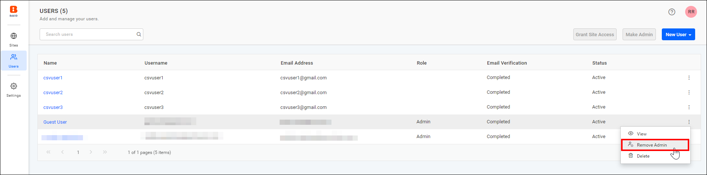
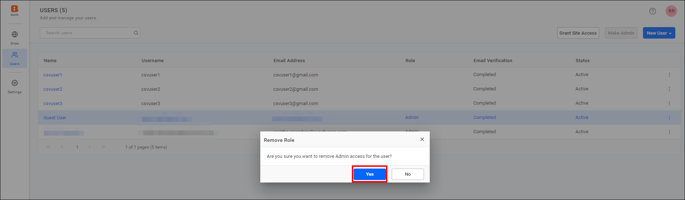

# Manage admin access for users in Bold Reports® UMS

In the Bold Reports® User Management Server (UMS), you can add or remove admin access for users from the user management page.

## How do I assign the admin role?

To assign the admin role in the Bold Reports® User Management Server (UMS), follow these steps:

1. Log in to the UMS User management page at `{Bold Reports URL}/ums/administration/user-management/users` using the existing admin credentials.

2. On the user listing page, select the users to whom you want to assign the admin role. Use `CTRL + Click` to select multiple users.

3. Choose the `Make Admin` option. The following image shows the selected users on the user management page.

   

4. In the confirmation window that opens, click `Yes` to assign the admin role to the selected users.

## How do I remove the admin role?

To remove the admin role in the Bold Reports® User Management Server (UMS), follow these steps:

1. Select any user who holds admin credentials. The following image shows the `Remove Admin` option.

   

2. Select the `Remove Admin` option. In the confirmation window that opens, click `Yes` to remove the admin role from the selected users.

## Frequently asked questions

### Can I assign the admin role to several users at once?

Yes. Use `CTRL + Click` to select multiple users on the user listing page, then choose the `Make Admin` option.

## See also

* [Manage sites](./../../manage-sites/manage-sites/)
* [Manage users](./../../manage-sites/manage-users/)
* [Create a new site](./../../manage-sites/create-site/)
