# Manage sites in Bold Reports® User Management Server

In the Bold Reports® User Management Server (UMS), you can suspend, activate, and edit sites, view site details, and grant or revoke site access.

## How do I suspend a site?

You suspend a site in the Bold Reports® UMS by clicking the `Suspend` option in the Action Menu.

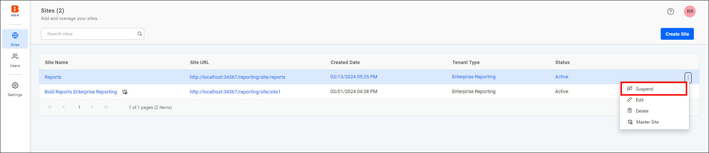

> **Warning :** If the site is suspended, users will not be able to access it.

## How do I activate a suspended site?

You activate a suspended site in the Bold Reports® UMS by clicking the `Activate` option.

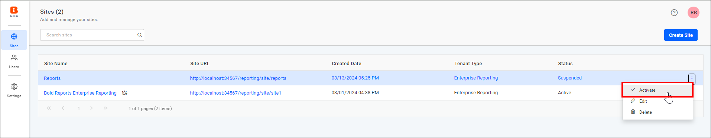

## How do I edit a site?

You can update the following site information in the Bold Reports® UMS with the `Edit` Site option:

* Site Name
* Site Domain
* Site Identifier
* Database User Credential

To edit the site, follow these steps:

1. Click the `Edit` option in the menu.

   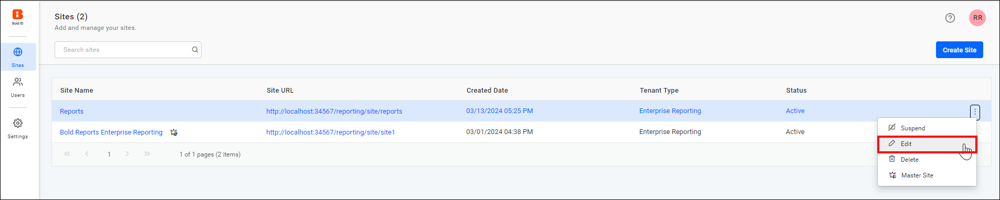

2. In the Edit Site dialog that opens, enter the site name, site domain, and site identifier. Click the `Next` button to update the database user credentials.

   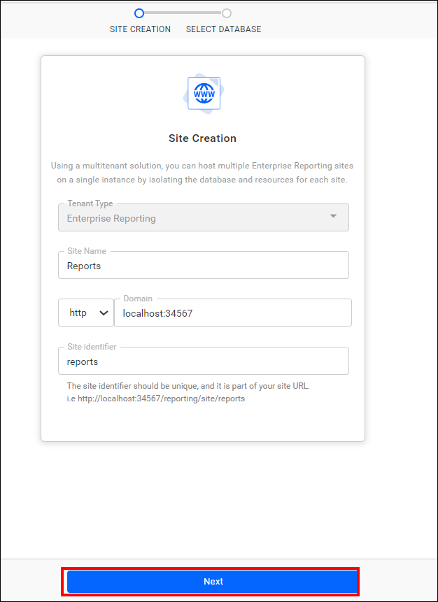

3. Enter your database credentials and click the `update` button to update the site details.

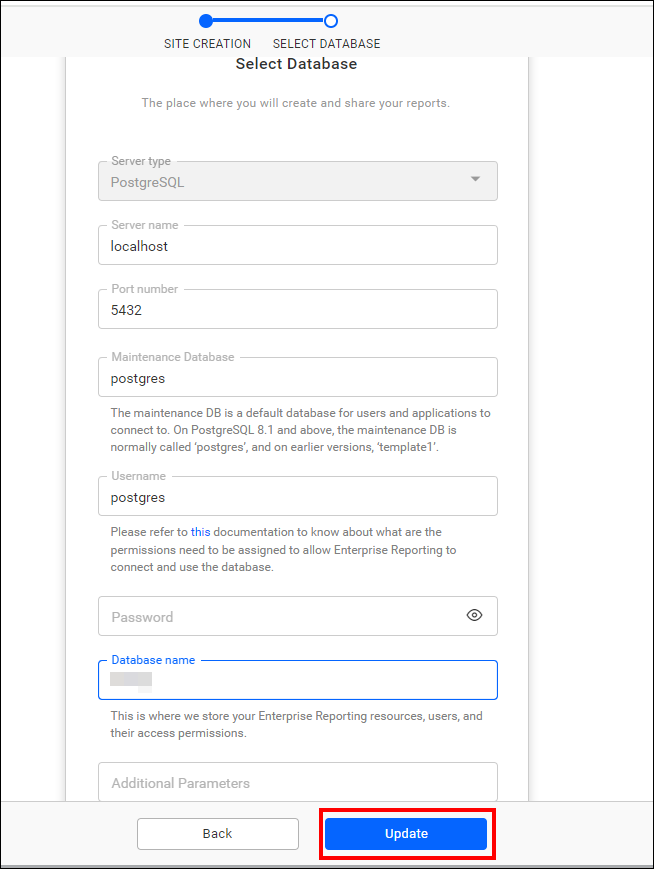

## How do I delete a site?

You delete a site and its database in the Bold Reports® UMS by clicking the `Delete` option.

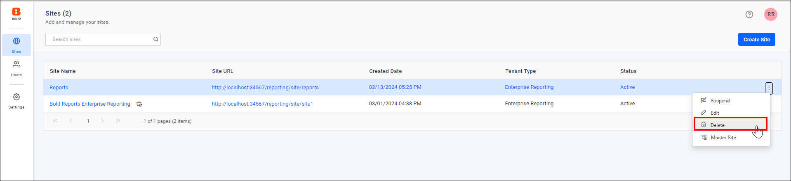

> **NOTE:** The database will not be deleted if there are any other tables present other than the Bold Reports® tables.

## How do I view site information?

To view site information in the Bold Reports® UMS, click the site name.

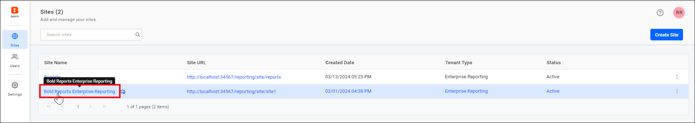

### General

The General section of the site information displays the basic information about the site, including:

* Site Name
* Site URL
* Client Id
* Client Secret

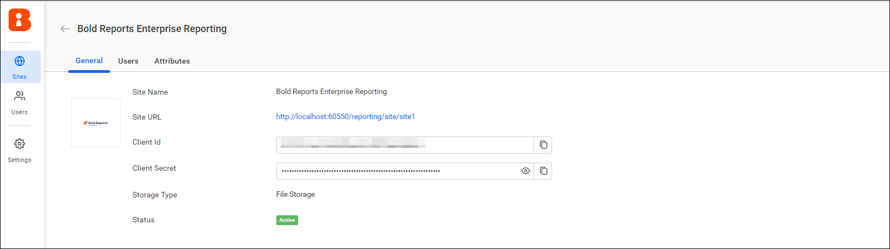

### Site Users

The Site Users section of the site information shows the list of users who have access to the site.

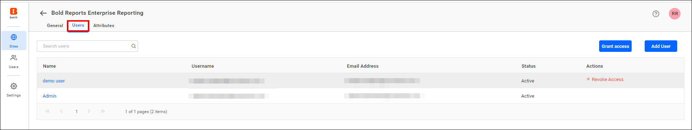

#### Grant Access

You grant users access to a Bold Reports® site by clicking the `Grant Access` button for the site.

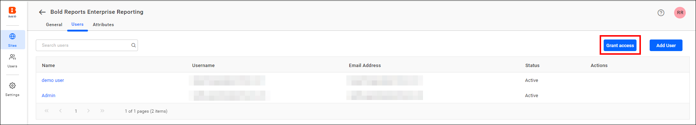

Then, select the users from the list and grant access to the site.

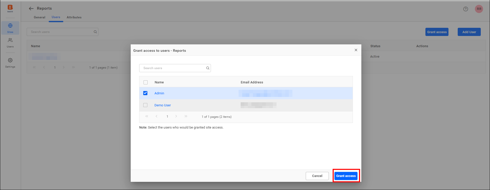

#### Revoke Access

You remove a single user's access to a Bold Reports® site by clicking `Revoke Access`.

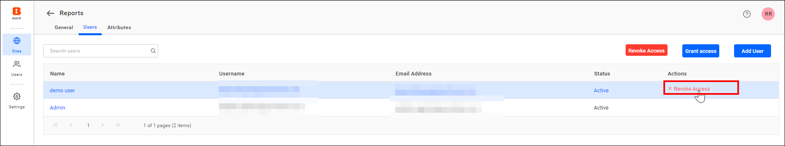

You can remove access for multiple users by clicking the `Revoke Access` button.

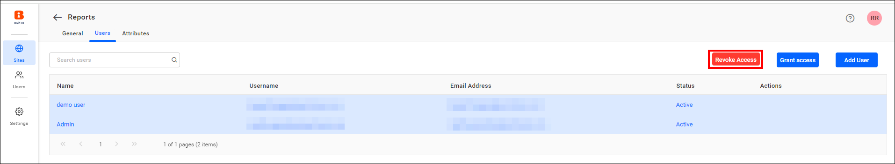

#### Add User

To grant a new user access to the Bold Reports® site, click the `Add User` button.

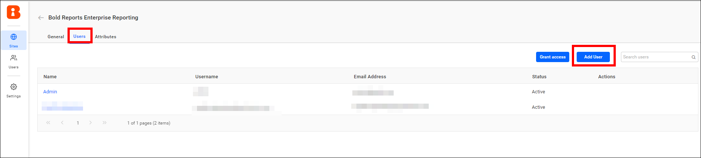

To add the user, see [Add User](./../manage-users/#add-individual-users).

The user is added and granted access to the site.

### Custom Attribute

To configure custom attributes for a Bold Reports® site, see the [Configure Custom Attribute Guide](../../../designer-guide/report-designer/manage-data/dataset/configure-custom-attribute/).

## Switch Master Site

The Bold Reports® site created during the initial deployment is designated as the master site, but you have the option to switch it. Follow these steps:

1. Click the **create site** button, then enable the **Master Site** option during site creation and proceed by selecting  **Yes** to designate the site as the master site.
    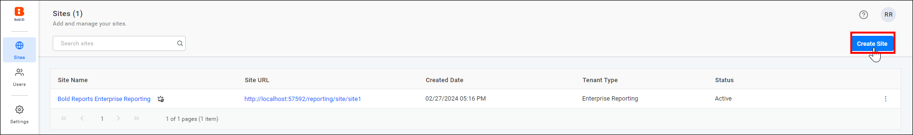
    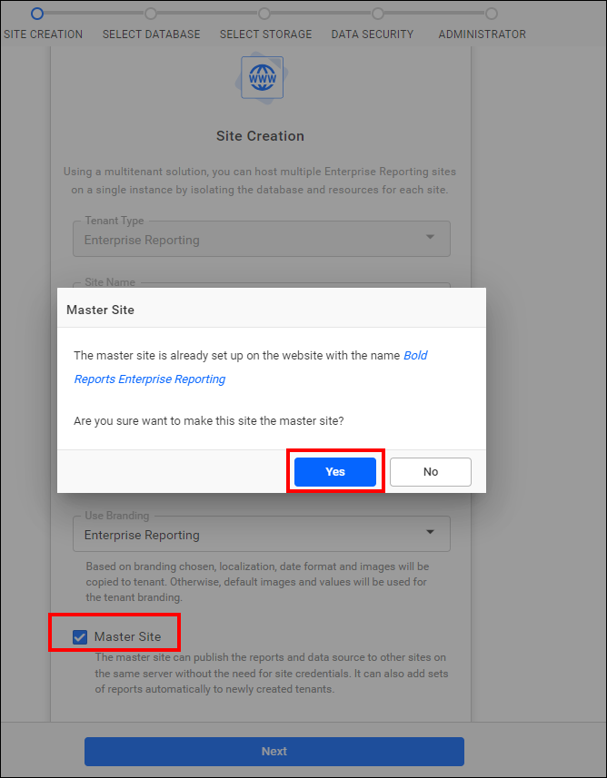

2. Click **Next** to proceed further.
    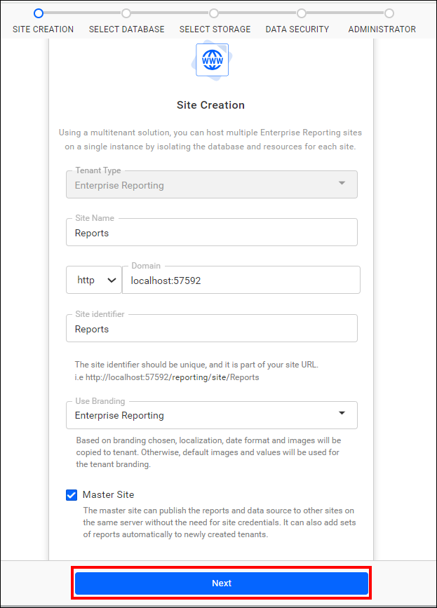

3. Select the Database, Storage type, and Administrator. For more information, see the [Create Site Documentation](./../../manage-sites/create-site/).

4. After the site is created, the new site takes on the role of the master, and the existing site moves into the role of the slave.

    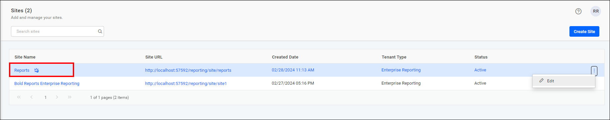

    > **Note:** To designate a site as the master, click the master site option in its context menu.
    > 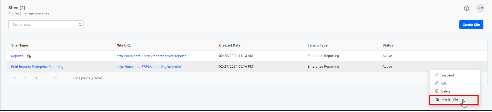

## Frequently asked questions

### Can users access a suspended site?

No. If the site is suspended, users will not be able to access it.

### Is the database always deleted with the site?

No. The database will not be deleted if there are any other tables present other than the Bold Reports® tables.

## See also

* [Create a new site](./../../manage-sites/create-site/)
* [Manage admin access](./../../manage-sites/manage-admin-access/)
* [Manage users](./../manage-users/)
