# Manage users in Bold Reports® User Management Server

In the Bold Reports® User Management Server (UMS), administrators can add, update, activate, and delete users.

Only users with UMS admin access can add, edit, or delete users.

## How do I add new users?

You add new users to the Bold Reports® UMS individually or in bulk by using CSV import.

### Add individual users

To add a new user in the Bold Reports® UMS, click `New User` and then `Add User` from the User Management page.

The following images show the `Add User` dialog and the success prompt.

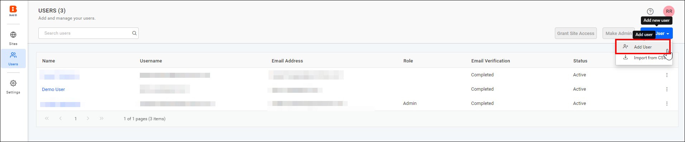

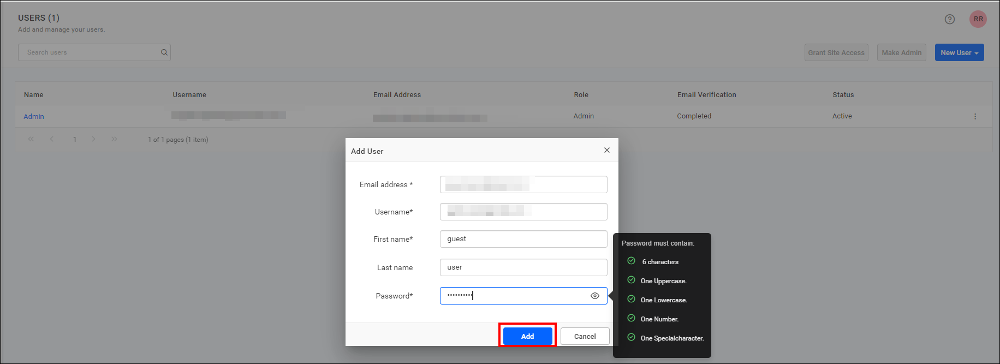

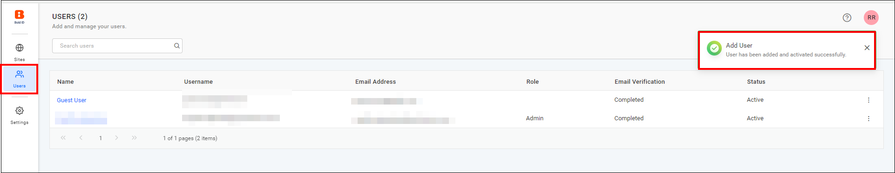

> **NOTE:**  
> * If the account activation mode is set to Automatic, new users will be activated automatically.
> * If the activation type is set to Email, users will receive an email to activate their account. Activation will occur after verifying the email. By default, the Account Activation Mode is set to Automatic.
> * For more details, see the [Account settings](./../site-administration/account-settings/) page.

| Automatic activation                   | Email activation          |
| -------------             | ------------- |
| Fill out the form with a Username, Email address, First name, Last name and Password, then click `Add`.  | Fill out the form with a Username, Email address, First name and Last name and then click on `Add`.        |
| See the [password requirements](#password-requirement) section. | To activate the user, please check the [Activate Users](#activate-users) section for more details. |

### How do I import users from a CSV file?

You can import users into the Bold Reports® UMS from a CSV file, which you download from the designated location in UMS.

To automate the process of adding a large number of users to UMS, you can download the CSV template file, add the users to it, and then import the file.

#### Add users from CSV file

In the Bold Reports® UMS, click `Import from csv` to begin importing the CSV file.

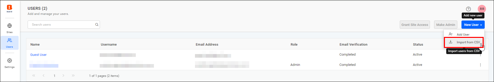

### CSV file Requirements

The first row in the Bold Reports® UMS CSV template should contain the column headings. UMS assumes that the data from the second line in the file represents the user information, and the following columns are mandatory in the downloaded CSV file:

**Automatic Activation**|**Email Activation**
:-----:|:-----:
Username|Full Name
Full Name|Email
Password|-

To add users with the CSV template, follow these steps:

1. Download the CSV template.

    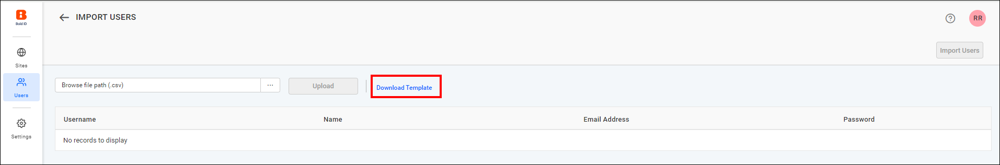

2. Add users to the CSV file, save the file, and then upload it.

    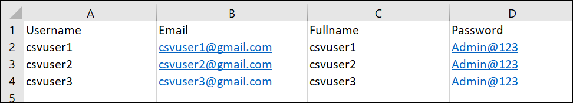

3. After you upload the file, the user details are displayed in the grid, as shown in the following images. Click **Import Users** to add the users.

    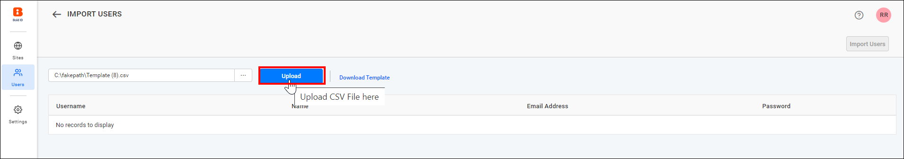

    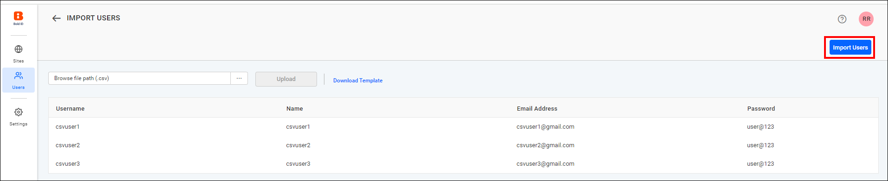

4. After the users are uploaded in UMS, the results are displayed as shown in the following image.

    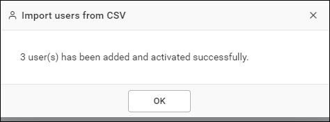

### Password Requirement

A Bold Reports® UMS user password must meet the following requirements:

It must contain:

* At least 6 characters,
* 1 uppercase letter,
* 1 lowercase letter,
* 1 numeric digit,
* 1 special character.

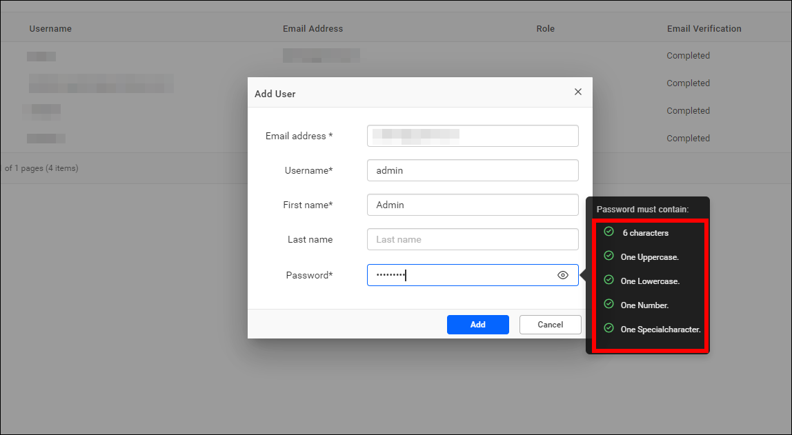

## Activate users

After you add a user in the Bold Reports® UMS, a new account is created, and an account activation email is sent to the email address provided, containing an activation link to activate the Bold Reports® account.

The activation link sent to the user will be valid only for 2 days. If the user does not activate within this period, a new activation link can be sent to the user from the user edit page.

The account will remain inactive until the user activates it from the activation email.

## How do I edit a user?

You edit user profile details in the Bold Reports® UMS on the user edit page, as shown in the following images.

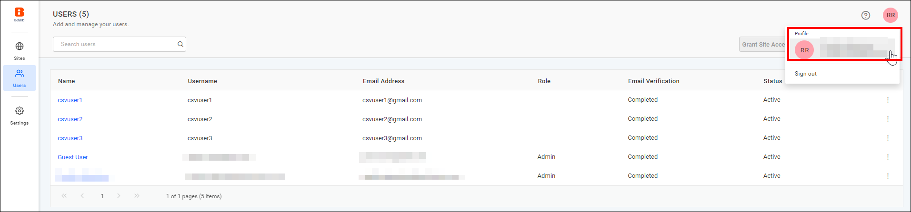

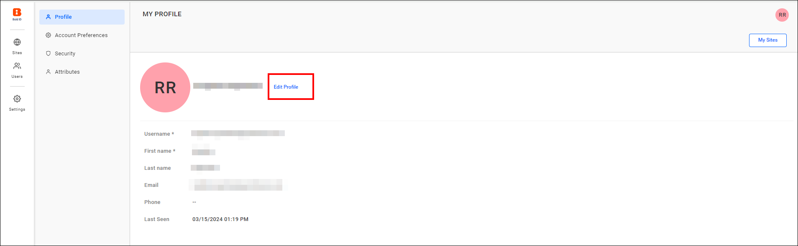

The Username, First name, Last name, Phone number, and Profile picture of the user can be edited.

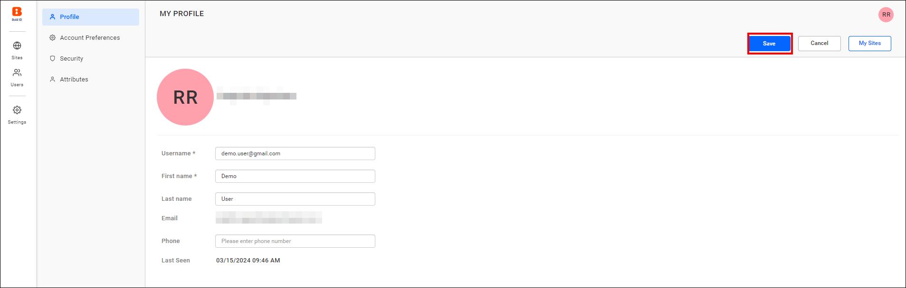

## How do I change a user's password?

In the Bold Reports® UMS, administrators can reset or create a password for users who forget their password or want a new one. See the [password requirements](#password-requirement) section.

The password change functionality is available for the following types of users:

* **Local Users:** Users created and managed within Bold Reports®.
* **Windows Active Directory (AD) Users:** Users imported from a configured Windows AD domain.

### How do local users change their password?

Bold Reports® local users can change their password directly from the **User Profile** section in the application.

### How do Windows AD users change their password?

Starting from **version 12.1.5**, **Bold Reports®** also supports changing the password for **Windows AD users** within the application.

* AD users can now **set or update their password** using the same interface used by local users.
* Once a new password is created or updated, it can be used to log in to the Bold Reports® application directly.

> **Note:** The newly created password for a Windows AD user is used **only within the Bold Reports® application** and does **not update the password in the actual Active Directory domain**.

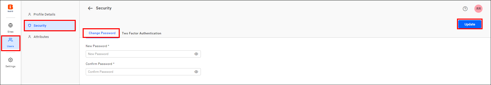

## How do I manage two-factor authentication for a user?

Bold Reports® users can enable [2FA](./../../user-profile/#two-factor-authentication) for their accounts. If a user loses their recovery code or authenticator application, the admin can disable 2FA or generate a new set of codes for them. Use the Two-Factor Authentication tab in the security section.

### How do I regenerate a recovery code for a user?

To regenerate the recovery code for a user in the Bold Reports® UMS, go to the Two Factor Authentication tab in the user details and click `Regenerate Recovery Code`.

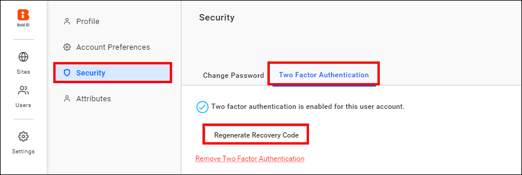

Click `Yes` to generate a recovery code. Copy the newly generated code and share it with the user.

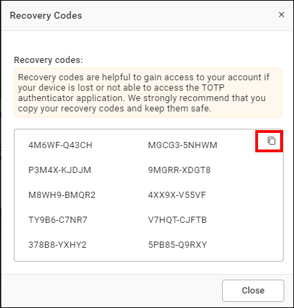

### How do I disable two-factor authentication for a user?

To disable Two-Factor Authentication for a user in the Bold Reports® UMS, click the **Remove Two-Factor Authentication** option, then confirm by selecting `Yes`.

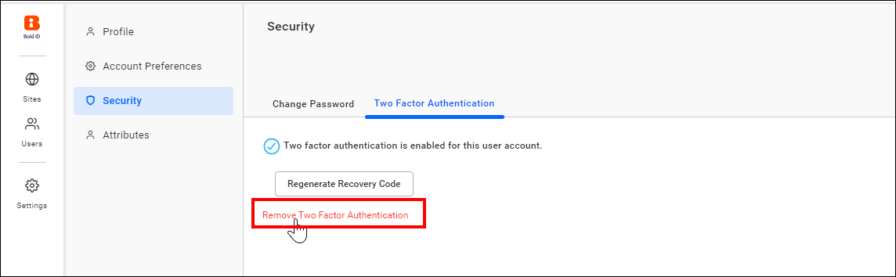

## How do I delete users?

You delete users from the Bold Reports® UMS when they no longer require access. The `System Administrator` can delete users from the user management page.

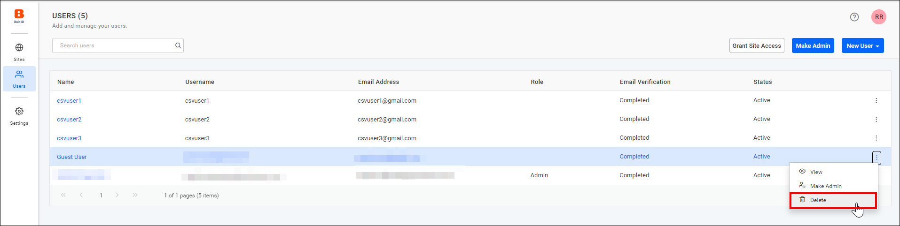

> **Note:**  Once a user is deleted by the System Administrator, their access will be revoked from the sites they belong to.

## How do I grant users access to multiple sites?

In the Bold Reports® UMS, you select single or multiple users in user management to provide access to multiple sites.

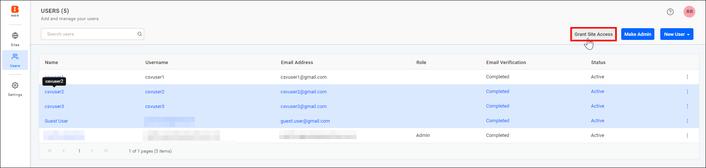

Select the sites to which you need to provide access to the selected users, and then click the `Grant Access` button to proceed.

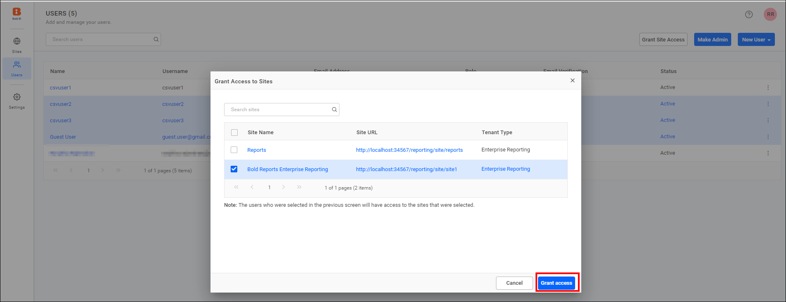

> **NOTE:**  If the selected user already has access to that site, the process will be skipped.

After the process is completed, you can view a detailed report on it and download the report in CSV format.

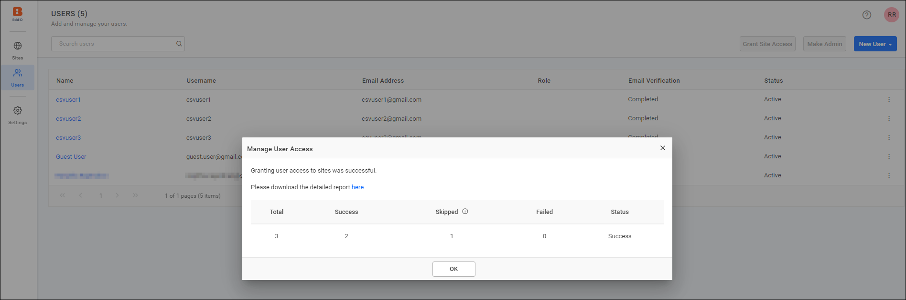

To revoke access to the site, follow the steps in [Revoke access](./../manage-sites/#revoke-access).

## Frequently asked questions

### How long is the account activation link valid?

The activation link sent to the user is valid only for 2 days. After that, you can send a new activation link from the user edit page.

### Does changing a Windows AD user's password update Active Directory?

No. The new password is used only within the Bold Reports® application and does not update the password in the actual Active Directory domain.

## See also

* [Account settings](./../site-administration/account-settings/)
* [Manage sites](./../manage-sites/)
* [Manage admin access](./../manage-admin-access/)
