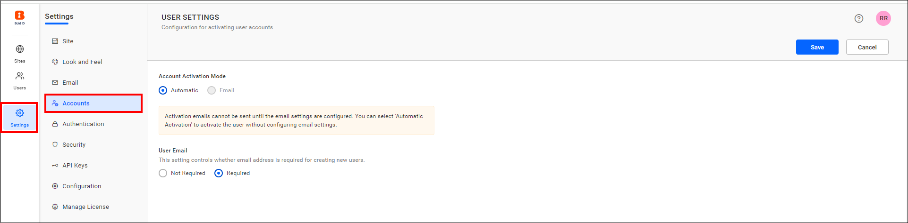
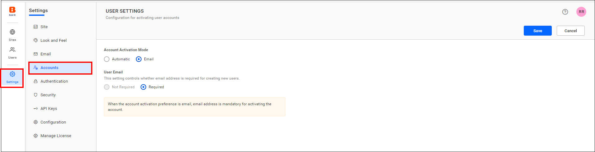

# Account settings in Bold Reports® User Management Server

In the Bold Reports® User Management Server, you choose how user accounts are activated and whether new users need an email address.

## Which account activation modes are available?

The Bold Reports® User Management Server offers two modes for account activation:

1. Automatic activation
2. Email activation

### Automatic activation

When user activation is set to `Automatic Activation` mode, the User Management Server activates user accounts automatically when you add users.

### Email activation

When user activation is set to `Email Activation` mode, the User Management Server does not activate user accounts automatically when you add users. Instead, it sends an account activation email with an activation link to the user's email address, so users can activate their account.

The account stays in inactive status until the user activates the account from the activation email.

> **NOTE:** By default, the Account Activation Mode is set to `Automatic`.

The following image shows the account activation settings.

## Does a new user need an email address?

The User email setting in the Bold Reports® User Management Server determines whether an email address is required for creating new users.

### Email required

When the user email setting is set to `Required` mode, an email address is mandatory for adding users in the User Management Server.

> **NOTE:** When the account activation preference is set to email, an email address is mandatory for activating the account.

### Email not required

When the user email setting is set to `Not Required` mode, an email address is not mandatory for adding users in the User Management Server.

> **NOTE:** By default, the User Email setting is set to `Required`.

The following image shows the user email settings.

## Frequently asked questions

### What is the default account activation mode?

By default, the Account Activation Mode is set to `Automatic`.

### Is an email address required by default?

Yes. By default, the User Email setting is set to `Required`.

## See also

* [Email settings](./../email-settings/)
* [Authentication settings](./../authentication/)
* [Site administration overview](./../)
