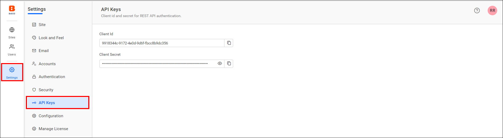

# API keys in Bold Reports® User Management Server

The API Keys page in the Bold Reports® User Management Server provides the Client Id and Secret that you use for REST API authentication.

## Where do I find the Client Id and Secret?

The Bold Reports® User Management Server shows the Client Id and Secret on the **API Keys** page, as shown in the following image.

## How do I use the API keys with the REST API?

Use the Client Id and Secret from the Bold Reports® API Keys page for REST API authentication. To learn more about the REST API, see <a href="../../../../rest-api-reference/interact-with-rest-api/" target="_blank">Interact with the REST API</a>.

## See also

* [Getting started with the REST API](./../../../../rest-api-reference/interact-with-rest-api/)
* [Authentication settings](./../authentication/)
* [Security settings](./../security/)
