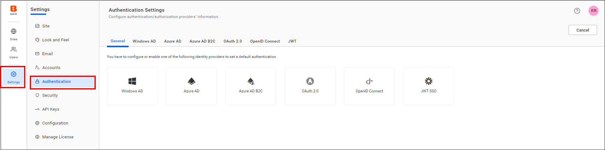
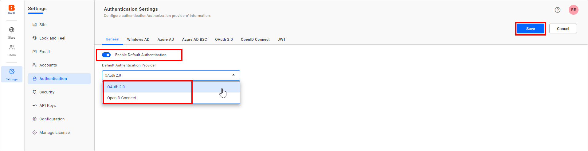
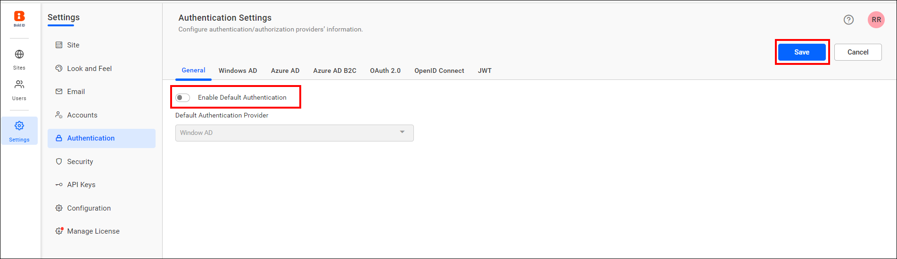

# Default authentication in Bold Reports® User Management Server

Default authentication in the Bold Reports® User Management Server redirects users to a selected identity provider at login, and you can enable or disable it.

## What does default authentication do?

Default authentication in Bold Reports® lets you configure any third-party identity provider as your default authentication provider. After default authentication is configured, the Bold Reports® application automatically redirects users to the provider's login page instead of the Bold Reports® login page.

## What do I need before enabling default authentication?

To set up default authentication in Bold Reports®, you must configure and enable one of the following identity providers. Otherwise, you see the options shown in the following image.

You can select any of the following providers as the default authentication provider:

[Microsoft Entra ID](./../../../../authentication/single-sign-on/azure-active-directory/)

[OAuth 2.0 Support](./../oauth-2.0-support/)

[OpenID Support](./../openid-settings/)

[JWT SSO](./../json-web-token/)

## How do I enable default authentication?

When you enable default authentication with any provider, the Bold Reports® application automatically redirects you to that provider when you log in. To enable it, follow these steps:

1. On the settings page, click the `Authentication` tab and select `General`.

2. Toggle the `Enable Default Authentication` option and choose any provider for default authentication.

## How do I disable default authentication?

When you disable default authentication in Bold Reports®, you are directed to the normal login page.

To disable default authentication, uncheck the **Enable Default Authentication** option and then click Save.

> **NOTE:** If you want to skip default authentication after setting it, then use `use_default_authentication=false` in the login URL. (ex: `https://testdomain.com/login?use_default_authentication=false`).

## Frequently asked questions

### How do I skip default authentication after enabling it?

Add `use_default_authentication=false` to the login URL, for example `https://testdomain.com/login?use_default_authentication=false`.

### Which providers can be the default authentication provider?

You can select Microsoft Entra ID, OAuth 2.0, OpenID, or JWT SSO as the default authentication provider.

## See also

* [OAuth 2.0 support](./../oauth-2.0-support/)
* [OpenID support](./../openid-settings/)
* [JWT SSO](./../json-web-token/)
