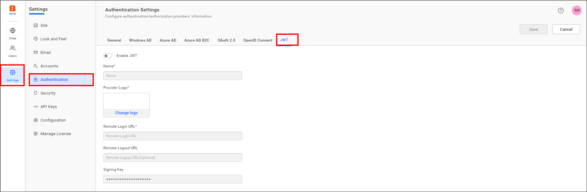
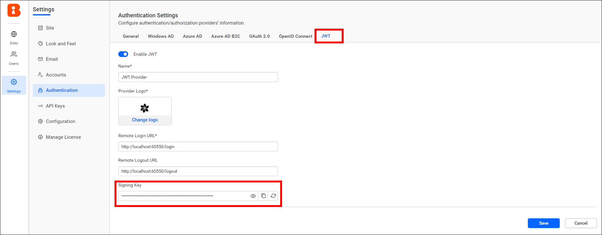
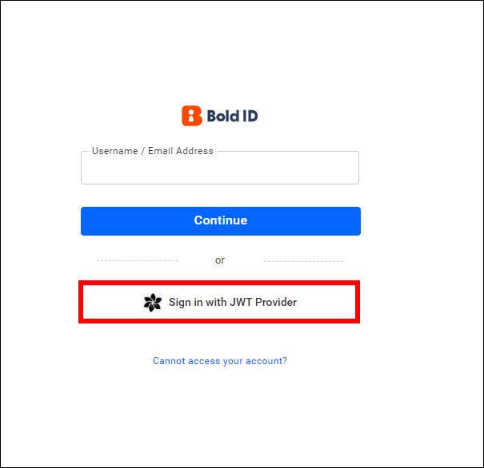

# Set up JWT single sign-on in Bold Reports<sup>®</sup> User Management Server

To set up JWT single sign-on (SSO) in Bold Reports<sup>®</sup>, enable and configure the custom JSON Web Token (JWT) settings on the User Management Server administration page.

## How do I configure JWT in Bold Reports<sup>®</sup>?

To configure JWT in the Bold Reports<sup>®</sup> User Management Server, follow these steps:

1. Log in with the URL `{Bold Reports URL}/ums/administration` using the admin credentials.

2. Click `Authentication` and then `JWT`.

   

3. Enable the JWT settings.

4. Provide the following details in the `JWT` settings.

    <table>

    <tr>
    <td>Name</td>
    <td>It represents the name of the JWT provider to be displayed on the login page.</td>
    </tr>

    <tr>
    <td>Provider Logo</td>
    <td>It represents the logo of the JWT provider to be displayed on the login page.</td>
    </tr>

    <tr>
    <td>Remote Login URL</td>
    <td>This is the endpoint of the JWT provider used to send the authorization request from the Bold Reports<sup>®</sup> application.</td>
    </tr>

    <tr>
    <td>Remote Logout URL</td>
    <td>It is the endpoint of the JWT provider to send the logout request once the user logged out in the Bold Reports<sup>®</sup> application.</td>
    </tr>

    </table>

5. After you save the values, the application generates a `Signing Key`. Use this signing key to sign JSON Web Tokens from your application.  

6. Copy, view, or reset the `Signing Key` with the following options:

    

## How does JWT work with Bold Reports<sup>®</sup>?

JWT single sign-on in Bold Reports<sup>®</sup> works in the following sequence:

1. After the JWT settings are configured, go to the Bold Reports<sup>®</sup> login page and click the JWT login option. You are redirected to the configured application login URL.
    

2. The application generates the JSON Web Token for the user and redirects back to Bold Reports<sup>®</sup> call back URL `{Bold Reports URL}/sso/jwt/callback?jwt={token}&site_identifier={site identifier}&redirect_to={redirecturl}` with the encoded JWT in a query string.

3. The Bold Reports<sup>®</sup> application validates the JWT and deserializes the user information from the token.

4. From the user information, the Bold Reports<sup>®</sup> application checks whether the user's email already has access to the Bold Reports<sup>®</sup> application. If the user is already available in Bold Reports<sup>®</sup>, the application authenticates the user.

5. If the user is not available in the Bold Reports<sup>®</sup> server, the application adds the user and authenticates the user to access the Bold Reports<sup>®</sup> application.

## JWT Callback URL

  The Bold Reports<sup>®</sup> JWT callback URL validates the JWT response from the configured application.

  After a successful login to your configured application, users can be redirected to the specified URL.

 `{Bold Reports URL}/sso/jwt/callback?jwt={token}&site_identifier={site identifier}&redirect_to={redirecturl}`

  <table>
    <tr>
    <th>Parameter</th>
    <th>Required</th>
    <th>Comments</th>
  </tr>

   <tr>
   <td>jwt</td>
   <td>Yes</td>
   <td>The JSON Web Token will be passed in this parameter, containing the JWT Payload</td>
   </tr>

   <tr>
   <td>site_identifier</td>
   <td>No</td>
   <td>This parameter will be used to grant site access for the JWT user.

   If the JWT login accessed from the tenant, the Bold Reports<sup>®</sup> login URL will redirect to your application with the tenant site identifier in the URL query string. You can use this identifier in the JWT response URL.

   Example Url`{Remote login URL}?site_identifier={site identifier}`

   > **NOTE:** Only one site identifier should be passed. Passing more than one identifier is not allowed.
   </td>
   </tr>

   <tr>
   <td>redirect_to</td>
   <td>No</td>
   <td>If this parameter is included in the JWT response, the user will be redirected to the corresponding page after the login process is completed.</td>
   </tr>
   </table>

## How do I create the JSON Web Token?

To create a JWT for Bold Reports<sup>®</sup>, use `HMAC-SHA256` as the signing algorithm.  

### What parameters can be passed in the payload of JWT

A JWT for Bold Reports<sup>®</sup> should include the following claims:

   <table>
   <tr>
    <th>Parameter</th>
    <th>Parameter Name</th>
    <th>Value Type</th>
    <th>Required</th>
    <th>Comments</th>
   </tr>

   <tr>
    <td>User Id</td>
   <td>sub</td>
   <td>string</td>
   <td>Yes</td>
   <td>Unique identifier of the user.</td>
   </tr>

   <tr>
   <td>Email</td>
   <td>email</td>
   <td>string</td>
   <td>Yes</td>
   <td>Email address of the user.</td>
   </tr>

   <tr>
   <td>First Name</td>
   <td>first_name</td>
   <td>string</td>
   <td>Yes</td>
   <td>First name of the user.</td>
   </tr>

   <tr>
   <td>Last Name</td>
   <td>last_name</td>
   <td>string</td>
   <td>No</td>
   <td>Surname of the user.</td>
   </tr>

   <tr>
   <td>Phone</td>
   <td>phone</td>
   <td>string</td>
   <td>No</td>
   <td>Phone number of the user.</td>
   </tr>
   </table>

### JSON Web Token sample

The following C# sample shows how to generate a JWT for Bold Reports<sup>®</sup>:

```c#
private string GenerateJSONWebToken(UserModel userInfo)
{
    var signingKey = "signingkey";// Signing key value will copy from JWT Settings page
    var securityKey = new SymmetricSecurityKey(Encoding.UTF8.GetBytes(signingKey));
    var credentials = new SigningCredentials(securityKey, SecurityAlgorithms.HmacSha256Signature, SecurityAlgorithms.Sha256Digest);

    var claims = new[] {
        new Claim("sub", "420c5d51-1754-4a9b-b4b5-d5bfebb21b0f")
        new Claim("email", "john.doe@example.com"),
        new Claim("first_name", "Makila"),
        new Claim("last_name", "S"),
        new Claim("phone", "1234567890")
            };

    var token = new JwtSecurityToken(claims: claims,
                expires: DateTime.Now.AddMinutes(120),
                signingCredentials: credentials);

    return new JwtSecurityTokenHandler().WriteToken(token);
}
```

## Frequently asked questions

### Which signing algorithm does Bold Reports<sup>®</sup> JWT use?

Use `HMAC-SHA256` as the signing algorithm, with the `Signing Key` generated on the JWT settings page.

### What happens if a JWT user does not exist in Bold Reports<sup>®</sup>?

The application adds the user and authenticates the user to access the Bold Reports<sup>®</sup> application.

### Can I pass more than one site identifier?

No. Only one site identifier should be passed in the callback URL.

## See also

* [Default authentication](./../default-authentication/)
* [OAuth 2.0 support](./../oauth-2.0-support/)
* [OpenID support](./../openid-settings/)
