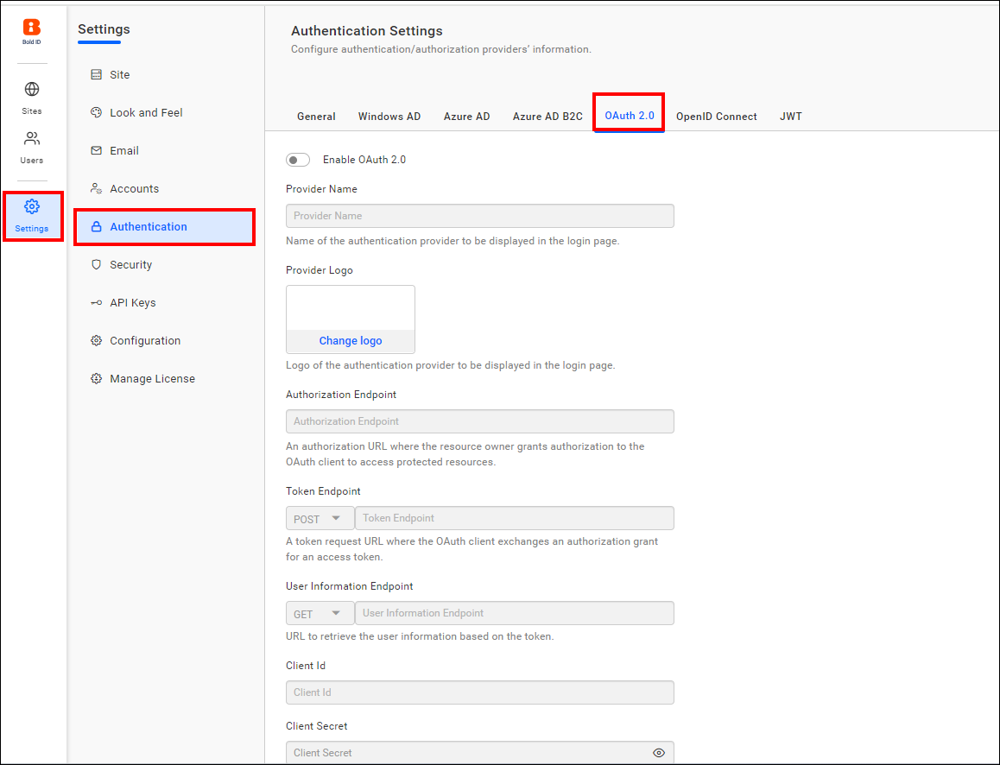
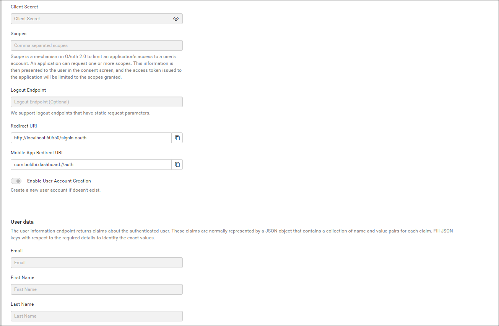
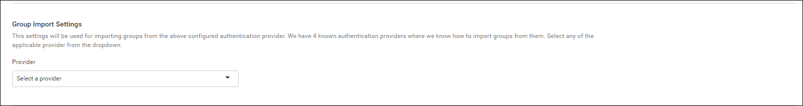
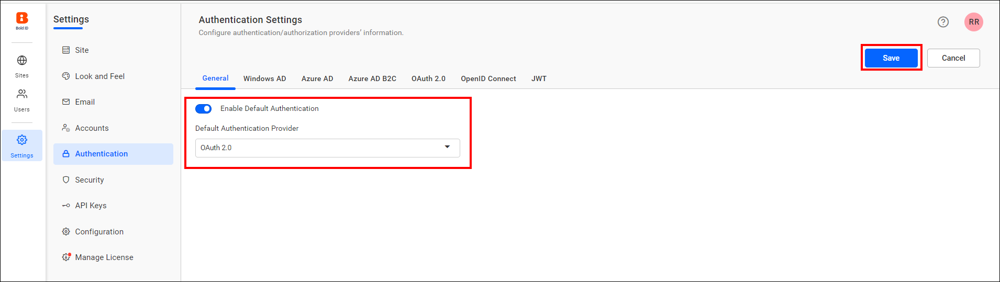
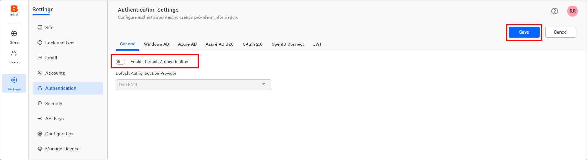

# Configure OAuth 2.0 SSO in Bold Reports® User Management Server

You can configure the Bold Reports® User Management Server to use OAuth 2.0 for Single Sign-On (SSO). Users then log in after authenticating with OAuth 2.0.

## What do I need before configuring OAuth 2.0?

To configure OAuth 2.0 in the Bold Reports® User Management Server, you need the following:

1. An account with an OAuth 2.0 provider.

2. Register the User Management Server in the OAuth 2.0 provider.

## Steps to configure OAuth 2.0 in User Management Server

To configure OAuth 2.0 in the Bold Reports® User Management Server, follow these steps:

1. Log in to the User Management Server with the admin credentials.

2. In the left-side menu, click `Settings`, then `Authentication`, and finally `OAuth 2.0`.

    
    

3. Provide the following details in the `OAuth 2.0` settings of User Management Server.

    <table>

    <tr>
    <td>Provider Name</td>
    <td>It represents the name of the authentication provider that will be displayed on the login page.</td>
    </tr>

    <tr>
    <td>Provider Logo</td>
    <td>It represents the logo of the authentication provider that will be displayed on the login page.</td>
    </tr>

    <tr>
    <td>Authorization Endpoint</td>
    <td>It is the endpoint in the provider used to authorize the user.</td>
    </tr>

    <tr>
    <td>Token Endpoint Method</td>
    <td>It represents the request type required to access the token endpoint.</td>
    </tr>

    <tr>
    <td>Token Endpoint</td>
    <td>It is the endpoint within the provider responsible for generating the token.</td>
    </tr>

    <tr>
    <td>User Information Endpoint Method</td>
    <td>It is the endpoint within the provider used to retrieve user details.</td>
    </tr>

    <tr>
    <td>User Information Endpoint</td>
    <td>It specifies the request type required to access the user information endpoint.</td>
    </tr>

    <tr>
    <td>Client ID</td>
    <td>It is a unique identifier provided to each application when registering with the providers.</td>
    </tr>

    <tr>
    <td>Client Secret</td>
    <td>It is a secret key used to authorize the applications.</td>
    </tr>

    <tr>
    <td>Scopes</td>
    <td>It is a comma-separated list of identifiers that specify the access privileges being requested from the provider.</td>
    </tr>

    <tr>
    <td>Email</td>
    <td>This must be the email associated with an admin account of the providers.</td>
    </tr>

    </table>

## Group Claims Authentication

Group claims authentication in the Bold Reports® User Management Server maps users and groups automatically, based on the group claim received in the authentication token. The claims are typically represented as a JSON object containing key-value pairs for each claim. Provide the appropriate JSON key to identify the group claim value.

<table>
    <tr>
        <td>Enable User and Group Mapping </td>
        <td>When enabled, the system fetches group claim values from the token and dynamically maps users to one or more groups during login.</td>
    </tr>
    <tr>
        <td>Un-map Existing Groups of User and map to New Group </td>
        <td>When enabled, all previously assigned groups for the user are removed, and the user is mapped only to the groups specified in the claim.</td>
    </tr>
    <tr>
        <td>Group Claim Name</td>
        <td>Enter the claim name that contains the group identifiers. Users will be mapped only if the group names in the claim match existing groups in the site.</td>
    </tr>
</table>

   

To import the OAuth 2.0 groups, you must configure the group details when saving the OAuth authentication settings.

  

## Which OAuth 2.0 providers have setup guides?

The following guides explain how to connect each OAuth 2.0 provider to the Bold Reports® User Management Server:

* [Amazon Cognito](../../../../authentication/single-sign-on/oauth-2.0/amazon-cognito/)
* [Auth0](../../../../authentication/single-sign-on/oauth-2.0/auth0/)
* [Okta](../../../../authentication/single-sign-on/oauth-2.0/okta/)
* [OneLogin](../../../../authentication/single-sign-on/oauth-2.0/onelogin/)

## Set OAuth 2.0 as default authentication

In the Bold Reports® User Management Server, you can set OAuth 2.0 as the default authentication method when [OAuth 2.0 settings](#steps-to-configure-oauth-20-in-user-management-server) are enabled.

To configure default authentication, follow these steps:

1. On the settings page, click the `Authentication` tab and select `General`.

2. Enable the **Enable Default Authentication** option and choose **OAuth 2.0** as the default authentication provider, as illustrated in the following screenshot.

    

## How do I disable OAuth 2.0 default authentication?

To disable the [OAuth 2.0 default authentication](#set-oauth-20-as-default-authentication) in Bold Reports®, turn off the **Enable Default Authentication** option and then click `Save`.

## Frequently asked questions

### How do I import OAuth 2.0 groups?

Configure the group details when you save the OAuth authentication settings.

### When can OAuth 2.0 be the default authentication?

OAuth 2.0 can be set as the default authentication method when the OAuth 2.0 settings are enabled.

## See also

* [Default authentication](./../default-authentication/)
* [OpenID support](./../openid-settings/)
* [JWT SSO](./../json-web-token/)
