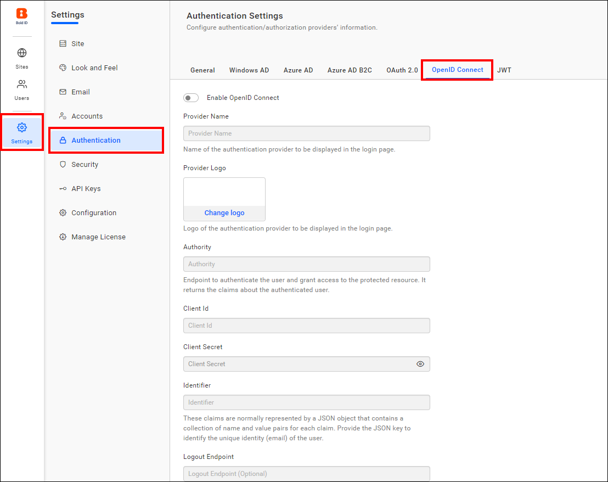
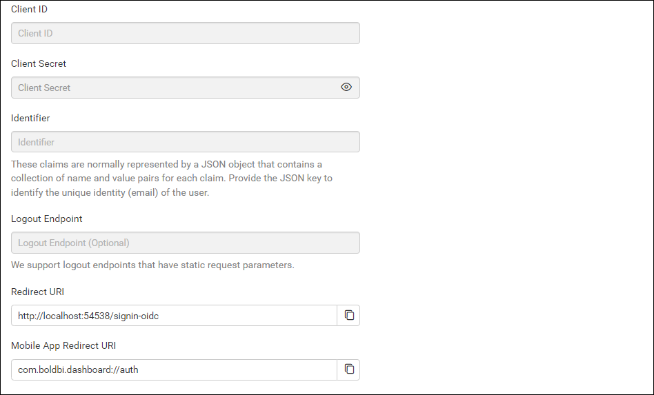
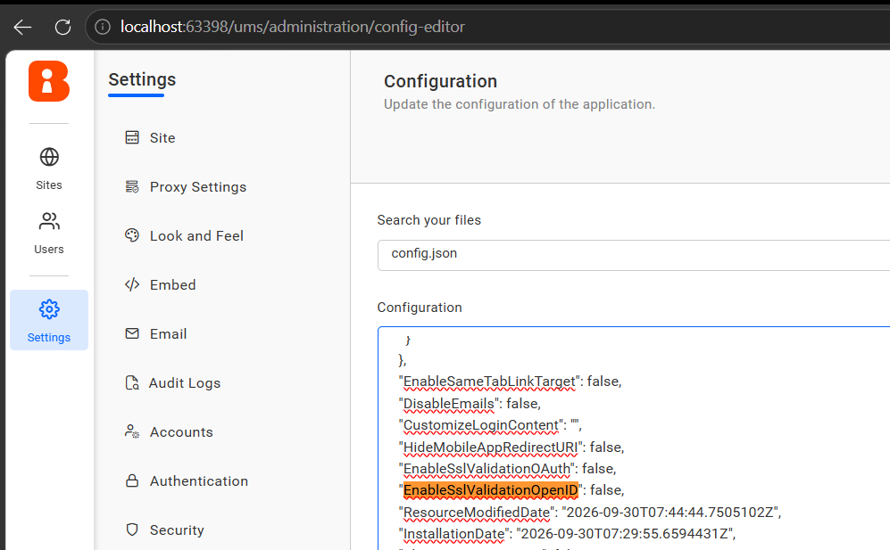
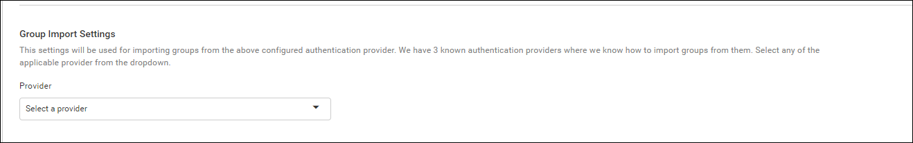
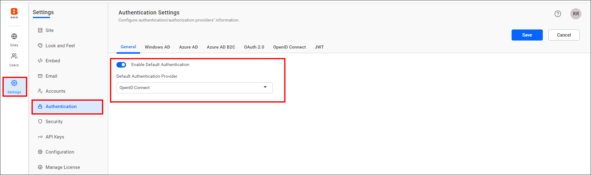
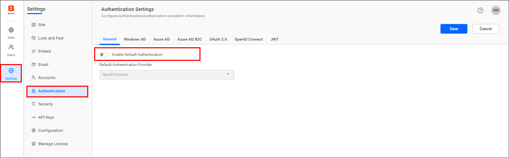

# Configure OpenID Connect SSO in Bold Reports<sup>®</sup> User Management Server

You can configure the Bold Reports<sup>®</sup> User Management Server to use OpenID Connect for Single Sign-On (SSO). Users then log in after authenticating with OpenID Connect.

## What do I need before configuring OpenID Connect?

To configure OpenID Connect in the Bold Reports<sup>®</sup> User Management Server, you need the following:

1. An account with an OpenID provider.

2. Register the User Management Server with the OpenID Connect provider.

## Steps to configure OpenID in User Management Server

To configure OpenID Connect in the Bold Reports<sup>®</sup> User Management Server, follow these steps:

1. Log in to Bold ID with admin credentials.

2. On the left-side menu, go to `Settings`, then `Authentication`, and then `OpenID Connect`.

    
    

3. Provide the following details in the `OpenID Connect` settings page of User Management Server.

    <table>

    <tr>
    <td>Provider Name</td>
    <td>It represents the name of the authentication provider that will be displayed on the login page.</td>
    </tr>

    <tr>
    <td>Provider Logo</td>
    <td>It represents the logo of the authentication provider that will be displayed on the login page.</td>
    </tr>

    <tr>
    <td>Authority</td>
    <td>It is the instance created for the user in the provider's environment.</td>
    </tr>

    <tr>
    <td>Client ID</td>
    <td>It is a unique identifier provided to each of the applications while registering with the providers.</td>
    </tr>

    <tr>
    <td>Client Secret</td>
    <td>It is a secret key that is used to authorize the applications.</td>
    </tr>

    <tr>
    <td>Identifier</td>
    <td>It is the property name that holds the user's email address in the deserialized ID token.</td>
    </tr>

    </table>  

## How do I allow HTTP OpenID Connect endpoints?

To allow HTTP-based OpenID Connect metadata endpoints in Bold Reports<sup>®</sup>, modify the following node in the `config.json` in the configuration settings:

```json
"EnableSslValidationOpenID": false
```

| Setting | Description |
| --- | --- |
| `EnableSslValidationOpenID` | Disables SSL certificate validation for OpenID Connect metadata and authority endpoints. |

> **Note:** Set this option to `false` only for trusted HTTP endpoints in development or internal environments. HTTPS is strongly recommended for production deployments.

The following image shows the OpenID Connect SSL setting.



>Note: Choose the response type for group claims authentication.

## Group Claims Authentication

Group claims authentication in the Bold Reports<sup>®</sup> User Management Server maps users and groups automatically, based on the group claim received in the authentication token. The claims are typically represented as a JSON object containing key-value pairs for each claim. Provide the appropriate JSON key to identify the group claim value.

<table>
    <tr>
        <td>Enable User and Group Mapping </td>
        <td>When enabled, the system fetches group claim values from the token and dynamically maps users to one or more groups during login.</td>
    </tr>
    <tr>
        <td>Un-map Existing Groups of User and map to New Group </td>
        <td>When enabled, all previously assigned groups for the user are removed, and the user is mapped only to the groups specified in the claim.</td>
    </tr>
    <tr>
        <td>Group Claim Name</td>
        <td>Enter the claim name that contains the group identifiers. Users will be mapped only if the group names in the claim match existing groups in the site.</td>
    </tr>
</table>

   

To import the OpenID Connect groups, configure the group details when saving the OpenID authentication settings.  
    

## Which OpenID Connect providers have setup guides?

The following guides explain how to connect each OpenID Connect provider with the Bold Reports<sup>®</sup> User Management Server:

* [Auth0](../../../../authentication/single-sign-on/openid-connect/auth0/)
* [Okta](../../../../authentication/single-sign-on/openid-connect/okta/)
* [OneLogin](../../../../authentication/single-sign-on/openid-connect/onelogin/)
* [Keycloak](../../../../authentication/single-sign-on/openid-connect/keycloak/)

## Set OpenID Connect as default authentication

In the Bold Reports<sup>®</sup> User Management Server, you can set OpenID Connect as the default authentication when [OpenID Connect settings](#steps-to-configure-openid-in-user-management-server) are enabled.

To configure default authentication, follow these steps:

1. On the settings page, go to the `Authentication` tab and select `General`.

2. `Enable` the **Enable Default Authentication** option and select **OpenID Connect** as default authentication provider, as shown in the following screenshot.  

   

## How do I disable OpenID Connect default authentication?

To disable the [OpenID Connect default authentication](#set-openid-connect-as-default-authentication) in Bold Reports<sup>®</sup>, turn off the **Enable Default Authentication** option and then click `Save`.  
    

## Frequently asked questions

### Should I disable SSL validation for OpenID Connect in production?

No. Set `EnableSslValidationOpenID` to `false` only for trusted HTTP endpoints in development or internal environments. HTTPS is strongly recommended for production deployments.

### How do I import OpenID Connect groups?

Configure the group details when you save the OpenID authentication settings.

## See also

* [Default authentication](./../default-authentication/)
* [OAuth 2.0 support](./../oauth-2.0-support/)
* [JWT SSO](./../json-web-token/)
