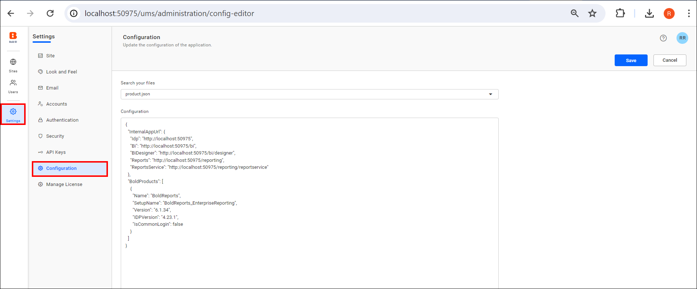
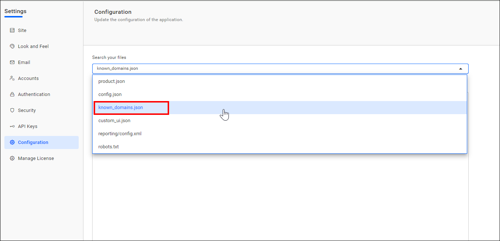
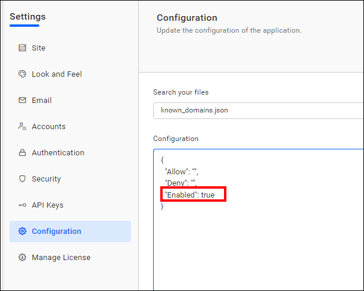
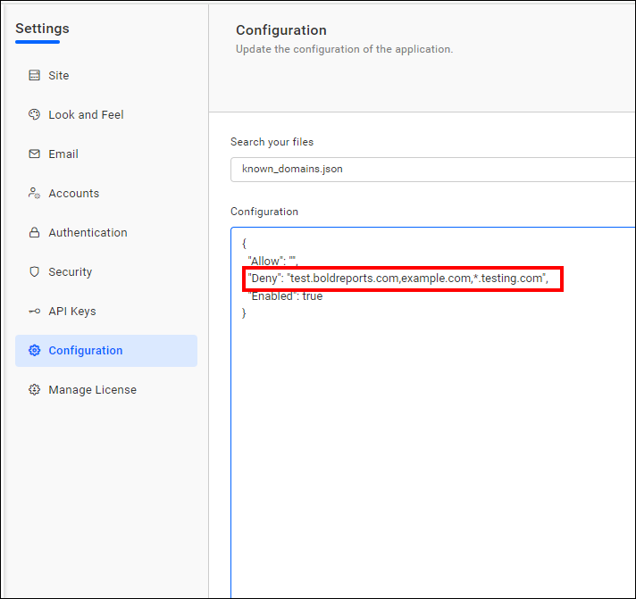
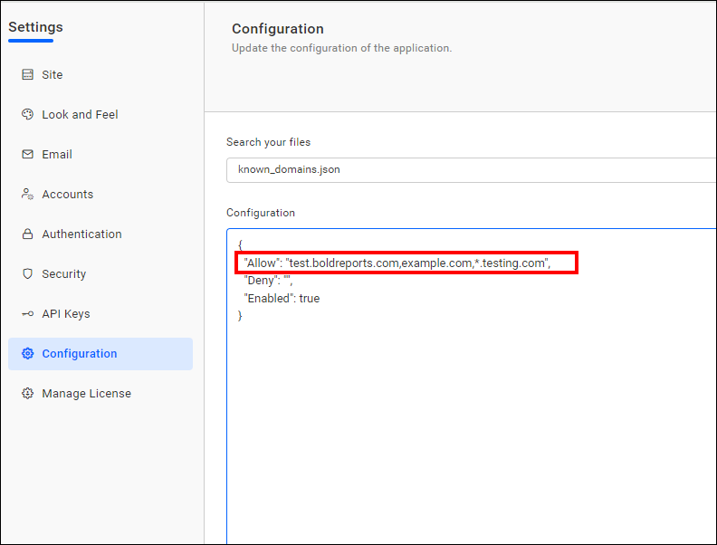
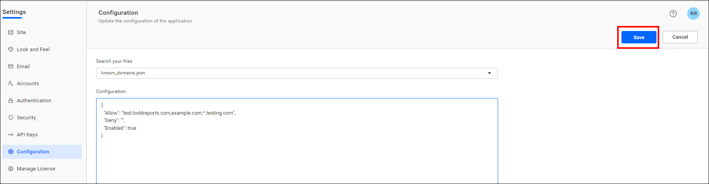

# Configure known domains in Bold Reports® to prevent SSRF

The Known Domains Feature is a security enhancement in Bold Reports® that helps protect your application from certain vulnerabilities. It specifically addresses two common security risks:
* Server-Side Request Forgery (SSRF)
* Open redirect vulnerabilities

## What is Server-Side Request Forgery (SSRF)?

Server-Side Request Forgery (SSRF) is one of the two risks the Bold Reports® Known Domains feature addresses.

* SSRF is a type of security vulnerability where an attacker tricks a server into making requests to internal resources or other external servers.

* By exploiting SSRF, an attacker can potentially access sensitive information, bypass firewalls, or perform actions on behalf of the server.

### What is an open redirect vulnerability?

Open redirect vulnerabilities are the second risk the Bold Reports® Known Domains feature addresses.

* An open redirect vulnerability occurs when an application redirects a user to an external URL without proper validation.
* Attackers can abuse open redirects to trick users into visiting malicious websites or phishing pages.

### Block Sending Data to Unknown Domain

Bold Reports® blocks sending data to unknown domains to stop callback URL attacks.

* The callback URL is present throughout a certain workflow within the application, so the operation status and other data can be delivered back to the program through that URL. What if a scammer changes the URL and manages to regain access to the encrypted data? This is a type of Server-side request forgery (SSRF) attack.

* A server-side request forgery (SSRF) attack is an attack that misuses server functionality to access or modify resources. By modifying the request URL, the attacker induces a server-side application to make requests to an unintended destination.

### Why should I configure known domains in Bold Reports®?

You can avoid an SSRF attack by configuring known domains in Bold Reports® using a known domain JSON file.

* With the Known Domains feature, you can define a list of trusted domains that your Bold Reports® application is allowed to communicate with.

* Any requests made to domains outside this list are automatically blocked.

* Your application then only communicates with authorized and safe domains, reducing the risk of SSRF attacks.

#### How do I configure the known domains?

To configure known domains in the Bold Reports® User Management Server (UMS), follow these steps:

1. Go to `Settings` in Bold Reports® under UMS, then select `Configuration`, as shown in the following image. You can also open the UMS page with the URL `http://<your-domain>/ums/administration/config-editor`.

    

2. Select the `known_domains.json` file to configure the list of allowed and denied domains on this page.

    

3. To configure known domains in Bold Reports®, set the `Enabled` node to `true`.

    

4. Add a list of denied domains to the `Deny` node. To allow or deny all external domains, use the wildcard * in known domain JSON nodes. You can also use a wildcard with the subdomain, such as (`*.boldreports.com, *.*.boldreports.com`).

    

5. Add a list of allowed domains to the `Allow` node. You can add more than one domain by using a comma.
    

    > By default, internal Bold Reports® domains are allowed, meaning domains from Bold Reports® sites.

6. Click the `Save` button to update the Known Domain JSON file.
    

> **Note:** If you have configured the same domain in both the `Allow` and `Deny` lists, the domain will be denied, as the Deny list takes priority.

## Frequently asked questions

### What happens if a domain is in both the Allow and Deny lists?

The domain is denied, because the Deny list takes priority.

### Are Bold Reports® site domains allowed by default?

Yes. By default, internal Bold Reports® domains, meaning domains from Bold Reports® sites, are allowed.

## See also

* [Proxy settings](./../proxy-settings/)
* [Security settings](./../security/)
* [Site administration overview](./../)
