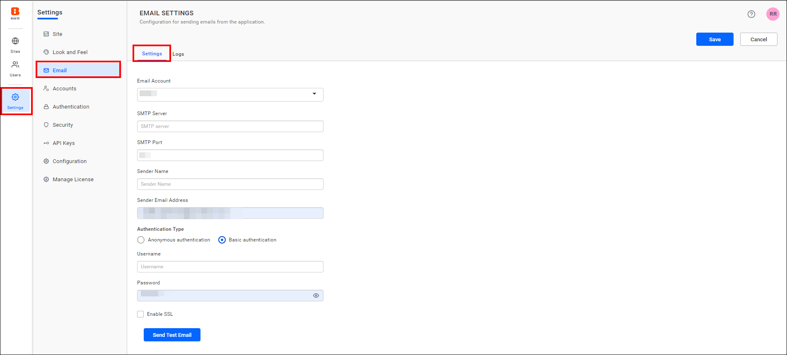
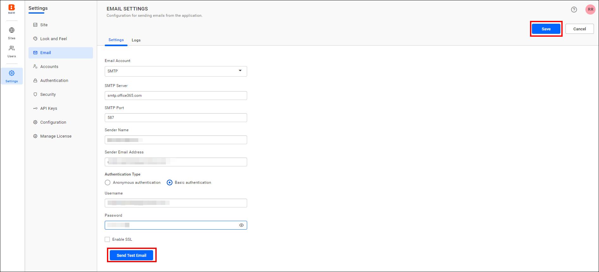

# Configure SMTP email settings in Bold Reports® User Management Server

To send emails from the Bold Reports® User Management Server, configure the [SMTP](https://en.wikipedia.org/wiki/Simple_Mail_Transfer_Protocol) server details.

## Which operations need SMTP email settings?

The Bold Reports® User Management Server needs SMTP email settings to perform the following operations:

**Account Activation:** Sends an email for user account activation.

**Forgot Password:** Sends request links to reset the password when the user has forgotten it.

**Reset Password:** Sends links to reset the password.

## What SMTP details does the User Management Server need?

The following SMTP details are required to send emails from the Bold Reports® User Management Server.

<table>
<tr>
    <td>SMTP Server</td>
    <td>The SMTP server specifies the public IP address or provider that delivers the emails to the end user's mail box. </td>
</tr>
<tr>
    <td>SMTP Port</td>
    <td>The Port number of the SMTP server should vary based on the SMTP server and the connection type(SSL/TLS).</td>
</tr>
<tr>
    <td>Sender Name</td>
    <td>The name displayed on the email as the <b>From name</b>.</td>
</tr>
<tr>
    <td>Sender Email</td>
    <td>The email address displayed as the <b>From email address</b> in the recipient's email.</td>
</tr>
<tr>
<td>Authentication type</td>
<td>
We support two types of authentication:

1. <b>Basic Authentication</b> – This default authentication type requires a username and password.
2. <b>Anonymous Authentication</b> – You can choose this option if you have disabled authentication on your SMTP server.
</td>
</tr>
<tr>
    <td>Username</td>
    <td>Username of the user with email-sending access.</td>
</tr>
<tr>
    <td>Password</td>
    <td>Password of the user.</td>
</tr>
<tr>
    <td>Enable SSL</td>
    <td>If SSL is enabled, it will be used to connect with your SMTP server; otherwise, the connection will be made using TLS.</td>
</tr>
</table>

## How do I configure SMTP account settings?

To configure an SMTP account in the Bold Reports® User Management Server, follow these steps:

1. Click the **Settings** option in the left-side panel and go to `Email settings`, as shown in the following image.
    

2. Fill in the SMTP Server, SMTP port, Sender Name, Sender Email Address, Authentication Type, Username, and Password fields.

3. Save the settings.

    

## Frequently asked questions

### Which SMTP authentication types are supported?

The User Management Server supports Basic Authentication, the default, which requires a username and password. It also supports Anonymous Authentication for SMTP servers with authentication disabled.

### What happens if I do not enable SSL?

If SSL is not enabled, the connection to your SMTP server is made using TLS.

## See also

* [Account settings](./../account-settings/)
* [Proxy settings](./../proxy-settings/)
* [Site administration overview](./../)
