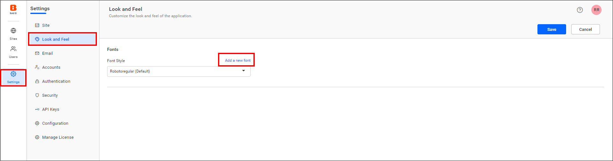
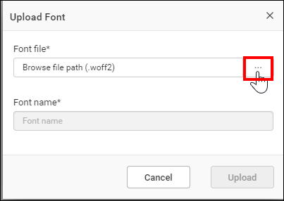
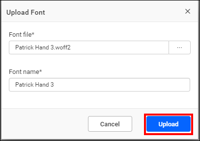
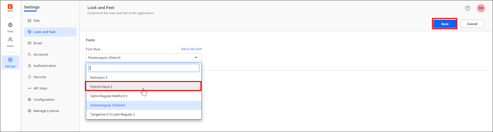
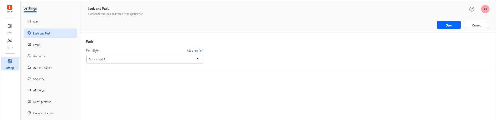

# Customize the font style in Bold Reports®

The default font style in the Bold Reports® application is **Robotoregular**. You can customize the font style by uploading your own font file.

## How do I add a new font?

To add a new font to the Bold Reports® application, follow these steps:

1. Go to the **Look and Feel** settings page and click the `Add a new font` option.

    

2. Browse the font file and click **Upload** in the dialog.

    

    

3. The uploaded font file is listed in the Font Style drop-down. Select the uploaded font and save the settings.

    

## What does the application look like after applying the font?

The following sample image shows the Bold Reports® application after the custom font is applied.

## Frequently asked questions

### What is the default font in Bold Reports®?

The default font style in the Bold Reports® application is **Robotoregular**.

## See also

* [Look and feel settings](./../)
* [Rebranding](./../../rebranding/)
