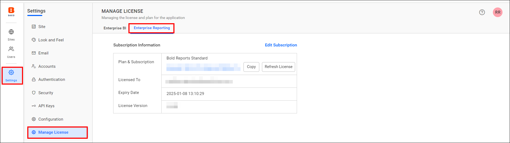
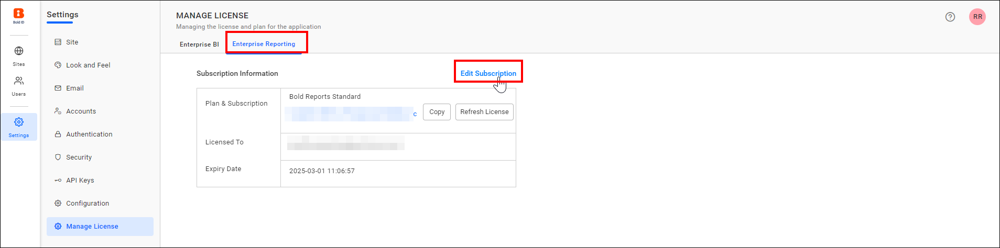
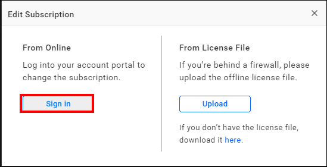
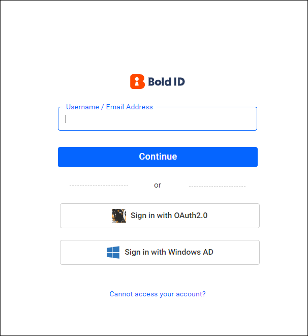
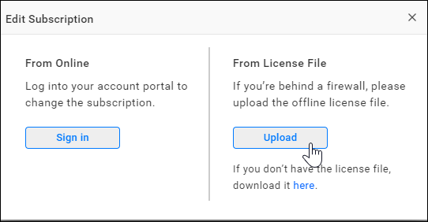
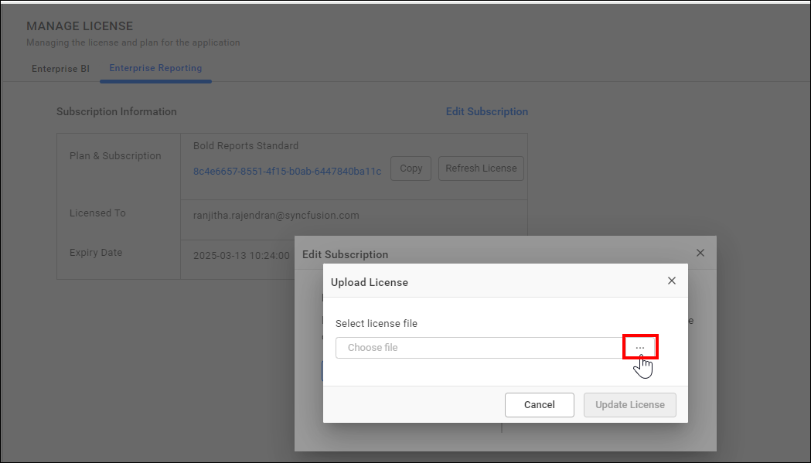
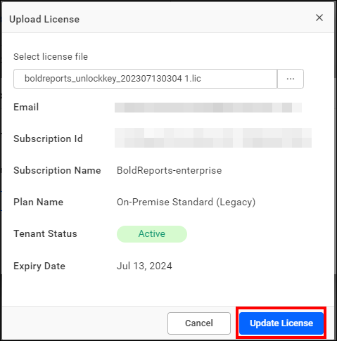

# Manage license in Bold Reports®

You can update the license in Bold Reports® Enterprise manually from the **Manage License** page in the Bold ID UMS application, either online or with a license file.

## How do I open the Manage License page?

To open the Bold Reports® Manage License page, follow these steps:

1. Open your Bold ID UMS application URL and log in with the Site Administrator account.

2. Go to `Settings` -> `Manage License`.

   

3. Choose your preferred mode to update the license.

   1. [Update license from online](#update-license-from-online)
   2. [Update license from license file](#update-license-from-license-file)

## Update license from Online

To update the Bold Reports® license online, follow these steps:

1. On the Manage License page, click `Edit Subscription`.

   

2. Click `Sign in` to change the subscription.

   

3. In the login pop-up, log in with your Bold ID account linked with your Bold Reports® subscription.

   

After you log in successfully, the license is updated in the application.

## Update license from License file

To update the Bold Reports® license in firewall-restricted environments, use the offline unlock key to activate the account. Download your offline unlock key from the [Bold Reports® account downloads page](https://www.boldreports.com/account/downloads?tab=self-service).

   > To learn how to get your offline license key from the Bold Reports® accounts page, see the [KB article on getting your offline license key](https://support.boldreports.com/kb/article/13271/how-do-i-get-my-offline-license-key-from-our-bold-reports-account-page).

Then, follow these steps:

1. Click the `Upload` option to upload your license file.

   

2. Select your license file in the dialog.

   

3. After uploading the unlock key, click the **Update License** button to update the license.

   

### What errors can occur when I upload a license file?

The following table lists Bold Reports® license file errors and their solutions.

<table>
 <tr>
    <td>
       Cases
    </td>
     <td>
        Solution
    </td>
 </tr>
 <tr>
 <td> Invalid File Type </td>
 <td> Please ensure that you upload the valid unlock key file (.lic) that was downloaded from <a href ="https://www.boldreports.com/account/downloads?tab=self-service" target="_blank">here</a>. </td>
 </tr>
 <tr>
 <td> Unlock Key Expired </td>
 <td> Your unlock key has expired. Please download the new unlock key file from <a href ="https://www.boldreports.com/account/downloads?tab=self-service" target="_blank">here</a>. </td>
 </tr>
 </table>

## How do I get help with license issues?

If you face any issues with your Bold Reports® license, [contact Syncfusion® support](https://www.syncfusion.com/support/directtrac/incidents/newincident) for assistance.

> **Note:** For instructions on activating your account during application startup, see [Application startup](./../../../../application-startup/).

## Frequently asked questions

### How do I update the license in a firewall-restricted environment?

Use the offline unlock key. Download it from the Bold Reports® account downloads page, upload the license file, and click **Update License**.

### What should I do if my unlock key has expired?

Download the new unlock key file from the Bold Reports® account downloads page and upload it.

## See also

* [Application startup](./../../../../application-startup/)
* [Site administration overview](./../)
