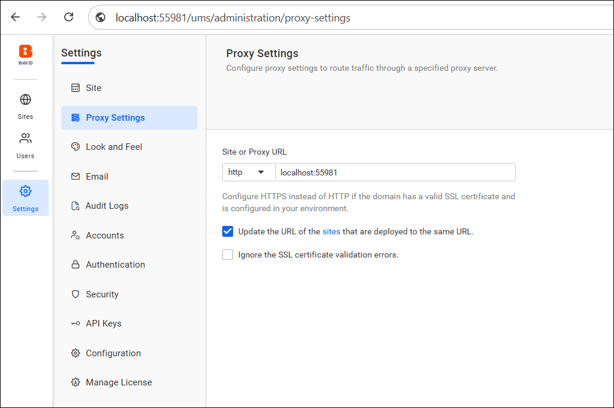
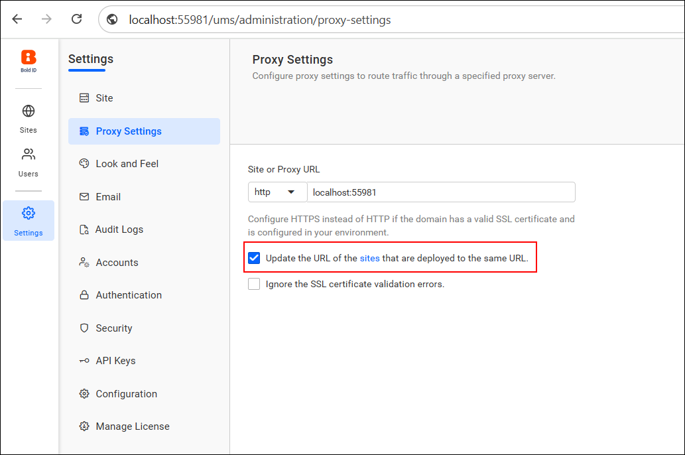
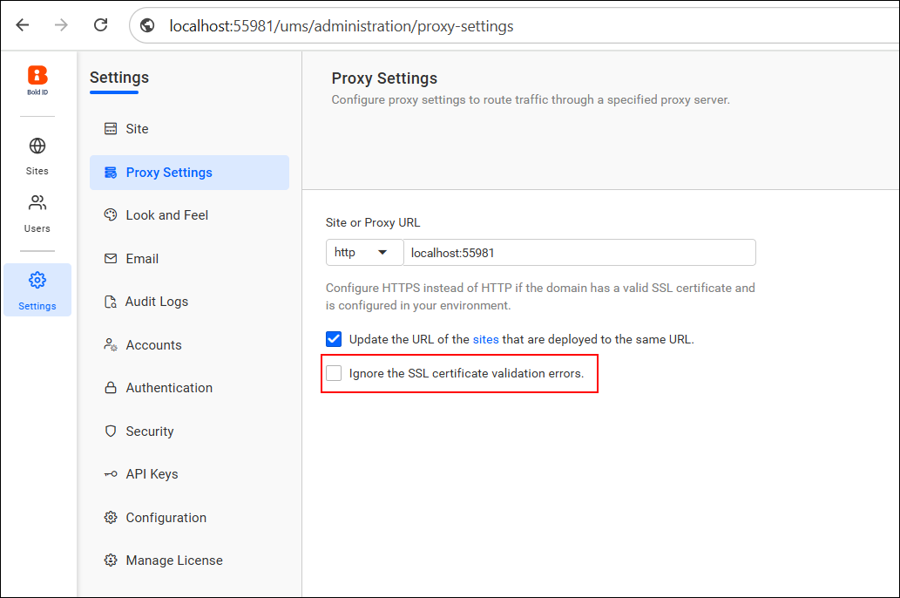

# Configure reverse proxy settings in Bold Reports®

You can configure proxy settings in the Bold Reports® application to route traffic through a specified proxy server.

## What is a Reverse Proxy?

A **reverse proxy** is a server that sits between client devices and your backend application servers, such as Bold Reports®. It receives incoming requests from clients and forwards them to the appropriate internal server. After the internal server responds, the reverse proxy sends the response back to the client.

## How do I configure the proxy URL?

To configure the proxy URL in Bold Reports®, set the protocol and the domain:

* Choose either `http` or `https` for the protocol based on your certificate configuration.
* In the **Site or Proxy URL** field, enter your desired domain (e.g., **example.com** or **localhost:55981**).

   

## Which proxy options are available?

The Bold Reports® proxy settings include the following options.

### Update the URL of the sites

* Enable this checkbox to automatically update the URL for all Bold Reports® sites that are deployed using the same domain.

   

### Ignore SSL Certificate Validation

* If your environment does not have a valid SSL certificate, you can check **Ignore the SSL certificate validation errors** in Bold Reports®.
* This option helps in development or internal environments without a trusted certificate authority.

   

#### Notes

* Use **https** only if a valid SSL certificate is configured.
* After the proxy settings are updated, you need to **restart IIS** for the changes to take effect.

> To set up Bold Reports® to work securely through an Nginx reverse proxy, follow the step-by-step guide. It explains how to deploy Bold Reports® on different platforms and connect it through a Linux-based reverse proxy. See the [KB article on deploying Bold Reports® with a reverse proxy](https://support.boldreports.com/kb/article/20447/bold-reports-deployment-using-reverse-proxy-setup).

## Frequently asked questions

### Do I need to restart anything after changing proxy settings?

Yes. After the proxy settings are updated, you need to **restart IIS** for the changes to take effect.

### When should I ignore SSL certificate validation?

Ignore SSL certificate validation only if your environment does not have a valid SSL certificate, such as development or internal environments without a trusted certificate authority.

## See also

* [Known domain configuration](./../configuration/)
* [Email settings](./../email-settings/)
* [Site administration overview](./../)
