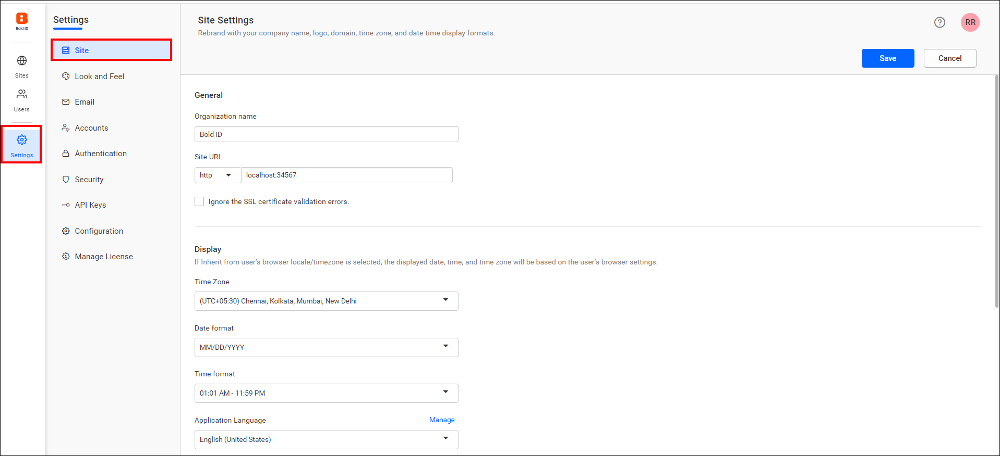
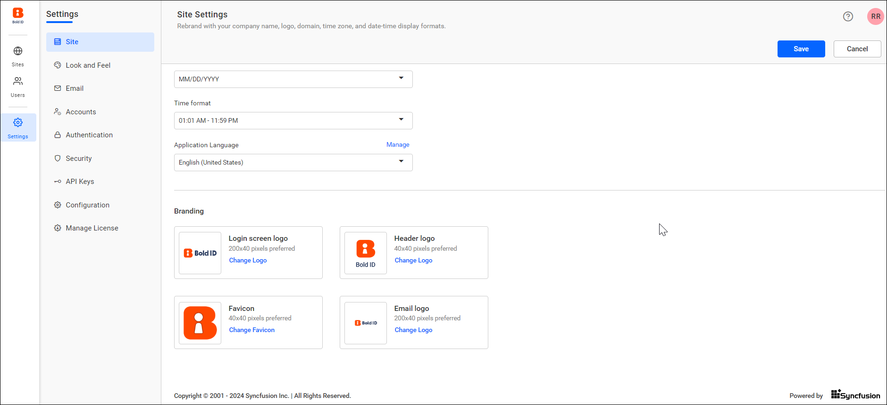

# Rebrand and white label the Bold Reports® User Management Server

You can rebrand the Bold Reports® User Management Server (Bold ID) with your own branding. Change the organization name, header logo, favicon, email logo, time zone, and date-time display formats.

## What can I rebrand in the User Management Server?

The Bold Reports® User Management Server can be rebranded and white-labeled with the organization name, header logo, favicon, email logo, time zone, and date-time format. The following images show the site settings page.

## Organization Name

You can change the name of the User Management Server at any time, and it appears in the title bar of the browser.

## Login Screen

You can change the User Management Server login page logo image, and the preferred image size is `200 x 40` pixels. By default, the User Management Server displays the Bold ID login logo.

## Header Logo

You can change the User Management Server header logo image, and the preferred image size is `40 x 40` pixels. By default, the User Management Server displays the Bold ID logo as the main screen logo.

## Favicon

You can change the favicon for the User Management Server, and the preferred image size is `40 x 40` pixels. By default, it displays the Bold ID favicon.

## Email

You can change the User Management Server email logo image, and the preferred image size is `200 x 40` pixels. By default, the User Management Server displays the Bold ID email logo.

## Display

The Display settings in the User Management Server control the time zone, date format, and time format.

### Time zone

You can change the time zone for the User Management Server. The User Management Server sets the Coordinated Universal Time (UTC) as the default time zone.

### Date format

You can change the date format of the User Management Server. The User Management Server uses `MM/dd/yyyy` as the default date format.

### Time format

You can change the time format of the Bold Reports® site. The User Management Server uses `12 hour` as the default time format.

## Language

You can localize the Bold Reports® User Management Server to any culture. To add a new localization or edit an existing one in the User Management Server, see [Localization](./../../../localization/).

## Frequently asked questions

### What image size should I use for the header logo?

The preferred header logo image size is `40 x 40` pixels.

### What are the default date and time formats?

The User Management Server uses `MM/dd/yyyy` as the default date format and `12 hour` as the default time format.

## See also

* [Look and feel settings](./../look-and-feel-settings/)
* [Proxy settings](./../proxy-settings/)
* [Localization](./../../../localization/)
