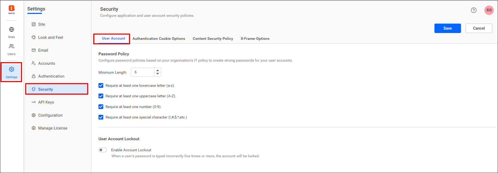
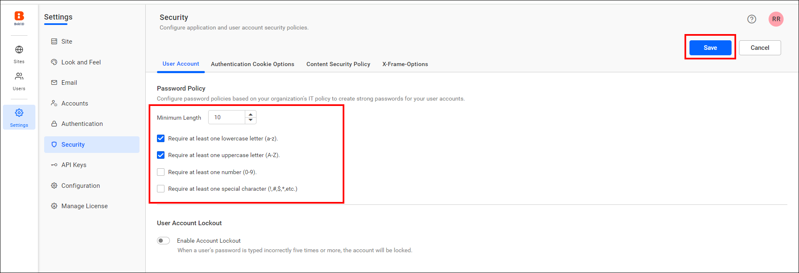
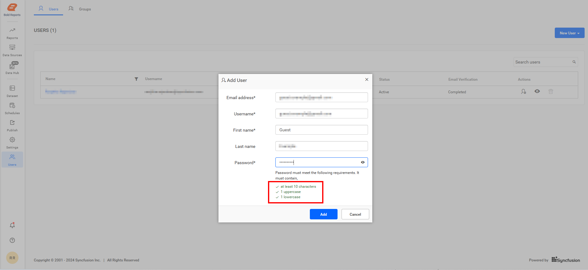

# Configure a custom password policy in Bold Reports®

Bold Reports® lets you customize the password rules for user accounts so the password policy matches your organization's IT policies. The option is available from Bold Reports® v5.4.

## What can I customize in the password policy?

The Bold Reports® password policy lets you set the password length and turn character requirements on or off. You can require at least one lowercase letter, one uppercase letter, one number, and one special character.

## How do I customize the password policy?

Follow these steps to customize the password policy in Bold Reports®:

1. On the settings page, click the `Security` tab and select `User Account`.

    

2. Set a maximum length, and enable or disable requirements such as at least one lowercase letter, an uppercase letter, a number, and a special character.

3. Click the save button to save the changes.

    The following screenshots show the password requirement settings and how the rules appear when a user enters a password.

    

    

    > **Note:** Users can set a minimum of 6 and a maximum of 64 characters for the length policy.

## Where does the password policy apply?

The Bold Reports® password policy works wherever passwords are required on the site. The rules apply in the following places where a user password is created:

* When adding users.
* When resetting a user's password.
* When activating a user account.

## Frequently asked questions

### What password length can I set in Bold Reports®?

The Bold Reports® length policy accepts a minimum of 6 and a maximum of 64 characters.

### Which Bold Reports® version added the custom password policy?

The option to customize password rules for user accounts was provided in Bold Reports® v5.4.

## See also

* [Account settings](../account-settings/)
* [Two-factor authentication](../../two-factor-authentication/)
* [Manage users](../../../manage-users/users/manage-users/)
