# User interface customization in Bold Reports<sup>®</sup>

You can customize the Bold Reports<sup>®</sup> application user interface by editing the **custom_ui_reports.json** configuration file. You can add custom menus, list menu items, change their order, and define how information is organized and displayed based on your preferences.

## How do I open and edit the UI customization file?

You customize the Bold Reports<sup>®</sup> user interface by editing **custom_ui_reports.json** from the UMS Settings page. Follow these steps:

1. Go to the **UMS Settings** page.
    `Example: http://{yourdomain}/ums/administration`
    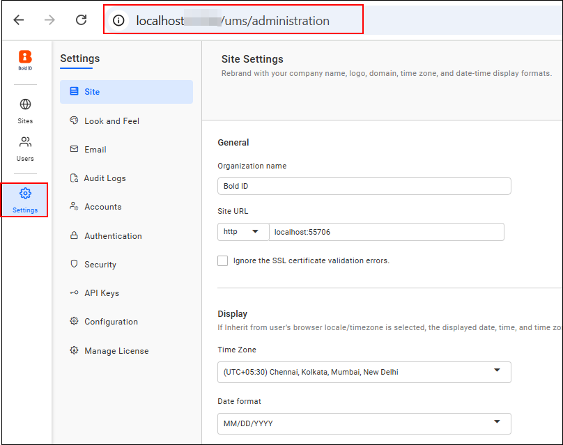

2. Select the **Configuration** tab from the settings menu.

3. From the **Search your files** drop-down, choose **custom_ui_reports.json**.

    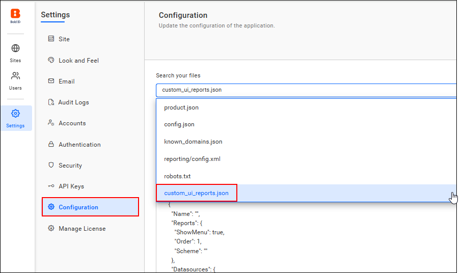

4. Fill in the required fields in the file and **save** the changes.
5. Restart the application and access the site. For more information, see [how to restart the Bold Reports<sup>®</sup> Enterprise application](https://help.boldreports.com/enterprise-reporting/administrator-guide/faq/how-to-restart-the-bold-reports-enterprise-application/).

### Which fields does the Custom UI JSON contain?

The Custom UI JSON file in Bold Reports<sup>®</sup> contains the following fields, which you use to customize the UI:

* Sites

* Profiles

* Schemes

* Custom Menus

* Custom Schedule Options

### Sites

The Sites field in the Bold Reports<sup>®</sup> Custom UI JSON maps a site to a profile. Provide the site name and the corresponding profile name that you want to customize the UI for.
    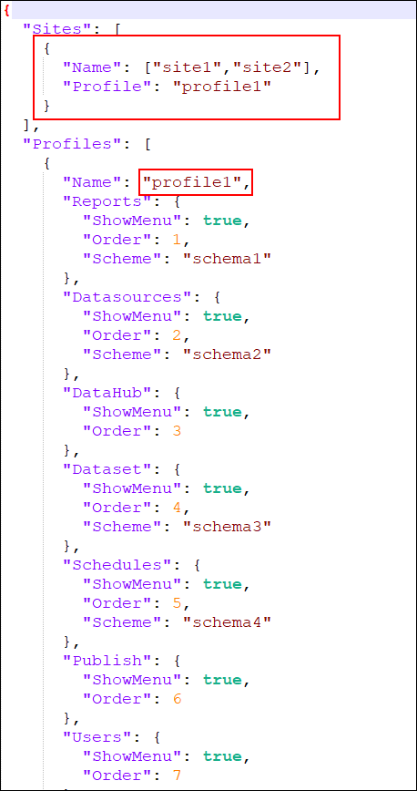

### Profiles

The Profiles field in the Bold Reports<sup>®</sup> Custom UI JSON contains a list of default left-side menu options and custom menus.
    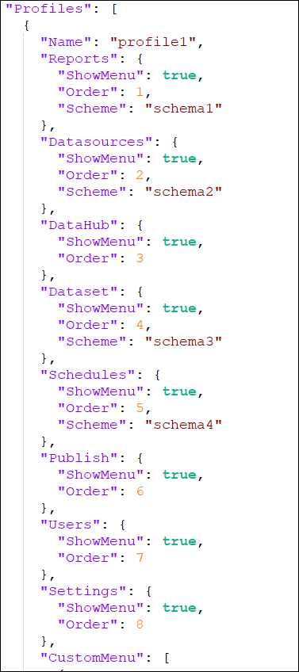

### Profile syntax

The following sample shows the full Bold Reports<sup>®</sup> profile syntax with every menu option:

```sh
 "Profiles": [
    {
      "Name": "profile1",
      "Reports": {
        "ShowMenu": true,
        "Order": 1,
        "Scheme": ""
      },
      "Datasources": {
        "ShowMenu": true,
        "Order": 2,
        "Scheme": ""
      },
      "DataHub": {
        "ShowMenu": true,
        "Order": 3
      },
        "Dataset": {
        "ShowMenu": true,
        "Order": 4,
        "Scheme": ""
      },
      "Schedules": {
        "ShowMenu": true,
        "Order": 5,
        "Scheme": ""
      },
      "Publish": {
        "ShowMenu": true,
        "Order": 6
      },
      "Users": {
        "ShowMenu": true,
        "Order": 7,
        "RestrictManageProfile": false
      },
      "Settings": {
        "ShowMenu": true,
        "Order": 8
      },
      "UserImport": [
        {
          "HideAddUser": false
        }
      ],
      "CustomMenu": [
        {
          "Name": ""
        }
      ],
      "CustomScheduleOptions": {
        "HideSignIn": false,
        "HideScheduleTemplateHeader": false,
        "HideScheduleTemplateFooter": false,
        "HideReportLink": false,
        "TimestampFormatForExportedReport": ""
      },
      "Notifications": {
        "ShowMenu": true
      },
      "Help": {
        "ShowMenu": true
      },
      "Profile": {
        "ShowMenu": true,
        "ShowManageSite": true,
        "ShowYourSites": true,
        "ShowMyProfile": true,
        "ShowLogout": true
      }
    }
  ]
```

**Name:** Provide the name of the profile that will be used to specify the profile under the Sites section.

**ShowMenu:** Determines whether the specific left-side menu option is shown or hidden.

**Order:** Specifies the position of the menu option.

**Scheme:** Provide the corresponding scheme name. The scheme customizes the item listing and context menu options.

**CustomScheduleOptions:** Enables customization of the scheduled email content.

**Notifications:** Specifies whether the **Notifications** menu is displayed.

* **ShowMenu**
  When set to `true`, the Notifications menu is displayed.
  When set to `false`, the Notifications menu is hidden.

    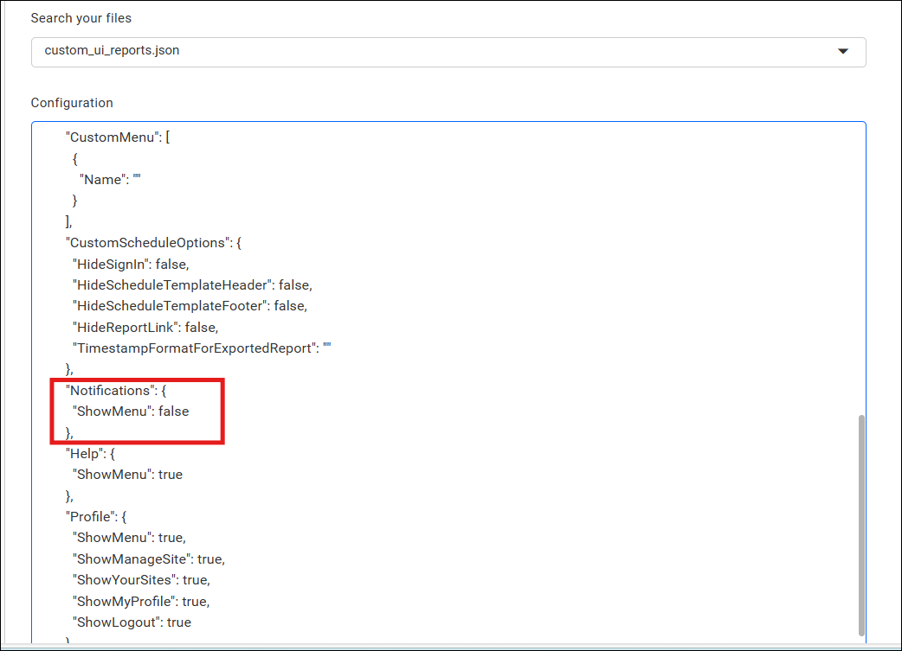

  After setting ShowMenu to false, the Notifications menu is hidden.
    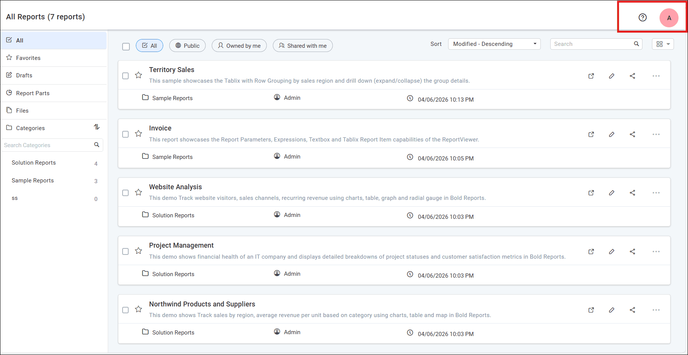

**Help:** Specifies whether the **Help** menu is displayed.

* **ShowMenu**
  When set to `true`, the Help menu is displayed.
  When set to `false`, the Help menu is hidden.

    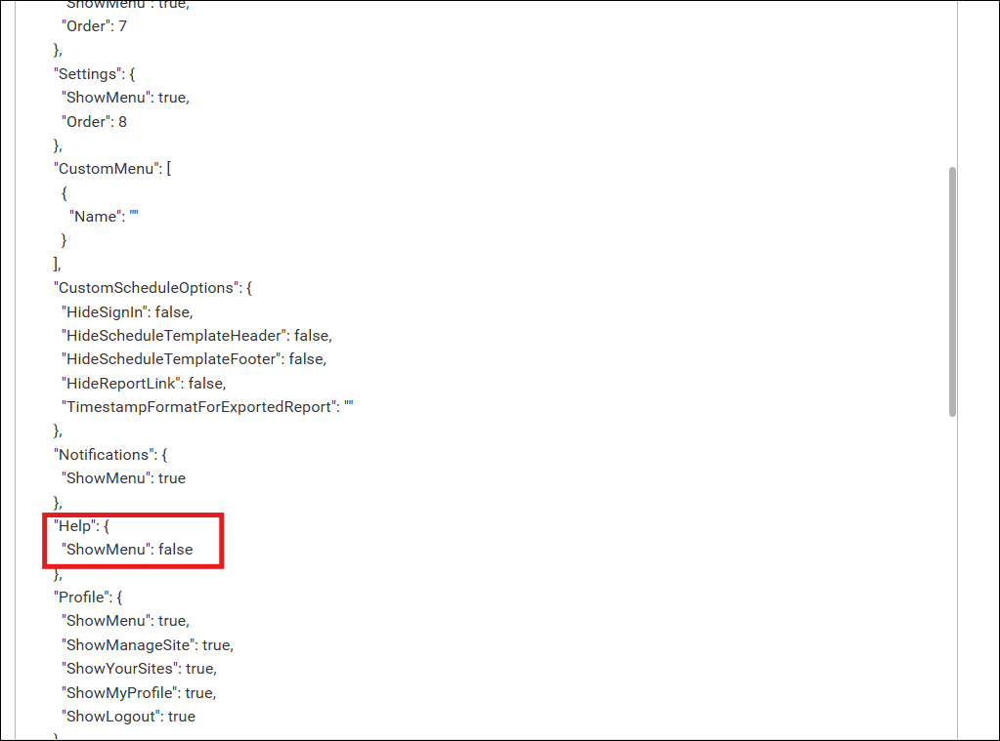

  After setting ShowMenu to false, the Help menu is hidden.
    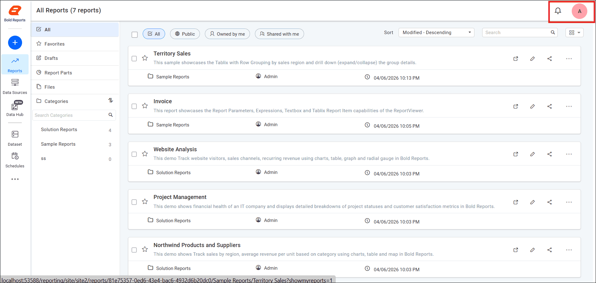

**Profile:** Specifies whether the **Profile** menu is displayed.

* **ShowMenu**
  When set to `true`, the management actions are hidden.
  When set to `false`, the management actions are displayed.

    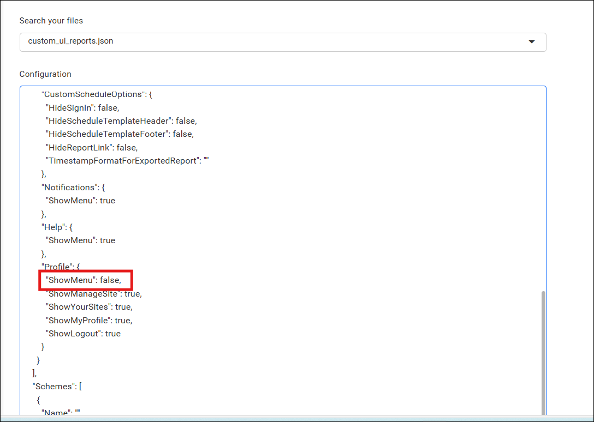

  After setting ShowMenu to false, the Profile menu is hidden.
    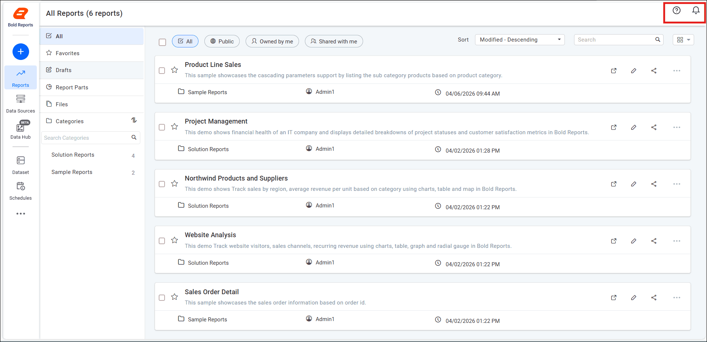

* **RestrictManageProfile**
  When set to `true`, user management actions such as **Assign Group**, **Delete User**, and **Activate/Deactivate User** are hidden.
  These actions are also unavailable when multiple users are selected.

    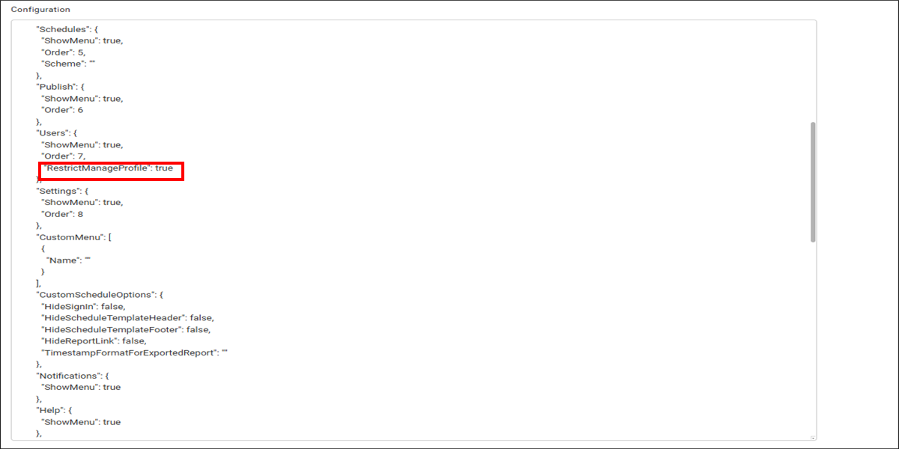

  After setting **RestrictManageProfile** to `true`, the user management actions are hidden on both the **Users** page and the **User Details** page.
    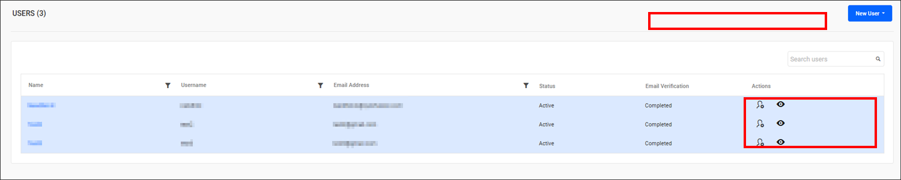
    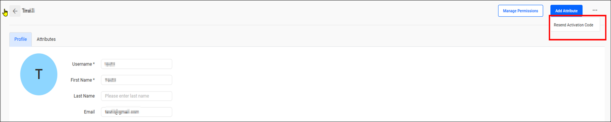

  When set to `false`, the user management actions are displayed based on the current user's permissions.

* **HideAddUser**
  When set to `true`, the **Add User** option in the **Users** page and the **Add User** option in the **Edit Group** page are hidden.
  When set to `false`, the **Add User** option is displayed on both the **Users** page and the **Edit Group** page.

    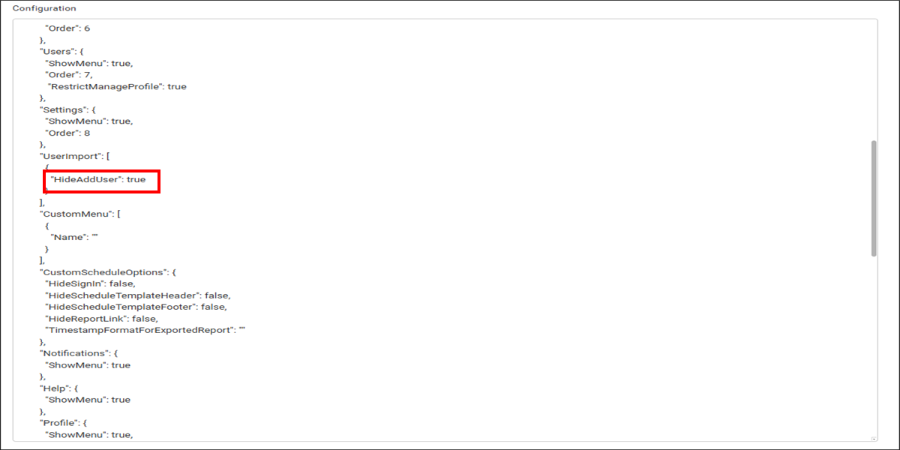

  After setting **RestrictManageProfile** to `true`, the user management actions are hidden on both the **Users** page and the **User Details** page.
    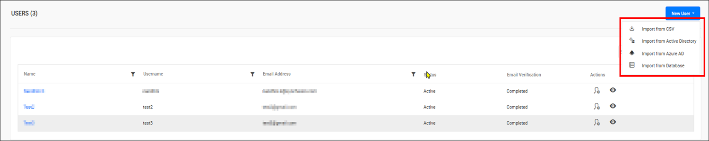
    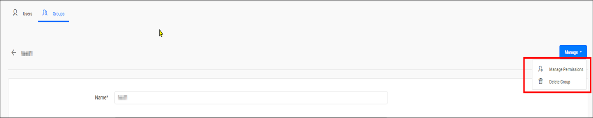

### Schemes

A scheme in the Bold Reports<sup>®</sup> Custom UI JSON shows or hides context menu items on item listing pages. Schemes are available on the Reports, Data Sources, Dataset, and Schedules pages.
    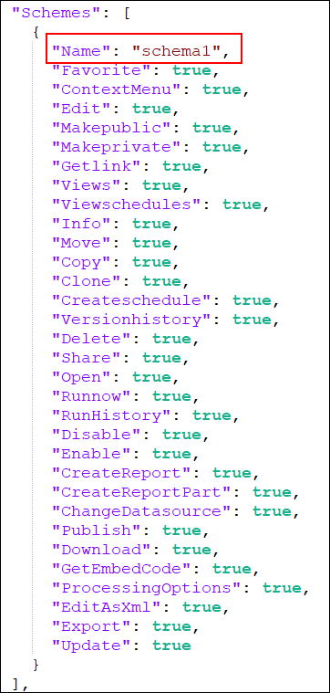

For example, you can **hide** the **Get Link** option in the Reports context menu. Set the Getlink property to **false** and specify the corresponding `scheme name` in the **profile**.

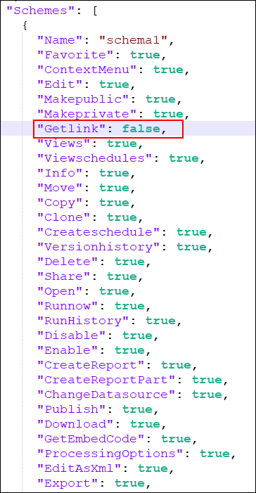
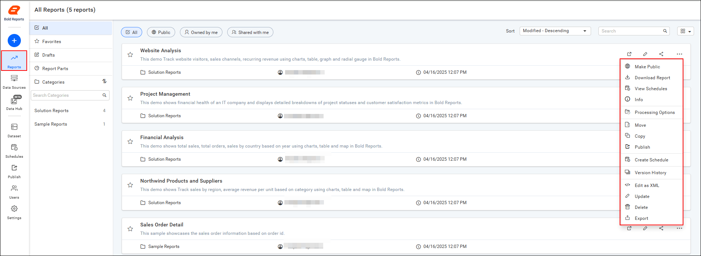

### How do I add custom items to the navigation menu?

You can add new menu items to the Bold Reports<sup>®</sup> left-side menu, displayed along with the default menu items. The following screenshots show the custom menu definition, the custom menu in the profile, and the resulting menu.

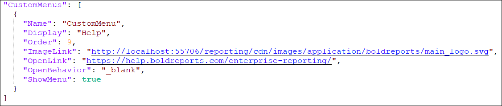
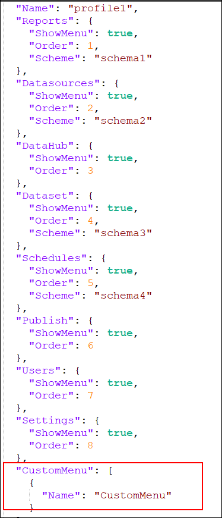
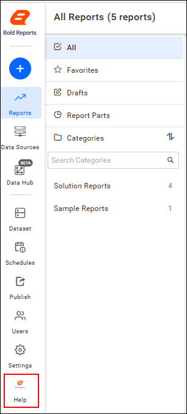

**Name:** Specify the name of the scheme. This name is used to identify the scheme in the profiles.

**Display:** The name that is shown in the menu item.

**Order:** The position of the menu item when displayed in the left-side menu bar.

**ImageLink:** The URL of the image to be displayed in the menu item.

**OpenLink:** The URL of the site or page to navigate to when the menu item is clicked.

**OpenBehavior:** Determines whether the custom menu page opens in the same window or in a new tab.

**ShowMenu:** Determines whether the custom menu is visible or hidden.

### How do I customize scheduled email options?

Use the Bold Reports<sup>®</sup> custom schedule options to control the visibility of specific elements in the scheduled email template.
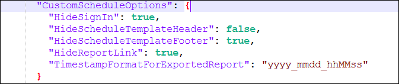

**HideSignIn:** Controls whether the `Sign In` option is shown in the scheduled email.

**HideScheduleTemplateHeader:** Controls the visibility of the header section in the scheduled email template.

**HideScheduleTemplateFooter:**  Controls the visibility of the footer section in the scheduled email template.

**HideReportLink:** Determines whether the report link is included in the scheduled email.

**TimestampFormatForExportedReport:** Defines a custom timestamp format for exported reports.

  For example, enter a valid timestamp format within the string, or leave it blank to use the default timestamp format.

#### What does a sample UI customization look like?

The following Bold Reports<sup>®</sup> example customizes **site1** by using the profile **profile1** and the scheme **schema1**, with changes applied to the order of the menu items.

  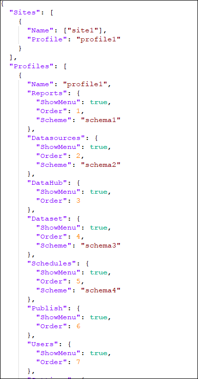

* In this example, the order of the side menu items is changed.
  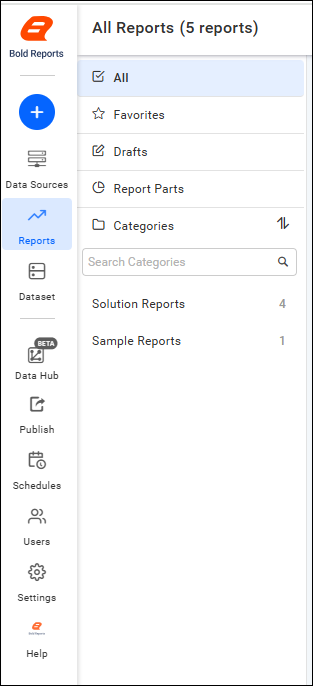

* Different schemes are provided for Reports, Data Sources, Dataset, and Schedules.

  For example, the **Info** option is visible in the Reports context menu but hidden in the Data Sources context menu.
  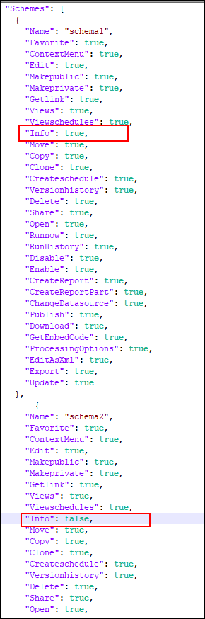
  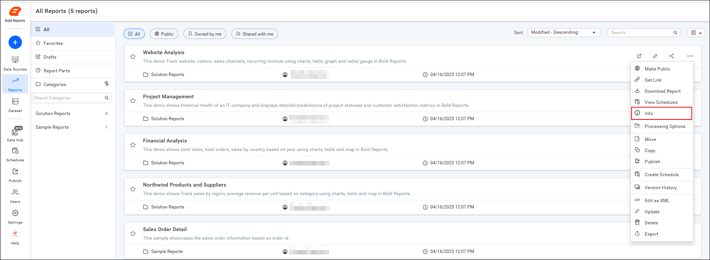
  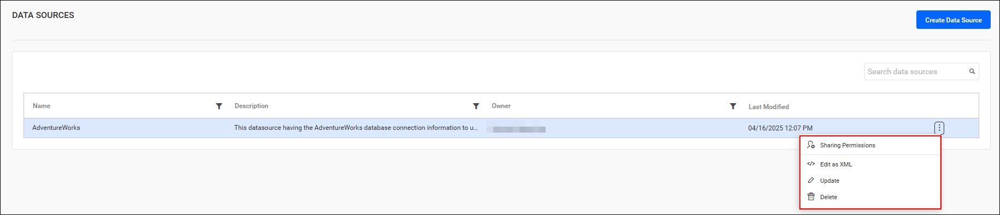

  Two different custom menu options are provided as examples to demonstrate how custom items can be added to the side menu.
  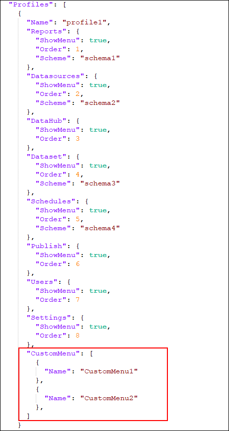
  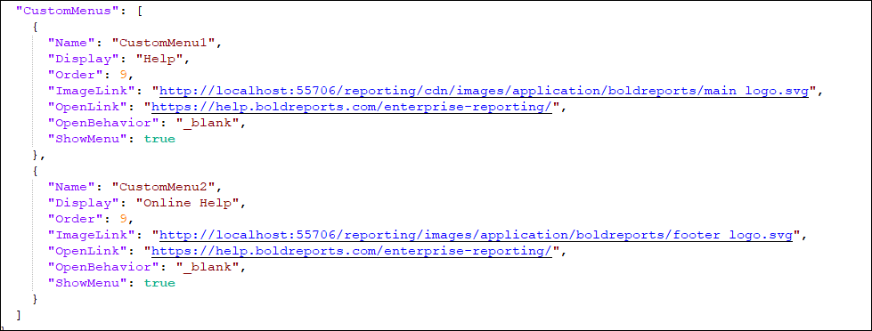
  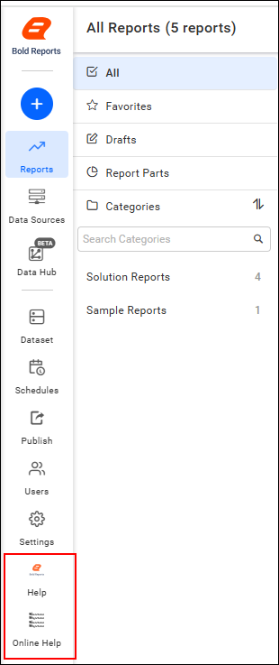

## Frequently asked questions

### Do I need to restart Bold Reports<sup>®</sup> after editing custom_ui_reports.json?

Yes. After you save the changes to **custom_ui_reports.json**, restart the Bold Reports<sup>®</sup> application and access the site.

### Which pages support schemes?

Schemes in Bold Reports<sup>®</sup> are available on the Reports, Data Sources, Dataset, and Schedules pages.

## See also

* [Rebranding](../rebranding/)
* [Look and feel settings](../look-and-feel-settings/)
* [Configuration](../configuration/)
