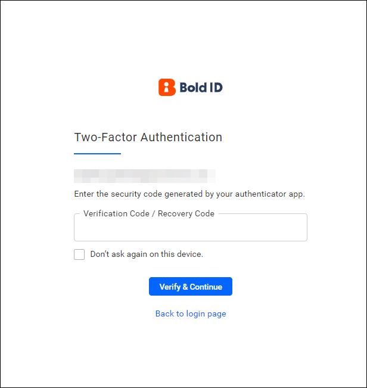

# Two-factor authentication in Bold Reports®

Two-factor authentication (2FA) in Bold Reports® adds an extra layer of protection against unauthorized access to your account. With 2FA enabled, you enter a verification code generated by your smartphone during each login.

## How do I enable or disable two-factor authentication?

You enable or disable Bold Reports® two-factor authentication for a user account from the user profile. To learn how, see [Two-factor authentication in the user profile](../../user-profile/#two-factor-authentication).

## How do I sign in when two-factor authentication is enabled?

When 2FA is enabled, the Bold Reports® login page requests a verification code. You can enter the verification code generated by any TOTP (Time-based One-time Password) application, or use a recovery code to confirm your identity.

You can also skip 2FA verification on your future logins by enabling the `Don't ask again on this device` check box. The following screenshot shows the login page requesting the verification code.

## Frequently asked questions

### Which apps can generate the Bold Reports® verification code?

Any TOTP (Time-based One-time Password) application can generate the verification code for the Bold Reports® login page.

### What if I cannot use my verification code?

You can use a recovery code instead of the verification code to confirm your identity on the Bold Reports® login page.

## See also

* [User profile](../../user-profile/)
* [Password policy configuration](../site-administration/security/)
* [Manage users](../../manage-users/users/manage-users/)
