# Single database for multiple sites in Bold Reports®

Starting from `version 6.1`, Bold Reports® introduced a feature that supports a `single database for multiple sites`. Multiple sites share the same database, and each site keeps its own set of tables.

## How does a single database support multiple sites?

Bold Reports® uses a multi-tenant architecture, where multiple instances of an application operate in a shared environment. The instances (sites) are logically isolated but physically integrated.

In the context of databases, **multiple sites** share the **same database**, but `each site` has its **own set of tables** that are distinguished by `schema` and `prefix`. The design allows for efficient resource utilization while ensuring data isolation and security for each site.

## How do I create a site in an existing database?

You create a new site in the Bold Reports® On-Premises Edition application from the site management module. Follow these steps:

1. Click the `Create Site` button in the site management module.
    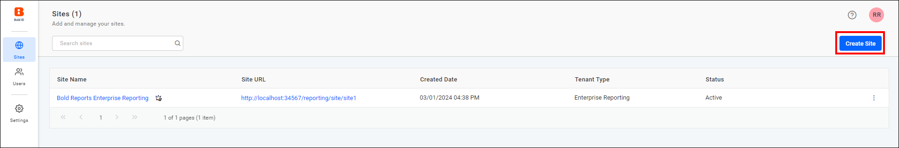

2. Enter the site name and site identifier in the `Site Creation` tab.

3. Click `Next` to proceed.

### Select Database:

The Bold Reports® site creation wizard supports MSSQL Server, PostgreSQL, and MySQL for a single database with multiple sites. Follow the steps for your server type.

#### MSSQL Server

To create another site in an existing Microsoft SQL Server database, follow these steps in Bold Reports®:

1. Select the server type as `Microsoft SQL Server`, and provide the Server name, Username, and Password.
    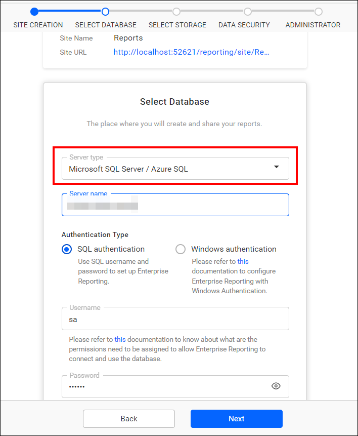

2. Provide the name of the `existing database` that you already used to create a site. Also provide the `new database schema name` and the `new server table prefix name`. Once provided, click `Next` to proceed further.
    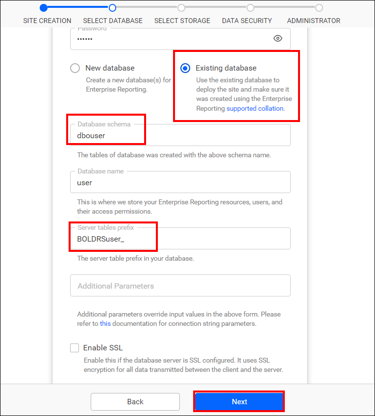

    > **Note:** After configuring the database, follow the steps in [Select storage](./../../../manage-sites/create-site/#select-storage) to create a site.

3. Check the tables in the database. In the screenshots below, `user` represents the existing database. `dbo.BOLDRS_` is the schema and prefix used for the tables created for `site 1`. `dbouser.BoldRSuser_` denotes the newly created schema and prefix for the tables created for `site 2`. Both schemas are present within the single database. By differentiating the schema and prefix names, you can create `multiple sites` within a `single database`.

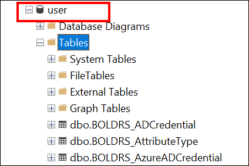
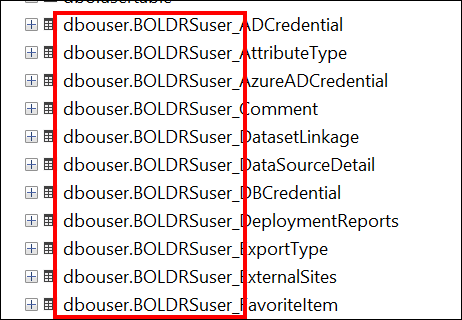

> **Note:** By default in MSSQL, the `database schema name` is **dbo**, and `server table prefix name` is **BoldRS_**.

#### PostgreSQL

To create another site in an existing PostgreSQL database, follow these steps in Bold Reports®:

1. Select the server type as `PostgreSQL` Server, and provide the Server name, Username, and Password.
    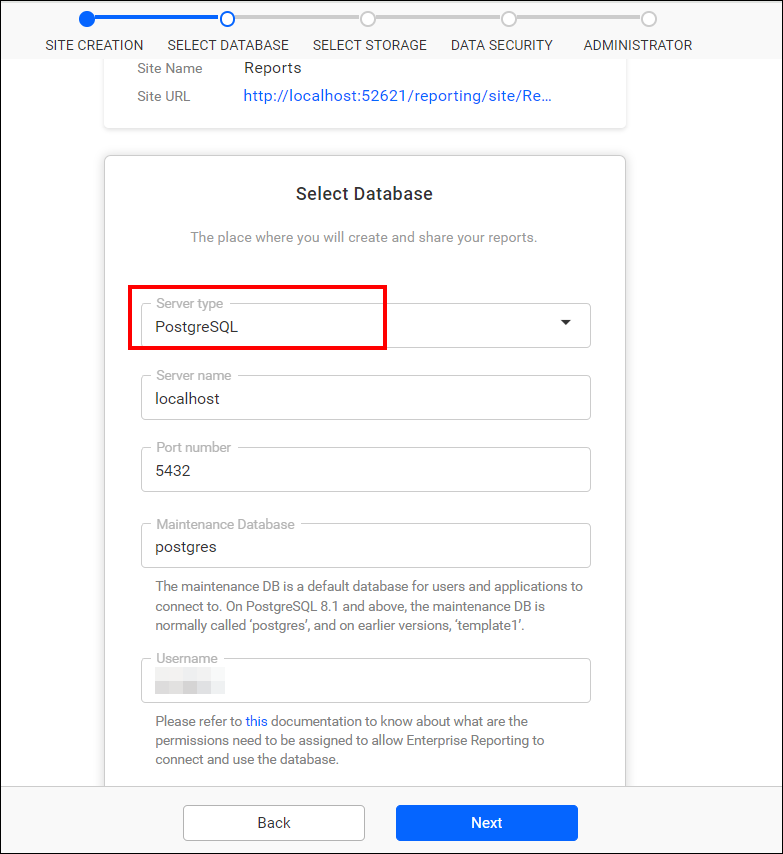

2. Provide the name of the `existing database` that you already used to create a site. Also provide the `new database schema name` and the `new server table prefix name`. Once provided, click `Next` to proceed further.
    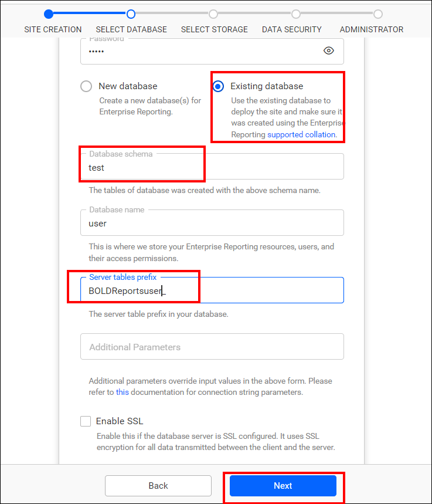

    > **Note:** After configuring the database, follow the steps in [Select storage](./../../../manage-sites/create-site/#select-storage) to create a site.

3. Check the tables in the database. In the screenshots below, `user` represents the existing database. For `site 1`, `public` is the schema and `boldrs_` is the table prefix. For `site 2`, `test` is the newly created schema and `boldreportsuser_` is the newly created table prefix. Both `schemas` are present within the single database. By differentiating the schema and prefix names, you can create `multiple sites` within the `single database`.

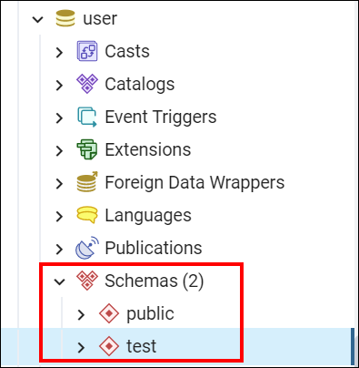
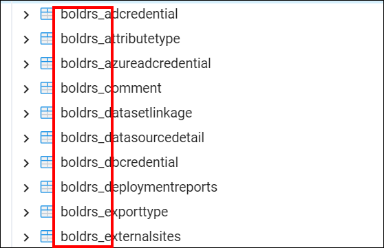
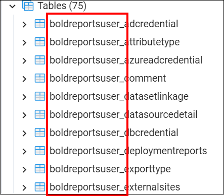

> **Note:** By default in PostgreSQL, the `database schema name` is **public**, and `server table prefix name` is **BoldRS_**.

#### MySQL

To create another site in an existing MySQL database, follow these steps in Bold Reports®:

1. Select the server type as `MySQL` Server, and provide the Server name, Username, and Password.
    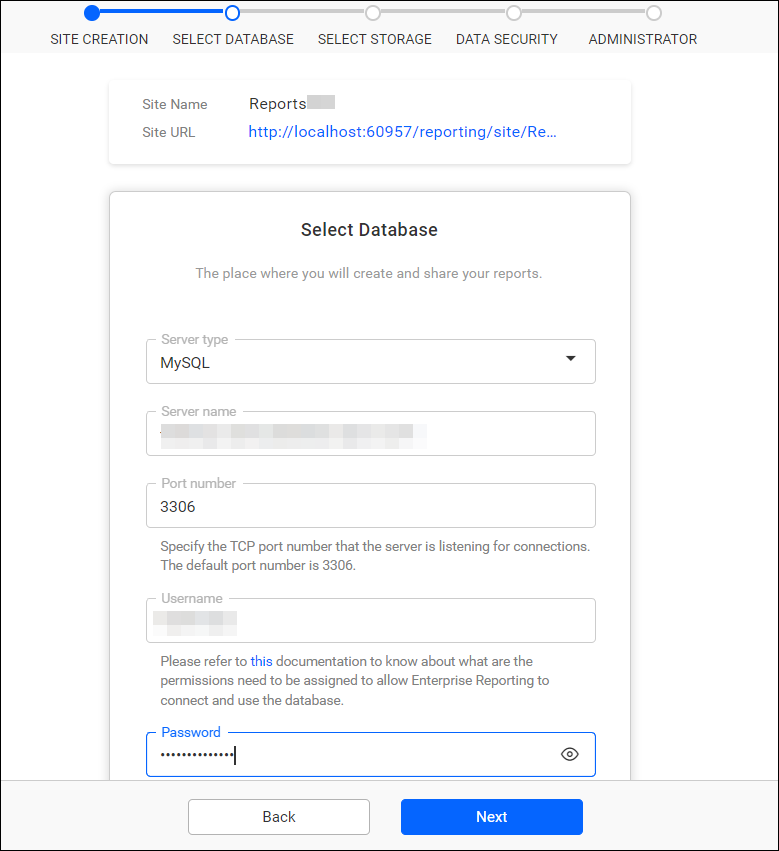

2. Provide the name of the `existing database` that you previously used to create a site, along with the `new server table prefix name`. After providing these details, click `Next` to continue.
    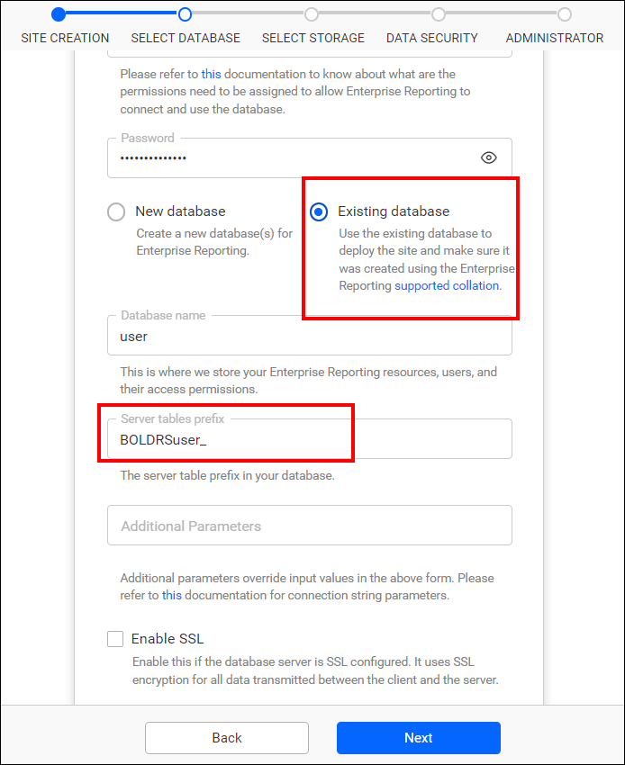

    > **Note:** After configuring the database, follow the steps in [Select storage](./../../../manage-sites/create-site/#select-storage) to create a site.

3. Check the tables in the database. In the screenshots below, `user` represents the existing database. `boldrs_` is the prefix for the tables created for `site 1`. `boldrsuser_` is the newly created prefix for the tables created for `site 2`. Tables for both sites are present within the single database. By differentiating the prefix names, you can create `multiple sites` within the `single database`.

    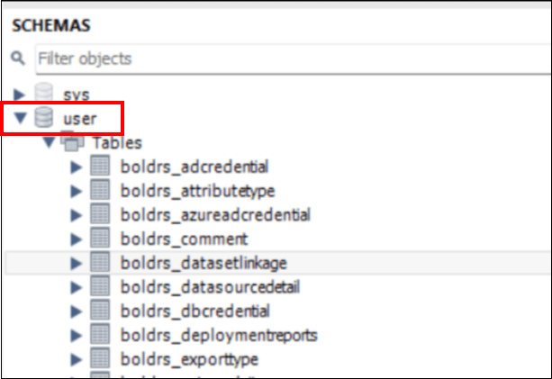
    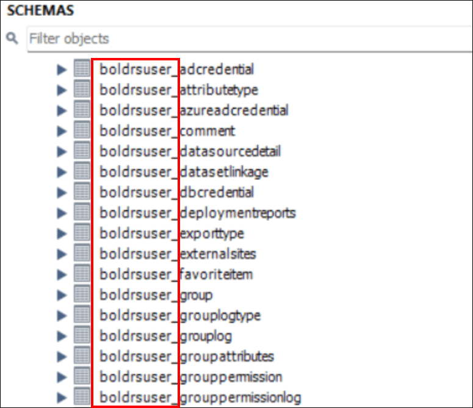

>**Note:** By default in MySQL, the `server table prefix name` is **BoldRS_**.

## Frequently asked questions

### Which databases support multiple sites in a single database?

Bold Reports® supports multiple sites in a single database for MSSQL Server, PostgreSQL, and MySQL. MSSQL and PostgreSQL use a schema and prefix, and MySQL uses a table prefix.

### What are the default schema and prefix names?

In MSSQL, the default `database schema name` is **dbo**, and in PostgreSQL it is **public**. The default `server table prefix name` is **BoldRS_** for MSSQL, PostgreSQL, and MySQL.

## See also

* [Create a site](./../../../manage-sites/create-site/)
* [Manage sites](./../../../manage-sites/manage-sites/)
* [Single database for all sites](./../../v7.1-or-later/single-database-for-all-sites/)
