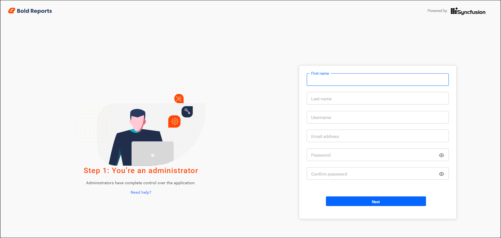
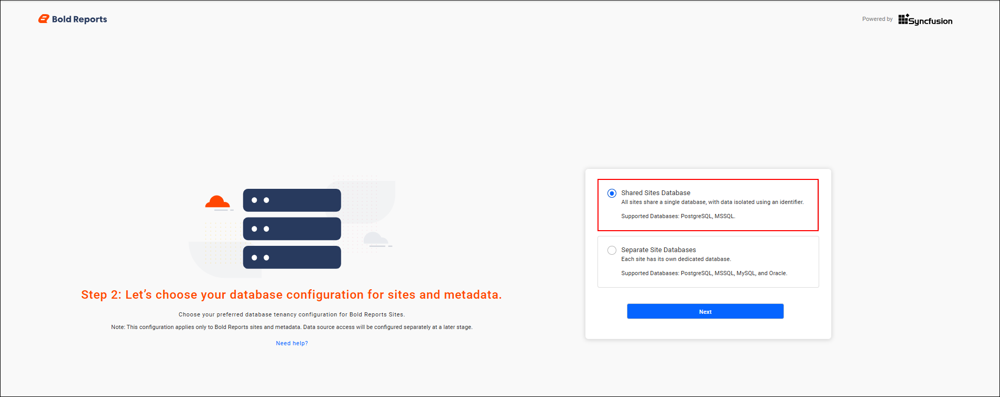
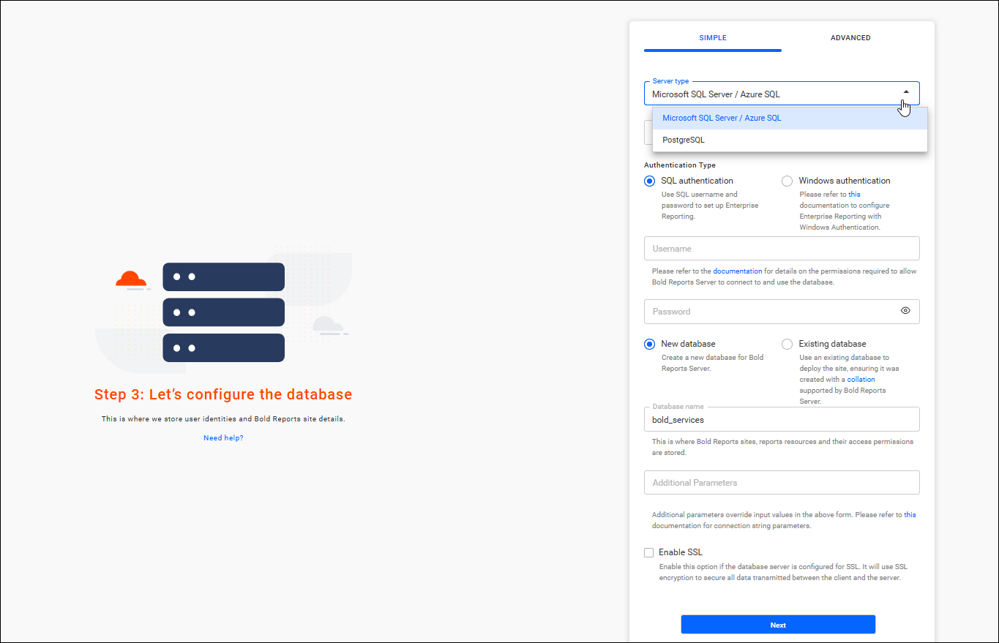
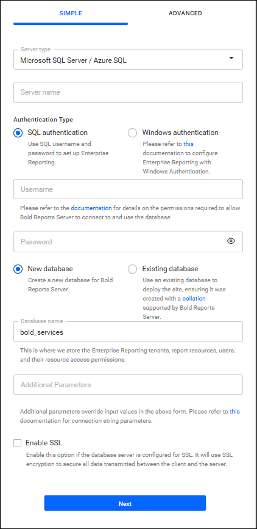
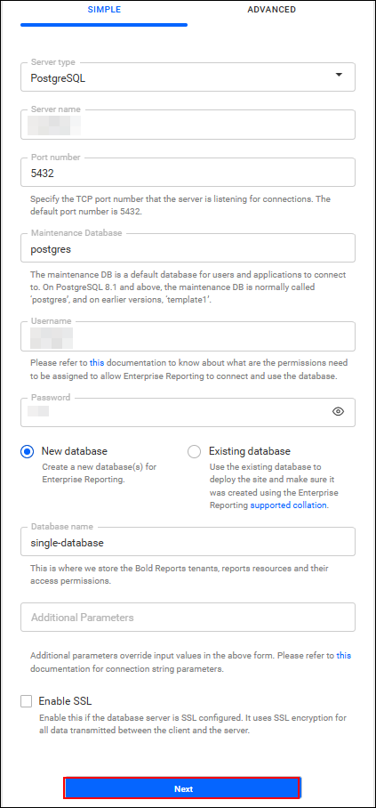
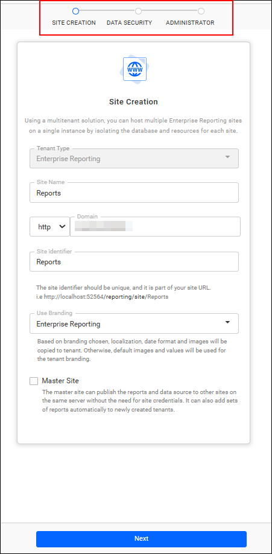

# Single database for all sites in Bold Reports®

Starting from `version 7.1`, Bold Reports® introduced a feature that supports a `single database for all sites`. All sites share the same database and reuse the same set of tables.

## What is a single database for all sites?

Bold Reports® now supports a **Single Database for All Sites**, enabling all sites to share the same database while reusing existing tables. Unlike traditional multi-tenancy, where each site has separate tables, the feature uses a common set of tables for all sites. The result is efficient resource utilization, simplified maintenance, and enhanced performance.

The feature is designed to minimize database overhead, improve scalability, and ensure logical data isolation at the application level.

> **Note:** supported only for **PostgreSQL** and **MSSQL** databases. Other database engines are not yet compatible with this feature.

## Step 1

### Application Installation and Activation

You start by installing and activating the Bold Reports® application.

* Download the Bold Reports® application from the [Downloads](https://www.boldreports.com/account/downloads?tab=self-service) page.
* After downloading the application, create a new user account.
    

## Step 2

### Database Configuration

You configure the shared database during Bold Reports® application startup by selecting the **Shared Database** option.

* Select the **Shared Database** option to configure a single database for all tenants, eliminating the need to create separate databases for individual sites.

    

* When you choose the **Shared Database** option, the available server types are **MSSQL** and **PostgreSQL**.

* Provide the Server Type (either MSSQL or PostgreSQL) and the corresponding server connection details.
    

### MSSQL Database Configuration:

To use MSSQL as the Bold Reports® shared database, follow these steps:

* Select the server type as **MSSQL**.

* Enter the server name and provide the **MSSQL credentials**.

* You can connect to the **MSSQL Server** using the following options:

    * New database.
    * Existing database.

    

### PostgreSQL Database Configuration:

To use PostgreSQL as the Bold Reports® shared database, follow these steps:

* Select the server type as **PostgreSQL**.

* Enter the server name and provide the **PostgreSQL credentials**.

* You can connect to the **PostgreSQL Server** using the following options:

    * New database.
    * Existing database.

    

### Common Configuration Steps

Bold Reports® lets you configure the shared database server details in both Simple and Advanced modes.

* For more details on both modes, see [PostgreSQL configuration](../../../../application-startup/postgresql-configuration/).

* If you proceed with Advanced mode, see [Storage Configuration](../../../../application-startup/#storage-configuration).

    > **Note:** When trying to **create a site** after deploying the application, the **select database** option doesn't appear because the **Shared Database** option was selected during deployment.
    > 

#### See Also:

* [Application Startup](../../../../application-startup/)

### Key Benefits

A single database for all Bold Reports® sites offers the following benefits:

* **Optimized Resource Utilization:** Reuses existing tables instead of duplicating them for each site.

* **Simplified Maintenance:** Eliminates the need to manage multiple sets of tables for different sites.

* **Data Segregation & Security:** Ensures that each site accesses only its own data using secure identifiers.

## Frequently asked questions

### Which databases support a single database for all sites?

Bold Reports® supports a single database for all sites only for **PostgreSQL** and **MSSQL** databases. Other database engines are not yet compatible with the feature.

### Why is there no select database option when I create a site?

The **select database** option doesn't appear because the **Shared Database** option was selected during deployment.

## See also

* [Single database for multiple sites](../../v6.1-or-later/single-database-for-multiple-sites/)
* [Create a site](../../create-site/)
* [MSSQL configuration](../../../../application-startup/sql-configuration/)
