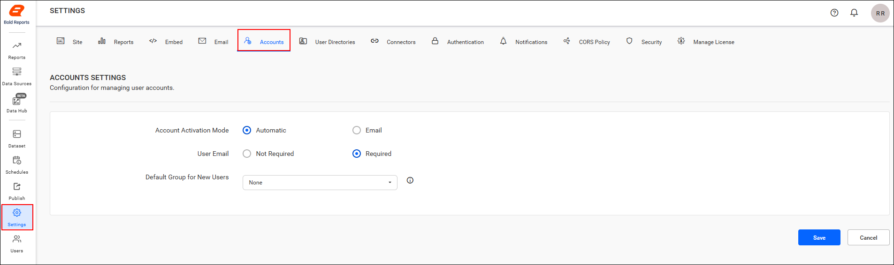
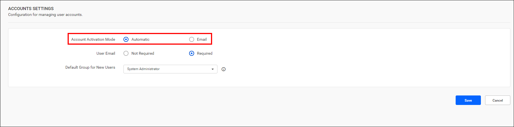
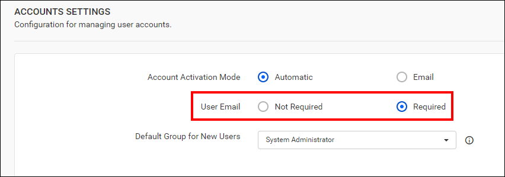
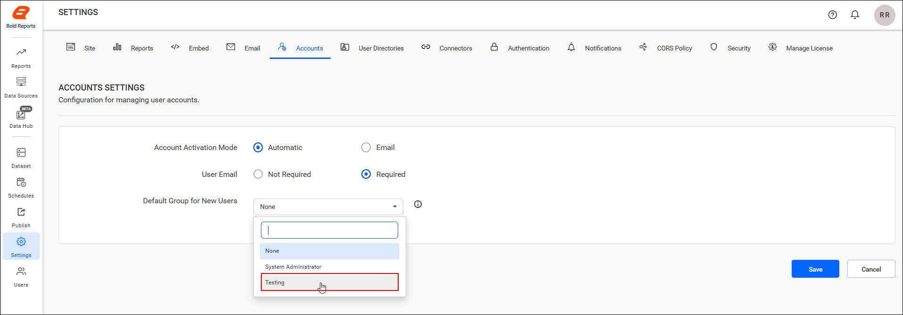

# Account activation in Bold Reports® Report Server

In the Bold Reports® Report Server, you configure account activation to activate users before you import them from an existing database. You also control whether new users need an email address and which default group they join.

## How do I open the account activation settings?

You manage the Bold Reports® Report Server activation mode from the `Accounts` tab of the settings page. Follow these steps:

1. Click **Settings** in the left-side panel of the Report Server.
2. Navigate to the `Accounts` tab, as shown in the following image.

## Which account activation modes are available?

The Bold Reports® Report Server offers two account activation modes: automatic activation and email activation.

## Automatic activation

When user activation is set to `Automatic Activation` mode, user accounts are activated automatically when added in the Bold Reports® Server. However, account activation emails are not sent.

## Email activation

When user activation is set to `Email Activation` mode in the Bold Reports® Report Server, user accounts are not activated when added. Instead, an activation email with an activation link is sent to the provided email address.

The activation link sent to the user is valid for only 3 days. If the user does not activate within this timeframe, you can send a new activation link to the user again from the user edit page. For further details, see the [activate users](./../../manage-users/users/manage-users/#activate-users) section.

The account remains in an inactive status until the user activates it from the activation email.

> **Note:** By default, the setting will be `Automatic`.

## Is an email address required for new users?

The Bold Reports® Report Server User Email setting controls whether an email address is required for creating new users. You can set it to `Required` or `Not required`.

## Email required

When the user email setting is set to `Required` mode, an email address is mandatory for adding users in the Bold Reports® server.

> **Note:** When the account activation preference is set to email, an email address is mandatory for activating the account.

## Email not required

When the user email setting is set to `Not required` mode, an email address is not mandatory for adding users in the Bold Reports® server.

> **Note:** By default, the setting will be `Required`.

## Default Group for New Users

The Bold Reports® Report Server lets you choose a default group that new users can be assigned to when they are added.

1. Select the default group and then save the changes on the reports settings page.
    

2. After selecting the default group, you can assign [new users](./../users/manage-users/#add-individual-users) to it when they are added.

>**Note:** When the `Default group for New Users` is set to `None`, the `Add to default group` toggle is hidden in the [add user](./../users/manage-users/#add-individual-users-with-password) popup page.

## Frequently asked questions

### How long is the account activation link valid?

The activation link sent by the Bold Reports® Report Server is valid for only 3 days. You can send a new link from the user edit page.

### What are the default account settings?

By default, account activation is set to `Automatic` and the user email setting is set to `Required`.

## See also

* [Manage users](./../users/manage-users/)
* [Import users from a database](./../users/import-users/import-users-from-database/)
* [Manage groups](./../groups/manage-groups/)
